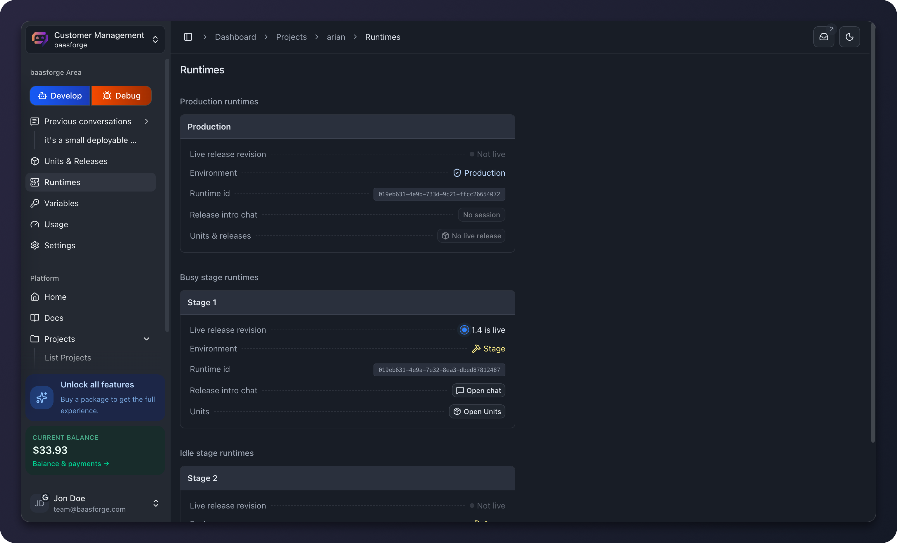

<p align="center">
  
</p>
<h1 align="center">BaaSForge Runtime</h1>
<p align="center"><strong>The execution plane of BaaSForge.</strong></p>
<p align="center">
  <a href="#local-quick-start">Get started</a> ·
  <a href="#documentation">Documentation</a> ·
  <a href="#contributing">Contribute</a>
</p>

[](LICENSE)
[](https://github.com/BaaSForge/baasforge-runtime-actix)
[](https://github.com/BaaSForge/baasforge-runtime-actix/issues)
[](CONTRIBUTING.md)
[](#community-and-support)

<p align="center">
  <a href="docs/assets/runtime-overview.png">
    
  </a>
</p>

Runtime overview in the BaaSForge dashboard. This screenshot shows release 1.4 live on Stage 1; production has no live release.

## Contents

- [Why BaaSForge?](#why-baasforge)
- [Ecosystem](#ecosystem)
- [Processes](#processes)
- [Local quick start](#local-quick-start)
- [Production](#production)
- [Tests](#tests)
- [Naming](#naming)
- [Documentation](#documentation)
- [Roadmap](#roadmap)
- [Contributing](#contributing)
- [Community and support](#community-and-support)
- [Code of Conduct](#code-of-conduct)
- [Security](#security)
- [License](#license)

## Why BaaSForge?

BaaSForge is for developers and small teams who want to describe a backend in plain language and ship APIs, workflows, and queue workers to production.

New to BaaSForge? Start with the [main backend repository](https://github.com/BaaSForge/baasforge-backend-actix) for the project introduction and ecosystem setup.

The BaaSForge runtime executes API, workflow, queue-worker, and actor units. It is a Rust and Actix service with a QuickJS JavaScript runtime.

This repository is the execution plane. The [BaaSForge backend](https://github.com/BaaSForge/baasforge-backend-actix) is the control plane. Both applications must connect to the same main PostgreSQL database and NATS deployment subjects.

## Ecosystem

The [backend repository](https://github.com/BaaSForge/baasforge-backend-actix) is the main entry point. Use the runtime and frontend repositories for their respective parts of the system.

| Repository | Start here |
| --- | --- |
| [Backend](https://github.com/BaaSForge/baasforge-backend-actix) | Main entry point and control plane |
| [Runtime](https://github.com/BaaSForge/baasforge-runtime-actix) | Execution plane |
| [Frontend](https://github.com/BaaSForge/baasforge-frontend-vite) | Dashboard, public pages, and documentation |

## Processes

A complete deployment runs six processes:

- `baal-runtime-actix`: HTTP, WebSocket, and unit execution API.
- `workflow_worker`: resumes durable workflows.
- `queue_worker_worker`: executes queued jobs.
- `actor_worker`: processes actor mailboxes and alarms.
- `runtime_cache_listener`: invalidates release and runtime-environment caches.
- `usage_ingest_worker`: writes usage batches to the main database.

The processes communicate through PostgreSQL, Redis, and NATS JetStream. Actor state uses a separate runtime-owned PostgreSQL database.

See [Architecture](docs/architecture.md) for the service and data flows.

## Local quick start

Requirements:

- Rust toolchain with Cargo
- Node.js 22 and npm
- Docker with Compose
- PostgreSQL and Redis
- Diesel CLI 2.3.x for Actor migrations

The repository Compose file starts NATS and the development nginx load balancer. PostgreSQL and Redis must already be available, typically from the local backend stack.

```sh
cp .env .env.local
# Set local connection values in .env.local.
docker compose up -d
./actors-migration-up.sh
./dev-scaled.sh
```

Use `http://localhost:1500` to reach the two API instances through nginx. Run `./dev-stop.sh` to stop local Rust processes.

The current development scripts do not hot-reload. Restart the affected script after a source change.

See [Local development](docs/local-development.md) for setup, backend connectivity, workers, migrations, and checks.

## Production

Production requires persistent PostgreSQL, Actor PostgreSQL, Redis, and NATS JetStream. Build and run the main image and all five worker images. Put an external TLS reverse proxy or load balancer in front of port `1501`.

See [Production and self-hosting](docs/running.md) for Docker, environment, migration, CI/CD, and rollback details.

> **Security: Values in the tracked environment and Compose files are local-development defaults. Override every credential, connection URL, and private key in staging and production. Do not deploy the tracked values.**

## Tests

```sh
./test.sh
./units/runtime-check/test.sh
./units/api-tests/test.sh
./units/common/test.sh
./units/workflow-tests/test.sh
./units/queue-worker-tests/test.sh
./units/actor-tests/test.sh
```

The integration suites report product health in JSON and `.output.log` files. Some suite scripts can exit with status 0 when their report contains failures. Inspect the report summary.

See [Testing](docs/testing.md) for coverage and limits.

## Naming

`baal` is the former platform name. The current name is `BaaSForge`.

Some technical identifiers still use the old name for compatibility. Examples include the `baal-runtime-actix` binary and crate, `BAAL_*` environment variables, `__baal_*` QuickJS host functions, `baal.*` telemetry attributes, and some database or container names. Treat these as historical identifiers, not the current product name. Do not rename them without a compatibility migration.

## Documentation

- [Architecture](docs/architecture.md)
- [Local development](docs/local-development.md)
- [API and development conventions](docs/conventions.md)
- [Production and self-hosting](docs/running.md)
- [Testing](docs/testing.md)
- [Database migrations](docs/db-migrations.md)
- [Contributing](CONTRIBUTING.md)

## Roadmap

Where BaaSForge is heading:

- [ ] Performance & runtime durability
- [ ] Stream processing and WebSocket / realtime units
- [ ] Storage pattern units
- [ ] Monitoring, alerting, and collaboration

<details>
<summary><strong>Explore more planned capabilities</strong></summary>

- Event and schedule triggers
- SDK convenience helpers
- Files and search behaviors
- Unit marketplace
- Third-party integrations

</details>

> These plans are directional. Timing and order may change.

**[Explore the full roadmap →](https://baasforge.com/docs/about/future-plans)**

See [Units](https://baasforge.com/docs/platform/units) for what is available now.

## Contributing

Read [CONTRIBUTING.md](CONTRIBUTING.md) before opening a pull request.
Documentation fixes, reproducible bug reports, and focused improvements are welcome.
Browse [open issues](https://github.com/BaaSForge/baasforge-runtime-actix/issues), or explain a proposed change before starting substantial work.

## Community and support

- [Report a bug or suggest an improvement](https://github.com/BaaSForge/baasforge-runtime-actix/issues).
- Include reproduction steps and the relevant repository when asking for help.
- If BaaSForge is useful to you, consider starring the repository or sharing what you built.

## Code of Conduct

Read our [Code of Conduct](CODE_OF_CONDUCT.md) for community standards and private reporting instructions.

## Security

Read our [Security Policy](SECURITY.md) to report a vulnerability privately and understand the scope of security maintenance.

## License

See [LICENSE](LICENSE).
