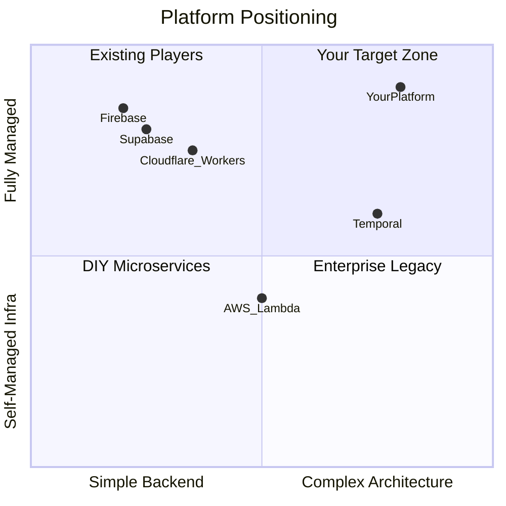

# Bold Feature Strategy: Architecture-as-a-Service

## The Core Thesis

Supabase and Firebase answer: **"How do I get a backend running fast?"**
Your platform should answer: **"How do I build a *serious* distributed backend without an infrastructure team?"**

The research shows:

- Temporal.io hit a **$5B valuation** proving demand for durable workflows
- Cloudflare Durable Objects proved demand for **stateful serverless**
- Developers spend **30-40% of their time on infrastructure** instead of product code
- **No platform** offers architectural patterns (event sourcing, sagas, actors) as first-class serverless primitives
- AI agent orchestration is exploding and needs durable execution

Your unique advantage is the combination of **bounded contexts + typed units + AI agent generation**. This means you can offer entire *architectural patterns* as composable primitives. The AI agent doesn't just generate functions — it scaffolds entire domain architectures.

---

## Design Principles

These rules govern every design decision in this document. Internalize them before proposing or implementing any feature.

### No Redundant Identity in Code

Every unit already has a globally unique path assigned by the platform: `context.module.unit_type.unit_name`. SDK constructors must **never** accept a name string — it would create a confusing dual-identity problem. The platform provides identity; user code provides logic.

```typescript
// WRONG — redundant name
export default actor<CartState>("shopping-cart", { ... });
export default stream<Transaction>("fraud-detection", { ... });
export default worker<EmailJob>("email-sender", { ... });

// RIGHT — platform provides identity, code provides logic
export default actor<CartState>({ ... });
export default stream<Transaction>(async (ctx, events) => { ... });
export default worker<EmailJob>(async (ctx, job) => { ... });
```

### Feature Implementation Preferences

When designing how users configure a feature:

1. **Dynamic at runtime via SDK** (preferred) — if the feature can be configured or triggered dynamically from the user's running code, that is the best option. It gives maximum flexibility and requires zero platform-side wiring per unit. Example: `sdk.emit("order.created", data)` is a runtime call — good.
2. **Metadata per unit** (fallback) — if runtime configuration is not possible (e.g., the platform needs to know something before the code runs, like "which events should wake this unit?"), then use the unit's metadata JSON. This is still lightweight — just data in a DB column that the platform reads on the fly.

### Infrastructure Scaling Rules

When designing how the platform implements a feature internally, follow this three-tier preference:

1. **Zero per-release wiring — on-the-fly lookup** (most preferred) — When a user deploys a new release, the platform simply updates the release row in the main DB (which already includes the release's units and their metadata). No other action is taken. Shared infrastructure (NATS consumers, schedulers, etc.) is already running and listening. When a shared consumer receives an event, it extracts the project ID, loads the project's current production release (already cached in Redis), scans the units' metadata for matching configuration, and dispatches. Deploying a release has zero infrastructure side effects — it is just a DB row update.
2. **Lightweight shared registry writes** (when on-the-fly lookup is not feasible) — Some features cannot rely on on-the-fly lookup because there is no incoming event to trigger the lookup. For example, cron scheduling: the scheduler must proactively find due jobs. In these cases, deploying a release writes minimal entries to shared registries (a Redis sorted set for cron next-run-times, etc.). These writes must be as simple and lightweight as possible. Developers should always ask: *"Can the shared consumer just look this up on the fly from the release data?"* If yes, skip the registry write.
3. **Per-project / per-unit infrastructure** (last resort, avoid) — Creating a standalone NATS consumer, Redis connection, or cron job per unit or per project. With 10 million users this creates 10 million connections/resources and becomes a maintenance nightmare. Only consider this if shared infrastructure provably cannot meet the requirement.

### Concrete Anti-Patterns

- BAD: "Create a NATS consumer for each unit that subscribes to events" (50M consumers at scale)
- BAD: "Spin up a cron scheduler per project" (10M schedulers at scale)
- BAD: "Create a queue consumer per queue worker unit" (millions of consumers)
- BAD: "Write to 5 Redis registries every time a user deploys" (when on-the-fly lookup would work)
- GOOD: "Deploy = update the release row. Shared consumer looks up metadata on the fly."
- GOOD: "One event consumer per pod, on-the-fly release lookup"
- GOOD: "One cron scheduler per pod, polling a global sorted set (only because no incoming event triggers the lookup)"

---

## What We Already Have

Three unit types are in production: **HTTP Unit** (api), **Durable Workflow Unit**, and **Queue Worker Unit**. Together they cover request-response, stateful orchestration, and stateless async processing. The remaining pending killer is the **stateful entity** model (Actor Unit).

### Durable Workflow Unit

Based on the implemented SDK and passing test suite (48 workflow tests + 16 endpoint contract tests), workflows already support:

| Capability | How |
|---|---|
| **Durable multi-step orchestration** | `ctx.run(name, fn)` — each step persisted, replayed on crash |
| **Compensation / rollback (saga pattern)** | try/catch + reverse compensation array (see `basic-compensation.ts`) |
| **Human-in-the-loop / external signals** | `ctx.promise(name).get()` suspends; shared handlers `.resolve()` from outside |
| **Queryable workflow state** | `ctx.set(k, v)` / `ctx.get(k)` + shared handler reads |
| **Parallel execution** | `Promise.all([ctx.run(...), ctx.run(...)])` |
| **Durable sleep / timers** | `ctx.sleep(name, duration)` — survives restarts |
| **Configurable retry with backoff** | `RunOptions.retryPolicy` — maxAttempts, intervals, backoff factor |
| **Non-retriable terminal failures** | `ctx.TerminalError` — stops retry immediately |
| **Deterministic replay** | `ctx.rand.uuidv4()`, `ctx.rand.random()`, `ctx.date.now()` |
| **Instance deduplication** | Same workflow slug + key = same instance |
| **Cancellation** | `POST /cancel` on suspended workflows |
| **Cross-unit invocation** | `sdk.callWorkflow(unitPath, data)` triggers other workflows |
| **Crash recovery** | Resume after step, sleep, or promise — verified by tests |

This is a **Temporal-grade** workflow engine. It's important to measure every proposed unit type against this bar: *does it bring a genuinely new computation model, or is it a pattern that existing units already handle?*

### Queue Worker Unit

Shipping with dedicated Redis (`WQ_REDIS_URL`) + NATS JetStream (`WQ_WORK` stream) infrastructure. Delivers at-least-once job processing with: configurable retry (`initialInterval`, `maxInterval`, `backoffFactor`), concurrency caps, rate limiting, batch mode, per-run execution lock, enqueue deduplication, delayed delivery, dead-letter handler (`onDeadLetter`) or dead-letter queue routing, `TerminalError` to skip retries, status transitions via Redis Lua CAS, and lifecycle events on Core NATS (`wq.events.{pid}.queue-worker.{name}`). See `docs/queue-worker-internals.md`.

### Leverage Remaining in Implemented Units

All three implemented unit types benefit from metadata opportunities not yet exploited. The API unit can use `metadata.method` to reject wrong HTTP methods at the Actix routing layer before loading JS, and `metadata.rateLimit` to enforce rate limits without invoking code. The Workflow unit can use `metadata.timeout` for max duration enforcement, `metadata.concurrency` for instance limits, and `metadata.retryPolicy` for default step retry configuration — all enforced by the shared workflow engine in Rust without new infrastructure.

---

## The Metadata Layer

Every unit has two configuration surfaces:

- **Runtime code** (dynamic JS) — business logic, SDK calls, anything that can be done dynamically at invocation time. Always preferred per the Design Principles.
- **Metadata** (static JSON per unit instance, stored in `project_units.metadata`) — declarative config for things the platform must know before code runs. Users set it in the dashboard.

The rule for **feature configuration:**

1. If it can be done dynamically by the SDK at runtime, do it in code (preferred).
2. If the platform needs to know before code runs, put it in metadata.

The rule for **infrastructure:**

1. Prefer zero per-release wiring: shared consumers look up metadata on the fly from the cached release row. Deploy = just update the release row.
2. If on-the-fly lookup is not feasible (e.g., cron needs a proactive sorted set), write minimal shared registry entries at deploy time.
3. Never create per-unit or per-project infrastructure resources.

### How Metadata Flows

**At deploy time:** The platform updates the release row. For most features, that is all that happens. The release row already contains unit references, and unit rows already contain their metadata. Shared infrastructure is already running and knows how to look this up.

**At runtime (on-the-fly lookup — preferred for most features):** When a shared consumer receives an event/request/job, it extracts the project ID, loads the project's cached production release, scans the units' metadata for matching configuration, and dispatches. No pre-computed registry needed.

**Exception (lightweight registry writes):** Cron scheduling is the primary example — there is no incoming event to trigger a lookup, so the scheduler must proactively find due jobs. At deploy time, compute next-run-times from cron expressions and write to a global Redis ZSET. This is the exception, not the rule.

```
Model A — Zero-wiring on-the-fly lookup (preferred, most features):

  Deploy: UPDATE project's release row. Done.

  Runtime:
    Shared Event Consumer (one per pod, subscribes to evt.>)
      -> receives evt.{project_id}.order.created
      -> loads project's cached production release (Redis cache, already hot)
      -> scans units' metadata for triggers matching "order.created"
      -> finds match, loads unit code, executes handler

    Shared Queue Dispatcher (one per pod, subscribes to queue.>)
      -> receives queue.{project_id}.emails
      -> loads project's release, finds queue worker unit for "emails"
      -> reads metadata for concurrency/rateLimit config
      -> loads code, executes handler

    API request handler (shared Actix routes)
      -> loads unit row (already cached), reads metadata.method / metadata.rateLimit
      -> enforces before invoking code

Model B — Lightweight registry (exception, only when no incoming event):

  Deploy: UPDATE release row + write to shared Redis ZSET

  Runtime:
    Shared Cron Scheduler (one process, or per pod with leader election)
      -> ZRANGEBYSCORE schedules -inf {now}
      -> finds due units across ALL projects
      -> loads code, executes handler
      -> computes next-run-time, writes back to ZSET
```

### Cross-Cutting Metadata Fields

These fields are available to ALL unit types, enforced by shared middleware or shared consumers via on-the-fly lookup:

| Field | Example | What the platform does |
|---|---|---|
| `triggers` | `[{ "event": "order.created" }, { "schedule": { "cron": "0 9 * * MON-FRI" } }]` | Shared event consumer dispatches on event match; shared cron scheduler dispatches on schedule |
| `timeout` | `30000` (ms) | Platform enforces max execution time |
| `rateLimit` | `{ "max": 100, "window": "60s" }` | Shared Redis-based rate limiter checked before invoking code |
| `concurrency` | `5` | Platform checks a shared Redis counter before dispatching |
| `tags` | `["billing", "critical"]` | Dashboard filtering, observability grouping |

The dashboard reads metadata directly from the DB for display — no code evaluation needed. Deploy-time validation rejects invalid metadata before the release row is updated.

---

## Critical Analysis: Which Unit Types Deserve to Exist?

The original roadmap proposed 10+ unit types. After checking each proposed type against **every other type** (not just workflows — every unit must justify itself against ALL others), here is the honest breakdown:

### Genuinely new computation/connection models (KEEP as unit types)

Each of these was checked against **every other unit type**. A unit type earns its place only if no other type can reasonably substitute for it.

| Unit Type | What it uniquely provides (vs ALL other types) |
|---|---|
| **Stateful Actor** | Indefinite-lifespan entities with persistent state and sequential message delivery. HTTP is stateless, workflows complete, streams aggregate across entities, queue workers are stateless, WebSocket holds connections but not durable state. |
| **Stream Processing** | Perpetual time-windowed event aggregation. No other type processes unbounded event flows in sliding/tumbling/session windows. |
| **Queue Worker** | Rate-limited, priority-ordered, batch-capable job processing with DLQ. HTTP has no delivery guarantees, workflows are overkill for single-step jobs, actors are entity-scoped not pool-scoped, streams aggregate rather than process individual jobs. |
| **WebSocket / Realtime** | Persistent bidirectional client connections. No other type holds a live network socket open for push-based communication. |

### Patterns achievable with existing units (DEMOTE to trigger modes / SDK helpers)

| Proposed Unit | Why it doesn't need its own unit type | Better approach |
|---|---|---|
| **Scheduled / Cron** | Computation is identical to HTTP — run a function, finish. Lifecycle is invocation-scoped, same as HTTP. The ONLY difference is the trigger source (clock vs. request). AWS Lambda, Vercel, and every major platform treat cron as a trigger configuration, not a separate function type. | Schedule trigger mode on any unit type. |
| **Saga** | Workflows already do compensation natively. The `basic-compensation.ts` test proves it: push compensations, catch errors, run in reverse. A saga is a declarative config for what workflows do imperatively. | `sdk.saga()` builder that returns a workflow. Syntactic sugar, not a new runtime. |
| **State Machine** | Actors (once built) handle this perfectly: persistent state + sequential message processing + transition logic. A state machine is just an actor with constrained transitions. | `sdk.stateMachine()` builder that returns an actor with enforced transitions. The platform can still visualize and validate the transition table at deploy time. |
| **Event Sourcing (3 sub-types)** | "Command" is just an API/workflow handler that validates and emits events. "Event handler" is just a function triggered by events (any unit with an event trigger). "Projection" is a stream processor. Three unit types for one architectural pattern is over-engineered. | Platform-managed event store infrastructure + `sdk.eventStore.*` primitives usable from ANY unit type. Projections run as stream processors. |

---

## TIER 1 — Killer Unit Types (The Differentiators)

These are the features that **do not exist** in Supabase or Firebase and are extremely hard for developers to build themselves. Each one alone justifies a user choosing your platform.

### 1. Durable Workflow Unit ✅ IMPLEMENTED

**What it is:** A unit that defines multi-step, long-running workflows that **survive crashes, restarts, and deployments**. Each step is individually retriable with configurable backoff. Workflows can run for seconds or days.

**Why it's bold:** Temporal.io is a $5B company solving exactly this. Inngest and Trigger.dev raised significant funding for simpler versions. Neither Supabase nor Firebase offers anything close. You have baked Temporal-grade durability into a unit type.

**What the developer writes:**

```typescript
import { workflow, sdk } from "@sdk";

export default workflow(async (ctx, order: Order) => {
  const payment = await ctx.run("charge-payment", async () =>
    sdk.callWorkflow("payments.charge", order)
  );

  const inventory = await ctx.run("reserve-inventory", async () =>
    sdk.callWorkflow("warehouse.reserve", order.items)
  );

  // Wait up to 48 hours for supplier confirmation (human-in-the-loop)
  const confirmation = await ctx.promise<SupplierConfirmation>("supplier-confirmed")
    .get({ timeout: { hours: 48 } });

  if (!confirmation) {
    throw new ctx.TerminalError("supplier timed out");
  }

  await ctx.run("ship", async () =>
    sdk.callWorkflow("shipping.dispatch", order)
  );

  return { orderId: order.id, status: "shipped" };
});
```

**Built-in saga/compensation pattern** (no separate unit type needed):

```typescript
import { workflow, sdk } from "@sdk";

export default workflow(async (ctx, transfer: TransferRequest) => {
  const compensations: Array<() => Promise<void>> = [];

  try {
    compensations.push(() =>
      ctx.run("undo-debit", async () =>
        sdk.callWorkflow("accounts.credit", { accountId: transfer.from, amount: transfer.amount })
      )
    );
    await ctx.run("debit-source", async () =>
      sdk.callWorkflow("accounts.debit", { accountId: transfer.from, amount: transfer.amount })
    );

    compensations.push(() =>
      ctx.run("undo-credit", async () =>
        sdk.callWorkflow("accounts.debit", { accountId: transfer.to, amount: transfer.amount })
      )
    );
    await ctx.run("credit-destination", async () =>
      sdk.callWorkflow("accounts.credit", { accountId: transfer.to, amount: transfer.amount })
    );

    await ctx.run("record-transfer", async () =>
      sdk.callWorkflow("ledger.record", transfer)
    );

    return { status: "completed" };
  } catch (e) {
    for (const comp of [...compensations].reverse()) {
      await comp();
    }
    throw e;
  }
});
```

**The platform handles:** Step-level persistence, automatic retries, timeout tracking, crash recovery mid-workflow, parallel step execution (`Promise.all`), deterministic replay, deduplication, cancellation, and observability of each step's status.

**Metadata schema** (enforced by the shared workflow engine, no new infrastructure):

| Field | Example | What the platform does |
|---|---|---|
| `timeout` | `"48h"` | Workflow engine checks elapsed time. Redis key TTL as safety net. |
| `concurrency` | `5` | Engine checks a shared Redis counter before starting a new instance. |
| `deduplication` | `{ "key": "input.orderId" }` | Engine extracts key from input JSON, checks existence in Redis before starting. |
| `retryPolicy` | `{ "maxAttempts": 3, "backoff": "exponential" }` | Default retry policy for all steps (overridable per step in code via `RunOptions`). |

**Target users:** E-commerce (order flows), fintech (payment processing), healthcare (compliance pipelines), AI agent orchestration (multi-step reasoning chains).

---

### 2. Stateful Actor Unit

**What it is:** A unit that maintains **persistent, isolated state** between invocations. Each instance is identified by a unique ID and processes messages sequentially (no race conditions). Think Cloudflare Durable Objects meets Microsoft Orleans virtual actors.

**Why it's bold:** Cloudflare is the *only* platform offering something similar, and it's locked into their ecosystem. Neither Supabase nor Firebase has stateful compute. This unlocks an entire category of applications that are otherwise impossible on serverless.

**What this brings that no other unit type provides:**
- vs **HTTP/API**: HTTP is stateless and request-scoped. Actors maintain persistent state across invocations — no need to re-read from a database on every call.
- vs **Workflow**: Workflows start, execute steps, and complete. Actors live indefinitely with no concept of "completion." A workflow that loops forever waiting for promises would grow unbounded step history. Actors are entity-centric (one instance per ID); workflows are process-centric (one instance per run).
- vs **Stream**: Streams aggregate events across all entities in time windows. Actors process messages for a single, specific entity with sequential delivery (no race conditions).
- vs **Queue Worker**: Queue workers are stateless — each job is processed independently. Actors carry persistent state between messages, so message N can depend on the result of message N-1 without a database round-trip.
- vs **WebSocket**: WebSocket holds a network connection open. Actors hold durable state. An actor might manage the state behind a WebSocket, but can't hold a socket. A WebSocket can deliver messages but doesn't persist state between connections.

**What the developer writes:**

```typescript
import { actor, sdk } from "@sdk";

export default actor<CartState>({
  state: { items: [], total: 0 },

  handlers: {
    addItem(ctx, item: CartItem) {
      ctx.state.items.push(item);
      ctx.state.total += item.price;
    },

    removeItem(ctx, itemId: string) {
      const idx = ctx.state.items.findIndex(i => i.id === itemId);
      if (idx >= 0) {
        ctx.state.total -= ctx.state.items[idx].price;
        ctx.state.items.splice(idx, 1);
      }
    },

    checkout(ctx) {
      const order = { items: ctx.state.items, total: ctx.state.total };
      sdk.emit("order.created", order);
      ctx.state = { items: [], total: 0 };
      return order;
    },

    getState(ctx) {
      return ctx.state;
    }
  },

  onAlarm(ctx, name) {
    if (name === "abandon-check" && ctx.state.items.length > 0) {
      sdk.emit("cart.abandoned", { cartId: ctx.id, items: ctx.state.items });
      ctx.state = { items: [], total: 0 };
    }
  }
});
```

**Built-in state machine pattern** (no separate unit type needed):

```typescript
import { actor, sdk } from "@sdk";

type OrderState = "placed" | "paid" | "shipped" | "delivered" | "cancelled" | "refunded" | "returned";

const TRANSITIONS: Record<OrderState, Record<string, OrderState>> = {
  placed:    { PAY: "paid", CANCEL: "cancelled" },
  paid:      { SHIP: "shipped", REFUND: "refunded" },
  shipped:   { DELIVER: "delivered", RETURN: "returned" },
  delivered: {},
  cancelled: {},
  refunded:  {},
  returned:  { REFUND: "refunded" },
};

export default actor<{ status: OrderState; history: string[] }>({
  state: { status: "placed", history: [] },

  handlers: {
    transition(ctx, event: { type: string }) {
      const allowed = TRANSITIONS[ctx.state.status];
      const next = allowed[event.type];
      if (!next) {
        throw new Error(`Invalid transition: ${ctx.state.status} + ${event.type}`);
      }
      const prev = ctx.state.status;
      ctx.state.status = next;
      ctx.state.history.push(`${prev} -> ${next}`);
      sdk.emit(`order.${next}`, { orderId: ctx.id, previousState: prev });
      return { status: next };
    },

    getStatus(ctx) {
      return { status: ctx.state.status, history: ctx.state.history };
    }
  }
});
```

**The platform handles:** State persistence, single-threaded execution per actor ID (no locks needed), automatic activation/deactivation, millions of concurrent actor instances, alarm scheduling, and location-transparent addressing.

**Metadata schema** (enforced by shared infrastructure, no per-actor consumers):

| Field | Example | How it's enforced |
|---|---|---|
| `handlers` | `["addItem", "removeItem", "checkout", "getState"]` | Shared routing layer rejects unknown handler names without loading JS. |
| `maxIdleTime` | `"30m"` | Shared actor manager tracks last-access timestamps in Redis. Periodic sweep deactivates idle actors — one sweep process, not per-actor timers. |
| `alarms` | `["abandon-check"]` | Declares valid alarm names for validation. Alarms are scheduled dynamically via `ctx.setAlarm()` in code (runtime, preferred). Execution uses the shared cron/schedule sorted set. |
| `stateLimit` | `"1MB"` | Checked at write time by the shared actor state persistence layer. |

Actor handler invocation is via a dedicated SDK function (e.g. `sdk.callActor("path.actor.name", { handler: "addItem", data: ... })`) — a runtime SDK call that routes through the existing shared request pipeline. No per-actor consumers.

**Target users:** Real-time apps (chat rooms, collaborative editing), gaming (player sessions), IoT (device twins), e-commerce (carts, user sessions), rate limiters, any entity-centric domain (order lifecycle, account management, device state).

---

### 3. Stream Processing Unit

**What it is:** A unit that **continuously processes real-time event streams** with windowing, filtering, and aggregation. Think Apache Flink or Kafka Streams — but as a single function.

**Why it's bold:** Real-time stream processing currently requires deploying and managing Kafka + Flink/Spark clusters. That's tens of thousands of dollars and a dedicated team. Making this a unit type is transformative.

**What this brings that no other unit type provides:**
- vs **HTTP/API**: HTTP processes one request and responds. Streams process a continuous, unbounded flow of events perpetually.
- vs **Workflow**: Workflows are triggered-then-complete. Streams run indefinitely. There's no way to model "aggregate all events in the last 5 minutes, every 1 minute" in the workflow step model.
- vs **Actor**: Actors process messages for a single entity. Streams aggregate events across ALL entities within time windows (tumbling, sliding, session). An actor receives one message at a time; a stream receives batches defined by time boundaries.
- vs **Queue Worker**: Queue workers process individual jobs. Streams window events over time and process them as groups — the concept of "all transactions in the last 5 minutes" doesn't exist in a queue worker.
- vs **WebSocket**: WebSocket sends/receives messages with clients. Streams process internal event flows — no client connection, no bidirectional channel.

**What the developer writes** (source, window, and checkpoint configuration lives in metadata — the code is purely processing logic):

```
metadata: { "source": "events.transactions", "window": { "type": "sliding", "size": "5m", "slide": "1m" } }
```

```typescript
import { stream, sdk } from "@sdk";

export default stream<Transaction>(async (ctx, events) => {
  const byUser = ctx.groupBy(events, e => e.userId);

  for (const [userId, txns] of byUser) {
    const total = txns.reduce((sum, t) => sum + t.amount, 0);
    if (txns.length > 20 || total > 50000) {
      sdk.emit("fraud.suspected", { userId, transactions: txns, total });
    }
  }
});
```

**Event Sourcing projections as streams** (no separate "projection" unit type needed):

```
metadata: { "source": "events.account.*", "window": { "type": "tumbling", "size": "1s" } }
```

```typescript
import { stream, sdk } from "@sdk";

export default stream(async (ctx, events) => {
  for (const event of events) {
    switch (event.type) {
      case "account.deposited":
        ctx.upsert(`balance:${event.data.accountId}`, (prev) => ({
          balance: (prev?.balance ?? 0) + event.data.amount,
          lastUpdated: event.timestamp,
        }));
        break;
      case "account.withdrawn":
        ctx.upsert(`balance:${event.data.accountId}`, (prev) => ({
          balance: (prev?.balance ?? 0) - event.data.amount,
          lastUpdated: event.timestamp,
        }));
        break;
    }
  }
});
```

**The platform handles:** Stream partitioning, windowing (tumbling, sliding, session), exactly-once semantics, checkpointing, backpressure, and auto-scaling based on stream lag.

**Metadata schema** (enforced by the shared stream engine via on-the-fly lookup — no deploy-time registry):

| Field | Example | How it's enforced |
|---|---|---|
| `source` | `"events.transactions"` or `"events.account.*"` | Shared stream engine loads the project release, scans stream units' `metadata.source` for pattern match. No deploy-time registry. |
| `window` | `{ "type": "sliding", "size": "5m", "slide": "1m" }` | Shared stream engine reads window config from metadata on the fly, manages windowing buffers in Redis. |
| `checkpoint` | `{ "interval": "10s" }` | Shared engine writes checkpoints to Redis. |
| `partitionKey` | `"data.userId"` | Shared engine partitions events by key, distributes across pods via consistent hashing. |

**Target users:** Fraud detection, real-time analytics, IoT sensor aggregation, live dashboards, CQRS projections, anomaly detection.

---

## TIER 2 — Essential Unit Types (Table Stakes Done Right)

These exist in some form elsewhere but combined with your Tier 1 features and AI agent, they complete the story.

### 4. HTTP Unit (Request-Response) ✅ IMPLEMENTED

The basic serverless function triggered by HTTP. This is what Supabase/Firebase already offer. Exists as the "api" unit type today.

**Metadata schema** (all enforced in the existing shared Actix routing layer — the unit row is already loaded from Redis cache on every request, so metadata is just another field on that row, zero new infrastructure):

| Field | Example | How it's enforced |
|---|---|---|
| `method` | `"POST"` or `["GET", "POST"]` | Actix handler checks metadata.method before loading JS. Same request path, one extra field read. |
| `timeout` | `30000` (ms) | Actix handler wraps `spawn_blocking` with `tokio::time::timeout`. Already shared. |
| `rateLimit` | `{ "max": 100, "window": "60s" }` | Shared Redis-based rate limiter checked in the Actix handler. One shared Redis connection pool per pod. |
| `cache` | `{ "ttl": "5m", "varyBy": ["query.page"] }` | Shared Redis cache checked before invoking code. Same connection pool. |
| `cors` | `{ "origins": ["https://app.example.com"] }` | Actix middleware reads from metadata. No extra infra. |
| `auth` | `{ "required": true, "scheme": "bearer" }` | Actix middleware validates before handler runs. Shared auth service. |
| `webhook` | `{ "provider": "stripe" }` | Actix handler validates webhook signature using shared provider logic. |

### 5. Queue Worker Unit

Reliable background job processing: retry with backoff, dead-letter queues, priority queues, delayed execution, batch processing, and rate-limited consumption. Positioned between a simple async function and a full workflow — for when you need reliable processing without multi-step orchestration.

**What this brings that no other unit type provides:**
- vs **HTTP/API**: HTTP is fire-and-forget from the caller's perspective — if the handler crashes, the request is lost. Queue workers guarantee at-least-once delivery with configurable retry, dead-letter queues for permanently failed jobs, and rate-limited consumption.
- vs **Workflow**: Workflows are designed for multi-step orchestration (durable steps, promises, compensation). Using a workflow with a single step to send an email is overkill — you pay for step persistence, replay infrastructure, and memoization you don't need. Queue workers are simpler and add queue-specific features workflows lack: priority queues (urgent jobs first), rate limiting (max N/minute), batch processing (process 50 jobs at once), and concurrency control (max 10 running simultaneously).
- vs **Actor**: Actors are entity-scoped (one actor per user/cart/device). Queue workers process a shared pool of jobs with no per-entity affinity. If you need to send 10,000 emails, you want a queue with concurrency control, not 10,000 actor instances.
- vs **Stream**: Streams aggregate events over time windows. Queue workers process individual, independent jobs. "Send this email" is not windowed aggregation — it's a discrete task with delivery guarantees.

Queue configuration (concurrency, rate limiting, retry, batching, etc.) lives in metadata — the code is purely the processing handler. Jobs are enqueued dynamically at runtime via `sdk.enqueue("queue-name", data)` — a runtime SDK call (preferred per Design Principles). The metadata configures HOW the queue is consumed, which the platform must know before the worker code runs.

```
metadata: {
  "queue": "emails",
  "concurrency": 10,
  "rateLimit": { "max": 100, "window": "60s" },
  "retry": { "maxAttempts": 3, "backoff": { "initial": "5s", "factor": 2 } },
  "dlq": { "enabled": true, "maxRetries": 5 }
}
```

```typescript
import { worker, sdk } from "@sdk";

export default worker<EmailJob>(async (ctx, job) => {
  await sendEmail(job.to, job.subject, job.body);
  sdk.emit("email.sent", { to: job.to, jobId: ctx.jobId });
});
```

The `onDeadLetter` handler remains in code (it is logic, not config):

```typescript
import { worker, sdk } from "@sdk";

export default worker<EmailJob>({
  async process(ctx, job) {
    await sendEmail(job.to, job.subject, job.body);
    sdk.emit("email.sent", { to: job.to, jobId: ctx.jobId });
  },

  async onDeadLetter(ctx, job, error) {
    sdk.emit("email.failed-permanently", { job, error: error.message });
  }
});
```

**Metadata schema** (enforced by a shared queue dispatcher per pod via on-the-fly lookup — no deploy-time wiring):

| Field | Example | How it's enforced |
|---|---|---|
| `queue` | `"emails"` | Project-scoped NATS subject `queue.{project_id}.{queue_name}`. ONE shared dispatcher per pod subscribes to `queue.>`. No deploy wiring. |
| `concurrency` | `10` | Shared dispatcher reads from unit metadata on the fly, checks a Redis counter before dispatching. |
| `rateLimit` | `{ "max": 100, "window": "60s" }` | Shared Redis-based rate limiter, config read from metadata on the fly. |
| `retry` | `{ "maxAttempts": 3, "backoff": { "initial": "5s", "factor": 2 } }` | Shared dispatcher manages retry logic, redelivery via JetStream NAK + delay. Config from metadata. |
| `batch` | `{ "size": 50, "timeout": "5s" }` | Shared dispatcher buffers before invoking the worker code. Config from metadata. |
| `priority` | `true` | Priority implemented via multiple NATS subjects per priority level, dispatcher reads highest first. |
| `dlq` | `{ "enabled": true, "maxRetries": 5 }` | Shared dispatcher publishes to DLQ subject after max retries. |

### 6. WebSocket / Realtime Unit

Persistent WebSocket connections for real-time features. Combined with Actor units, this enables real-time collaborative apps — chat rooms, live cursors, multiplayer game lobbies, real-time dashboards.

**What this brings that no other unit type provides:**
- vs **HTTP/API**: HTTP is request-response — the server can't push data to the client unprompted. WebSocket keeps a persistent, bidirectional channel open so the server can push at any time.
- vs **Workflow**: Workflows run in the background with no client connection. A workflow can't send a real-time update to a user's browser.
- vs **Actor**: Actors maintain durable state per entity but have no concept of a live network connection. An actor manages the *state* of a chat room; a WebSocket unit manages the *connections* to it. They complement each other but neither replaces the other.
- vs **Stream**: Streams process internal event flows. WebSocket connects to external clients over a persistent channel.
- vs **Queue Worker**: Queue workers process async background jobs. WebSocket delivers real-time, low-latency messages to connected clients.

```typescript
import { realtime, sdk } from "@sdk";

export default realtime({
  async onConnect(ctx) {
    const roomId = ctx.params.roomId;
    await ctx.subscribe(`room:${roomId}`);
    const history = await sdk.callWorkflow("chat.get-history", { roomId, limit: 50 });
    ctx.send({ type: "history", messages: history });
  },

  async onMessage(ctx, message) {
    const roomId = ctx.params.roomId;
    await sdk.callWorkflow("chat.store-message", { roomId, ...message });
    ctx.broadcast(`room:${roomId}`, {
      type: "message",
      from: ctx.connectionId,
      ...message
    });
  },

  async onDisconnect(ctx) {
    const roomId = ctx.params.roomId;
    ctx.broadcast(`room:${roomId}`, {
      type: "user-left",
      connectionId: ctx.connectionId
    });
  }
});
```

WebSocket is inherently connection-scoped (one connection = one running handler), so it is an exception to the "invoked-and-terminated" model. Most configuration happens dynamically in code (subscribing to channels, broadcasting) — preferred per the Design Principles. Metadata is minimal.

**Metadata schema:**

| Field | Example | How it's enforced |
|---|---|---|
| `auth` | `{ "required": true }` | Shared Actix WS upgrade handler checks auth before accepting. |
| `maxConnections` | `1000` | Shared connection manager tracks count per unit in Redis. |
| `heartbeat` | `"30s"` | Shared Actix WS heartbeat config. |
| `channels` | `["room:{roomId}", "user:{userId}"]` | Shared NATS pub/sub for channel fanout. Channel subscriptions are dynamic at runtime via `ctx.subscribe()` in code (preferred). Metadata declares valid patterns for authorization. |

---

## What Doesn't Need Its Own Unit Type

### Scheduled / Cron → Trigger Mode via Metadata, Not a Unit Type

A cron unit's **computation is identical to an HTTP unit** — it runs a function and finishes. The only difference is how it's triggered (time-based vs. request-based). Comparing against all other unit types:

- vs **HTTP**: Same computation model. Same lifecycle (invocation-scoped). Same connection model (fire-and-forget). The ONLY difference is the trigger source (clock vs. HTTP request).
- vs **Workflow**: A cron job doesn't need durable steps, crash recovery, or promises.
- vs **Actor**: A cron job is stateless. It doesn't maintain persistent state between invocations.
- vs **Stream**: A cron job runs at discrete intervals. It doesn't do windowed event aggregation.
- vs **Queue Worker**: A cron job isn't consuming from a queue. No DLQ, no priority, no rate limiting.

**Conclusion:** Cron adds zero new computation capabilities. It's a **trigger mode** configured via metadata — not a separate unit type. Every major platform agrees: AWS Lambda uses EventBridge schedule rules (not a separate function type), Vercel configures cron in `vercel.json` on regular API routes.

Schedule triggers are declared in the unit's metadata (not in code, because the platform must know the schedule before the code runs):

```
metadata: { "triggers": [{ "schedule": { "cron": "0 9 * * MON-FRI", "timezone": "America/New_York" } }] }
```

```typescript
// API unit with schedule trigger — code is purely business logic
import { sdk } from "@sdk";

export default async function handle(ctx) {
  const stats = await sdk.callWorkflow("analytics.daily-summary", {
    date: ctx.scheduledAt
  });
  await sdk.callWorkflow("notifications.send-report", stats);
}
```

```
metadata: { "triggers": [{ "schedule": { "cron": "0 0 * * SUN" } }] }
```

```typescript
// Workflow with schedule trigger — for when the scheduled job needs durable steps
import { workflow, sdk } from "@sdk";

export default workflow(async (ctx) => {
  await ctx.run("archive", async () => sdk.callWorkflow("data.archive-week"));
  await ctx.run("cleanup", async () => sdk.callWorkflow("data.cleanup-stale"));
  await ctx.run("report", async () => sdk.callWorkflow("reports.weekly-summary"));
});
```

**Infrastructure note:** Cron scheduling is the primary case where a deploy-time registry write is needed (Model B from The Metadata Layer section). There is no incoming event to trigger an on-the-fly lookup, so the platform writes next-run-times to a global Redis ZSET at deploy time. A shared scheduler (one process, or one per pod with leader election) polls `ZRANGEBYSCORE schedules -inf {now}`, dispatches due units, computes next-run-time, and writes back. Zero per-user cron jobs — one sorted set, one poller.

The platform handles: cron expression parsing, timezone awareness, missed-run policy (skip, catch up, queue), run history tracking, next-run-time display in the dashboard, and enable/disable toggle. All of this is trigger infrastructure, not a unit type.

---

### SDK Patterns: Helpers Built on Existing Unit Types

These are powerful architectural patterns delivered as **SDK helpers** on top of existing unit types. They give developers the same expressive power without fragmenting the runtime into unnecessary unit types.

### Saga Pattern → `sdk.saga()` on Workflows

Sagas are already proven by the workflow test suite (`basic-compensation.ts`, `nested-compensation.ts`, `partial-compensation.ts`, `compensation-failure.ts`). The SDK helper provides the declarative syntax people expect from saga frameworks, but it compiles down to a standard workflow:

```typescript
import { workflow, sdk } from "@sdk";

export default workflow(async (ctx, data: TransferRequest) => {
  // sdk.saga() returns a runner that manages compensations automatically
  return await sdk.saga(ctx, {
    steps: [
      {
        name: "debit-source",
        execute: () => sdk.callWorkflow("accounts.debit", {
          accountId: data.from, amount: data.amount
        }),
        compensate: () => sdk.callWorkflow("accounts.credit", {
          accountId: data.from, amount: data.amount
        })
      },
      {
        name: "credit-destination",
        execute: () => sdk.callWorkflow("accounts.credit", {
          accountId: data.to, amount: data.amount
        }),
        compensate: () => sdk.callWorkflow("accounts.debit", {
          accountId: data.to, amount: data.amount
        })
      },
      {
        name: "record-transfer",
        execute: () => sdk.callWorkflow("ledger.record", data)
      }
    ],

    onFailure(failedStep, error) {
      sdk.emit("transfer.failed", { step: failedStep, error: error.message });
    }
  });
});
```

Under the hood, `sdk.saga()` wraps each step in `ctx.run()`, collects compensations, and runs them in reverse on failure — exactly what the workflow already does, but with a cleaner declarative API.

### State Machine Pattern → `sdk.stateMachine()` on Actors

State machines are a constrained actor: persistent state + enforced transitions. Rather than a separate unit type, the SDK provides a builder that creates an actor with transition enforcement:

```typescript
import { actor, sdk } from "@sdk";

// sdk.stateMachine() returns an actor with enforced transition rules
export default sdk.stateMachine<OrderContext>({
  initial: "placed",
  context: { orderId: "", items: [] },

  states: {
    placed:    { on: { PAY: "paid", CANCEL: "cancelled" } },
    paid:      { on: { SHIP: "shipped", REFUND: "refunded" } },
    shipped:   { on: { DELIVER: "delivered", RETURN: "returned" } },
    delivered: { terminal: true },
    cancelled: { terminal: true },
    refunded:  { terminal: true },
    returned:  { on: { REFUND: "refunded" } }
  },

  onTransition(ctx, from, to, event) {
    sdk.emit(`order.${to}`, { orderId: ctx.id, previousState: from });
  }
});
```

The platform can still:
- Validate the transition table at deploy time
- Visualize the state machine graph in the dashboard
- Enforce that only declared transitions are possible
- Track state history for debugging

All of this is possible because `sdk.stateMachine()` is a well-known builder with a schema the platform understands — it doesn't need to be a separate runtime.

### Event Sourcing → Platform Infrastructure + SDK Primitives

Event sourcing is not a computation model — it's a **data persistence pattern**. The event store, aggregate loading, and projection rebuilds are infrastructure concerns. Any unit type should be able to use them:

```typescript
// In an API unit or workflow — command pattern
import { sdk } from "@sdk";

export default async function handleDeposit(req, res) {
  const { accountId, amount } = req.body;

  const account = await sdk.eventStore.loadAggregate("account", accountId);

  if (account.state.frozen) {
    return res.status(400).json({ error: "Account is frozen" });
  }

  await sdk.eventStore.append("account", accountId, {
    type: "account.deposited",
    data: { accountId, amount, newBalance: account.state.balance + amount }
  });

  res.json({ success: true, balance: account.state.balance + amount });
}
```

```typescript
// Aggregate reducer — registered once, used by sdk.eventStore.loadAggregate()
sdk.eventStore.defineAggregate("account", {
  initialState: { balance: 0, frozen: false },
  apply(state, event) {
    switch (event.type) {
      case "account.deposited":
        return { ...state, balance: state.balance + event.data.amount };
      case "account.withdrawn":
        return { ...state, balance: state.balance - event.data.amount };
      case "account.frozen":
        return { ...state, frozen: true };
    }
  }
});
```

Event-triggered reactions use **event triggers** (see below) — any unit type can subscribe to domain events. Projections use the **Stream Processing Unit** to build materialized read models. No need for three separate "event sourcing" unit types.

---

## Event Triggers: Cross-Cutting Capability

Rather than creating a separate "event handler" unit type, **any unit type can declare event subscriptions via metadata**. When `sdk.emit("order.created", data)` fires from any unit at runtime, every unit whose metadata subscribes to that event is triggered.

Event triggers use the zero-wiring on-the-fly lookup model (Model A): a shared event consumer (one per runtime pod) subscribes to `evt.>`. On each event, it extracts the project ID from the NATS subject (`evt.{project_id}.{event_name}`), loads the project's cached production release, scans units' metadata for matching trigger patterns, and dispatches each match. No registry writes at deploy time — the release row and unit metadata are already cached.

```
metadata: { "triggers": [{ "event": "order.created" }] }
```

```typescript
// A workflow triggered by an event — code is purely business logic
import { workflow, sdk } from "@sdk";

export default workflow(async (ctx, order: Order) => {
  await ctx.run("validate", async () =>
    sdk.callWorkflow("compliance.check", order)
  );
  await ctx.run("fulfill", async () =>
    sdk.callWorkflow("warehouse.prepare", order)
  );
});
```

```
metadata: { "triggers": [{ "event": "order.created" }] }
```

```typescript
// An API unit triggered by an event (simple reaction, no durable steps needed)
import { sdk } from "@sdk";

export default async function handle(event: OrderCreatedEvent) {
  if (event.data.total > 10000) {
    await sdk.callWorkflow("compliance.flagTransaction", event.data);
  }
  await sdk.callWorkflow("notifications.send", {
    userId: event.data.userId,
    message: `Order #${event.data.orderId} confirmed!`
  });
}
```

**Wildcard event matching:** Units can subscribe to event patterns. The shared consumer does pattern matching against each unit's trigger metadata (exact match first, then wildcard expansion):

```
metadata: { "triggers": [{ "event": "order.*" }] }
```

**Multi-trigger units:** A single unit can have multiple triggers (both event AND schedule):

```
metadata: {
  "triggers": [
    { "event": "payment.failed" },
    { "schedule": { "cron": "0 */6 * * *" } }
  ]
}
```

The event trigger uses Model A (on-the-fly lookup, no deploy wiring). The schedule trigger uses Model B (ZSET entry written at deploy time, because no incoming event triggers the lookup).

This keeps the unit type count small while giving every unit access to event-driven patterns.

---

## SDK Architecture: The Three-Tier Model

Rather than hiding all infrastructure behind abstract SDK methods (which creates a lowest-common-denominator API that loses the power of each tool), the SDK follows a three-tier model that respects developer choice while removing operational burden.

### Tier 1 — Platform Primitives (Abstracted, Non-Negotiable)

These are capabilities that *are* the platform. Users don't choose the implementation because these define how units communicate and how the platform operates internally.

- `sdk.callWorkflow(unitPath, data)` — Invoke a workflow unit durably (and future per-type equivalents for other unit types; no generic `sdk.call`)
- `sdk.emit(eventName, data)` — Event emission through the platform's internal event bus (triggers event handlers, stream processors, etc.)
- `sdk.secrets.get(key)` — Per-environment encrypted secrets
- `sdk.log` / `sdk.trace` — Structured logging and auto-distributed tracing across units
- `sdk.eventStore.*` — Event sourcing primitives (append, loadAggregate, defineAggregate)
- `sdk.saga(ctx, config)` — Declarative saga builder (compiles to workflow steps)
- `sdk.stateMachine(config)` — Declarative state machine builder (compiles to actor)
- Workflow step persistence, actor state persistence — internal to those unit types, not user-configurable

These *must* be abstracted because they are the platform's contract. You need to control how units discover and talk to each other.

### Tier 2 — Infrastructure Catalog (Exposed Directly, User's Choice)

This is a **major differentiator**. The platform provisions and manages infrastructure, but gives users **native access** through standard clients. Users pick what they need from a catalog per project.

**How it works:**
1. User adds an infrastructure resource to their project (e.g., "Add PostgreSQL", "Add Redis", "Add Kafka")
2. Platform provisions, manages, scales, backs up, and injects credentials automatically
3. User accesses it via SDK with the **real, native client API** — not a watered-down abstraction

```typescript
// sdk.pg returns a pg-pool compatible client — real SQL, real PostgreSQL
const users = await sdk.pg.query("SELECT * FROM users WHERE active = $1", [true]);

// sdk.redis returns an ioredis-compatible client — full Redis command set
await sdk.redis.zadd("leaderboard", score, playerId);
const top10 = await sdk.redis.zrevrange("leaderboard", 0, 9, "WITHSCORES");

// sdk.kafka returns a KafkaJS-compatible producer/consumer
await sdk.kafka.producer.send({ topic: "events", messages: [{ value: payload }] });

// sdk.neo4j returns a neo4j-driver compatible session — real Cypher queries
const friends = await sdk.neo4j.run(
  "MATCH (u:User {id: $id})-[:FRIENDS_WITH]->(f) RETURN f", { id: userId }
);

// sdk.mongo returns a native MongoDB client
const doc = await sdk.mongo.collection("orders").findOne({ _id: orderId });
```

**Available infrastructure catalog:**

- **Relational:** PostgreSQL, MySQL
- **Document:** MongoDB
- **Cache/KV:** Redis, Memcached, Valkey
- **Message Brokers:** Kafka, NATS JetStream, RabbitMQ
- **Graph:** Neo4j
- **Search:** Elasticsearch, Meilisearch
- **Analytics/Timeseries:** ClickHouse, TimescaleDB
- **Object Storage:** S3-compatible (MinIO)
- **Coordination:** Zookeeper, etcd

**Why this is a killer differentiator:**
- **Supabase** locks you into PostgreSQL. Want Redis? Provision it yourself elsewhere.
- **Firebase** locks you into Firestore and their proprietary APIs. Want PostgreSQL? You're on your own.
- **Your platform** says: "Pick the tools you know from our catalog. We provision, manage, scale, and back them up. You write native code against them."

Users bring their existing knowledge. A developer who knows Redis uses Redis commands. A team that prefers Kafka over NATS uses Kafka semantics. No learning a proprietary abstraction.

### Tier 3 — Convenience Helpers (Optional Sugar on Top of Tier 2)

For common patterns that 80% of developers implement the same way, offer thin helpers that use whichever Tier 2 infrastructure the user has provisioned. These are *optional shortcuts*, not abstractions — users can always drop down to the native client.

```typescript
// Distributed lock — uses the user's Redis under the hood, but saves them
// from implementing the Redlock algorithm themselves
await sdk.lock("order:123", { ttl: "10s" }, async () => {
  // Exclusive access guaranteed
});

// Rate limiting — uses Redis, saves boilerplate
const allowed = await sdk.rateLimit("user:" + userId, { max: 100, window: "1m" });

// Cache-aside pattern as a one-liner — uses Redis
const user = await sdk.cache.through("user:123", () => sdk.pg.query(...), { ttl: "5m" });

// Circuit breaker — wraps any external call with fault isolation
const result = await sdk.circuitBreaker("payment-gateway", {
  timeout: "5s", failureThreshold: 5, resetAfter: "30s"
}, () => fetch("https://api.stripe.com/..."));
```

These helpers auto-detect which Tier 2 resource to use (e.g., `sdk.lock` looks for Redis in the project). If the user hasn't provisioned the required resource, the SDK throws a clear error telling them what to add.

---

## The AI Agent Multiplier

Here is where your existing AI agent becomes a **10x multiplier** on top of these features. The key insight:

**Other platforms have AI that generates functions. Your AI generates *architectures*.**

Because the unit types encode well-known patterns (workflows, actors, streams), the AI agent can:

- User says: *"I need an order management system"* -> AI generates a complete bounded context with: HTTP units for the API, a workflow with saga compensation for payment + fulfillment coordination, an actor using `sdk.stateMachine()` for order lifecycle, a stream processor for the analytics projection, and event triggers wiring it all together.
- User says: *"Add fraud detection to my payment flow"* -> AI adds a stream processing unit watching the transaction event stream, wired into the existing workflow with a hold step.
- User says: *"Make the checkout resilient to warehouse service failures"* -> AI reconfigures the existing workflow's compensation logic and adds circuit breakers in the SDK calls.

This is impossible on Supabase or Firebase because they don't have typed architectural primitives for the AI to compose.

---

## Infrastructure: What the Platform Manages vs. What Users Choose

There are two categories of infrastructure in the platform:

**Platform-internal infrastructure (users never see this):**
- The internal event bus that powers `sdk.emit` and `sdk.callWorkflow` (and future per-type call functions) between units (you choose NATS/whatever fits)
- Workflow step persistence storage
- Actor state persistence storage
- The event store for `sdk.eventStore.*` primitives
- Stream processing checkpointing and windowing
- Tracing/logging pipeline
- The platform controls these and can swap them without affecting user code

**User-chosen infrastructure (from the catalog):**
- Everything in the Tier 2 catalog above (PostgreSQL, Redis, Kafka, Neo4j, etc.)
- Users explicitly add these to their project
- Users access them via native clients through the SDK
- The platform manages provisioning, scaling, backups, and credential injection
- Users own the choice and the data model

---

## Competitive Positioning Summary




**Your one-liner:** "The serverless platform where distributed system patterns are unit types, not engineering projects."

---

## Prioritized Build Order

The recommended implementation sequence balances impact with dependency chains:

**Phase 1 — Foundation** ✅ DONE
1. **SDK Tier 1 (Platform Primitives)** — `sdk.callWorkflow`, `sdk.enqueueWorker` (no generic `sdk.call` — each unit type gets its own explicit function)
2. **HTTP Unit** ✅ — Table stakes entry point (implemented as "api" unit)
3. **Durable Workflow Unit** ✅ — First major differentiator (48 tests passing)
4. **Queue Worker Unit** ✅ — Reliable async processing with retry, DLQ, batch, concurrency, rate limit

**Phase 2 — Stateful Compute (NEXT)**
5. **Stateful Actor Unit** 🔜 — The single biggest capability unlock remaining. Introduces the *entity* computation model (workflows = processes, queue workers = tasks, actors = entities). Only Cloudflare Durable Objects offers comparable in the serverless space; neither Temporal, Inngest, Supabase, nor Firebase has this. Unlocks chat rooms, carts, device twins, game sessions, per-entity rate limiters, `sdk.stateMachine()` helper, and is the state backbone for the future WebSocket unit.

**Phase 3 — Cross-Cutting Trigger System**
6. **Metadata in the request path** — Ensure `project_units.metadata` is loaded alongside `compiled_code` in the existing unit loading/caching pipeline. Zero new infrastructure. Prerequisite for triggers.
7. **Shared Event Consumer + Event Triggers** — One per pod, subscribes to `evt.>`, dispatches to matching units via on-the-fly release lookup (Model A). Multiplies the power of every unit type already built (HTTP, Workflow, Queue Worker, Actor).
8. **Shared Cron Scheduler** — One process (or per pod with leader election), polls global `schedules` ZSET (Model B — the only feature requiring a deploy-time registry write).

**Phase 4 — Real-Time + Stream + SDK Patterns**
9. **WebSocket / Realtime Unit** — Builds on actors for durable room/session state.
10. **Stream Processing Unit** — Windowed event aggregation. Shared stream engine per pod. Unlocks CQRS projections.
11. **Event Sourcing Infrastructure** — `sdk.eventStore.*` primitives on top of event bus + streams.
12. **`sdk.saga()` helper** — Declarative compensation wrapper for workflows (low effort, high polish).
13. **`sdk.stateMachine()` helper** — Declarative FSM wrapper for actors (low effort, high polish).

**Phase 5 — Polish**
14. **SDK Tier 3 (Convenience Helpers)** — Distributed locks, circuit breakers, rate limiting, cache-aside patterns.
15. **Expand Infrastructure Catalog** — Add remaining tools (Neo4j, ClickHouse, Elasticsearch, etc.).

### Rationale for Actor as the Next Feature

Queue Workers completed the *stateless async* story. Actors complete the *stateful* story — the gap that no existing unit type covers. Every other pending feature either (a) benefits from actors being available first (WebSocket needs state; event sourcing aggregates are natural fits for actors; state machines compile to actors), or (b) is cheaper to ship after actors because the shared-consumer pattern will already be generalized (event triggers). Shipping actors next maximizes the platform's *headline capability* and the AI agent's ability to scaffold real domain architectures (order lifecycle, chat room, device twin, player session).

---

## Appendix: Why These Unit Types and Not Others

### The Litmus Test

A new unit type is justified **only if** it introduces a fundamentally different:
1. **Computation model** — how code executes (steps vs. entity vs. continuous stream)
2. **Lifecycle** — how long the unit lives (request-scoped vs. indefinite vs. scheduled)
3. **Connection model** — how data flows (request-response vs. bidirectional vs. queue-pull)

If a pattern can be expressed within an existing unit type without awkward workarounds, it should be an **SDK helper**, not a new type. More unit types = more runtime complexity, more edge cases, more documentation. Fewer types with composable helpers = simpler platform, easier to learn, easier to maintain.

### Final Scorecard

| Proposed Unit | New computation model? | New lifecycle? | New connection model? | Unique vs ALL other types? | Metadata enhances | Verdict |
|---|---|---|---|---|---|---|
| **Durable Workflow** | ✅ Durable step replay | ✅ Long-running, completable | — | ✅ No other type has crash-safe step orchestration | timeout, concurrency, dedup, retryPolicy, triggers | **UNIT TYPE** ✅ Done |
| **Stateful Actor** | ✅ Sequential message processing | ✅ Indefinite, entity-scoped | — | ✅ No other type has indefinite stateful entities | handlers, maxIdleTime, alarms, stateLimit | **UNIT TYPE** |
| **Stream Processing** | ✅ Windowed continuous aggregation | ✅ Perpetual | — | ✅ No other type does time-windowed event aggregation | source, window, checkpoint, partitionKey | **UNIT TYPE** |
| **HTTP / API** | — | ✅ Request-scoped | ✅ Request-response | ✅ Only type that synchronously answers HTTP requests | method, timeout, rateLimit, cache, cors, auth, webhook | **UNIT TYPE** ✅ Done |
| **Queue Worker** | — | ✅ Queue-driven | ✅ Pull-based with backpressure | ✅ No other type has rate limiting, priority, DLQ, batch | queue, concurrency, rateLimit, retry, batch, dlq | **UNIT TYPE** |
| **WebSocket / Realtime** | — | ✅ Connection-scoped | ✅ Persistent bidirectional | ✅ Only type holding persistent client connections | auth, maxConnections, heartbeat, channels | **UNIT TYPE** |
| **Scheduled / Cron** | ❌ Same as HTTP | ❌ Same as HTTP | ❌ Same as HTTP | ❌ Identical to HTTP with a timer — just a trigger | — (is a metadata trigger itself) | **Trigger mode** (metadata) |
| **Saga** | ❌ Same as workflow | ❌ Same as workflow | — | ❌ Workflow compensation does this already | — | **SDK helper** (`sdk.saga()`) |
| **State Machine** | ❌ Constrained actor | ❌ Same as actor | — | ❌ Actor with transition rules does this already | — | **SDK helper** (`sdk.stateMachine()`) |
| **Event Sourcing (×3)** | ❌ API + subscriber + stream | ❌ Mixed | — | ❌ Splits across existing types, not a computation model | — | **Platform infra** + SDK |

Note: all metadata enforcement happens through shared middleware or shared consumers. The number of NATS consumers and infrastructure connections equals the number of runtime pods, not the number of units or users.

### What This Means for Users

**6 unit types** (down from 10+), each with a genuinely distinct runtime model. Every pairwise comparison between unit types shows clear differences in computation, lifecycle, or connection model — no two types overlap.

```
┌─────────────────────────────────────────────────────────┐
│                     UNIT TYPES (6)                       │
│                                                         │
│  ┌──────────────┐  ┌──────────────┐  ┌──────────────┐  │
│  │   HTTP/API   │  │   Workflow   │  │    Actor     │  │
│  │   ✅ Done    │  │   ✅ Done    │  │              │  │
│  └──────────────┘  └──────────────┘  └──────────────┘  │
│  ┌──────────────┐  ┌──────────────┐  ┌──────────────┐  │
│  │ Queue Worker │  │    Stream    │  │  WebSocket   │  │
│  │              │  │  Processor   │  │              │  │
│  └──────────────┘  └──────────────┘  └──────────────┘  │
├─────────────────────────────────────────────────────────┤
│           METADATA LAYER (per unit, in DB)                │
│                                                         │
│  triggers · timeout · rateLimit · concurrency · tags     │
│  + unit-type-specific: method, source, window, queue...  │
│  (platform reads on-the-fly, no per-unit infra)          │
├─────────────────────────────────────────────────────────┤
│          TRIGGER MODES (via metadata, on any unit)        │
│                                                         │
│  HTTP request · Schedule/Cron · Event (sdk.emit)         │
├─────────────────────────────────────────────────────────┤
│                   SDK PATTERNS (on top)                   │
│                                                         │
│  sdk.saga()         → compiles to workflow                │
│  sdk.stateMachine() → compiles to actor                  │
│  sdk.eventStore.*   → platform-managed infra             │
├─────────────────────────────────────────────────────────┤
│       SHARED INFRASTRUCTURE (per pod, not per unit)      │
│                                                         │
│  Shared Event Consumer · Shared Cron Scheduler           │
│  Shared Queue Dispatcher · Shared Stream Engine          │
├─────────────────────────────────────────────────────────┤
│                INFRASTRUCTURE CATALOG                    │
│                                                         │
│  PostgreSQL · Redis · Kafka · Neo4j · MongoDB · ...      │
│  (native SDK access, platform-managed)                   │
└─────────────────────────────────────────────────────────┘
```

Each unit type represents a **choice developers understand**: "Is this a request handler? A long-running process? A stateful entity? A continuous stream? A background task? A real-time connection?" Six clear answers, no two overlapping. Then they optionally configure how the unit is triggered (HTTP, schedule, event).
