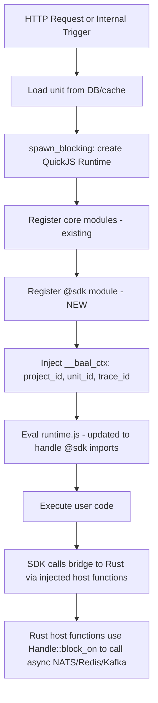
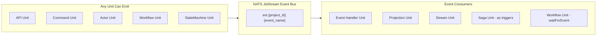
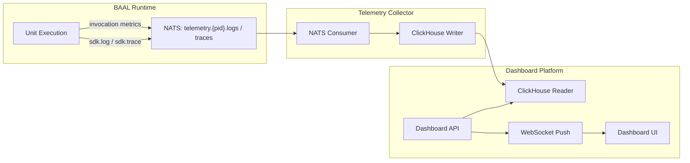

take a look at @docs/killers-features.md 

I want to implement `Durable Workflow Unit` feature

first of all let met explain you about our platform (add these explanation into a doc at @docs too):

- We have a supabase-like platform, we call each function a `unit`, users can create multiple projects, each containing thousands of units, units are nodejs functions, which run in the current project (this project)
- Users can create different type of units we support, for now we just support `api` units which accepts a `req` and `res` and can answer and receive HTTP requests
- Users can trigger units either internally using our platform (using internal APIs we provide for them), or using the public API's unit's trigger URL, each api unit has a public trigger URL inside this project
- Units will be able to talk to each other through the sdk module we provide them in the nodejs runtime
- Units can access several tools & features which we listen in @docs/killers-features.md 

Now here is what I want you:

1. at @units folder we have already a folder which is a nodeJS project checking the core / language features we provide to the units, like importing from `node:*`, these are tested in that folder, the runtime (this project) also supports the `exact` same features (core / language features we listed in @units/runtime-check ) so the @units folder is going to be our source of truth of what is allowed to be written into the units codes (add this explanation to the docs too, its important)

2. we need to have a plan to write some tests for the features we will introduce based on @docs/killers-features.md doc, so first we need to add some folder at @units specific to testing the features we are going to add, there we list all features we support and write deep / detailed test for all, NOTE: IT'S very important to have detailed tests for each feature, whether inside a single file or multiple files, its just important to me to check all aspects of the features we introduce as our SDK

3. then we need to support all those features in this project (the real runtime), I know we needs some tools like `Kafka` or `NATS` or `Redis` listed into @docs/killers-features.md so write a dev docker compose file (something like runtime-compose.yml) to run them locally, use password for each, then support those features one by one in the runtime

4. the sdk must be as convenient as it could be, I mean it doesn't need to be set up by the user, every tool must be initialized and managed internally by us, the sdk is just to use

5. we need a type declaration file for the sdk features written in typescript so we can type check the units codes againts it to make sure it's written correctly

NOTE: its important to give the sdk access to the tools I mentioned only scoped to their project so ther users' units can't access to other projects (neither their project nor other user's projects, projects are completely isolated), so when you write tests make sure you write the tests to check the isolation of each sdk tool, for the tests you can hard code the project uuids, for a real project's units the units all have a `project_id` like at @schema.rs (148-149) 

NOTE: all the available modules to import are listed into @units/runtime-check/index.ts , nothing else is allowed, so when you provide the new features, you MUST add those features under `@sdk`

NOTE: for the tools like kafka or redis or others which we want to provide to the units through the SDK, we need to provide the features supported by the real official sdk for that tool expect some limitations: 1. the tools are shared across multiple projects, so the users are not allowed to setup their own Kafka for example, they just use a SDK which is mimicing the official sdk of Kafka in nodejs 2. as we don't want to allow each user to configure the Kafka or other tools, we need to cut some SDK features as they are not allowed, for all tools I need you to carefully define what is SDK capable of doing while they use the same shared kafka instances scoped to their project

NOTE: some features like workflows or sagas or others may need to persist some state of their own, it's important to note that the runtime (current project) database must be separated from the dashboard platform project which user's see and define their units there, so if you need these kind of data to persist, just add a new service into dev docker compose file (something like runtime-compose.yml), note as these states must be very fast, you need to use a database or tool which has persistent while it can load the live data into the RAM so it would be fast enough, so it doesnt have to do anything with @src/schema.rs as its for the dashboard project

IMPORTANT: the tools and functions you define into SDK is very important to be chosen carefully as it allows the users to write their logics, it must be flexible enough, so make sure you follow the official sdk for each tool to provide the features, also for other tools which are dedicated to our platform (like saga or statemachine or others), make sure you consider the flexibility a lot to allow users combine the sdk features to build something powerful, try to follow proven sdks which are popular between developers

IMPORTANT: the features we intoroduce as the first platform supporting those (like saga or event sourcing or actors) must be designed very carefuly as they are one of the most promising features of our platform, so for each one follow the most popular frameworks to get idea to design their abilities and features, like Axon or Orleans or others

NOTE: the codes you see at @docs/killers-features.md are just samples, don't consider those as the base code, THEY ARE JUST SAMPLES, you define what is needed based on what I said in this message

IMPORTANT: when you choose what infrastrucute to use for these new features (like what to use to persist the event sourcing units or saga units), you MUST consider the multi-tenancy and security concerns too, we can't setup a single instance of tools like kafka or nats or a single separated database for each project, so you have to use tools which have these abilities buit-in and can support millions of projects

IMPORTANT: the different unit types must be able to communicate to eachother, so in the SDK provide proper solution to async or sync calls between different units, note we have some events in different unit types like sagas or event sourced units, Im not sure whether they must be shared and accessible between different unit types or they must be exclusive for those units only, you analyze and choose what to do

NOTE: we need to provide some monitoring tools for the users to see their unit's activities or tracing or logs, in your plan add a separated detailed plan for what to add to the dashboard platform, please write it exactly how it needs to be implemented and provide detailed technical instructions (like what must be the UI or how data are persisted and fetched and so on...)


take a look at @docs/killers-features.md 

I want to implement `Durable Workflow Unit` feature

first of all let met explain you about our platform (add these explanation into a doc at @docs too):

- We have a supabase-like platform, we call each function a `unit`, users can create multiple projects, each containing thousands of units, units are nodejs functions, which run in the current project (this project)
- Users can create different type of units we support, for now we just support `api` units which accepts a `req` and `res` and can answer and receive HTTP requests
- Users can trigger units either internally using our platform (using internal APIs we provide for them), or using the public API's unit's trigger URL, each api unit has a public trigger URL inside this project
- Units will be able to talk to each other through the sdk module we provide them in the nodejs runtime
- Units can access several tools & features which we listed in @docs/killers-features.md  later

Now here is what I want you:

0. The GOAL: I want you just to plan the implementation of `Durable Workflow Unit`, we have some explanation below which might refer other future goals, but you are going to design the plan of implementation of `Durable Workflow Unit`

0.0. I know there are open source or packages which are popular between developers to use `Durable workflow unit` in platforms like Supabase or firebase, I need you to check if there is any pre-built package or library instead of implementing it yourself, this way we make sure the SDK options you provide to the users are flexible enough as it's proven by community, THE ONLY thing you must consider is the runtime of that library must be ready to scale for using by millions of users, so the firs choice is to use an already exist project or library instead of implementing it, if there is nothing to use, you must to plan to use a high available infrastructure, note the SDK is very important, even if there is no high scale / proven runtime to use, the SDK must follow most popular tools or library matching our goal

SO you go by this priorities:

- if there is a proven library or package to run as a high scale runtime, use it instead of building the infrastrcuture yourself, in that case you must follow that tool or library to design the SDK features you provide to ther users
- if there is no proven runtime to use at scale, you must setup the infrastrucure in a dev runtime docker compose file, and wire the runtime to use for millions of projects
- in both cases you must support multi-tenancy so projects must be isolated and securely separated from other projects
- in both cases you must follow a proven tool or library to design the SDK to make sure: 1. users are familar with 2. its flexible enough and proven to implement complex goals

1. at @units folder we have already a folder which is a nodeJS project checking the core / language features we provide to the units, like importing from `node:*`, these are tested in that folder, the runtime (this project) also supports the `exact` same features (core / language features we listed in @units/runtime-check ) so the @units folder is going to be our source of truth of what is allowed to be written into the units codes (add this explanation to the docs too, its important)

2. we need to have a plan to write some tests for the `Durable workflow unit` we will introduce based on @docs/killers-features.md doc, so first we need to add some folder at @units specific to testing the feature we are going to add, there we list all features we support and write deep / detailed test for all, NOTE: IT'S very important to have detailed tests for that feature, whether inside a single file or multiple files, its just important to me to check all aspects of that feature we introduce as our SDK

3. then we need to support that feature in this project (the real runtime), I know we might need some servers (redis or something else you choose, so write a dev docker compose file (something like runtime-compose.yml) to run them locally, use password for each, then support those features one by one in the runtime

4. the sdk must be as convenient as it could be, I mean it doesn't need to be set up by the user, every tool must be initialized and managed internally by us, the sdk is just to use

5. we need a type declaration file for the sdk features written in typescript so we can type check the units codes againts it to make sure it's written correctly

NOTE: its important to give the sdk access to the tools I mentioned only scoped to their project so ther users' units can't access to other projects (neither their project nor other user's projects, projects are completely isolated), so when you write tests make sure you write the tests to check the isolation of each sdk tool, for the tests you can hard code the project uuids, for a real project's units the units all have a `project_id` like at @schema.rs (148-149) 

NOTE: all the available modules to import are listed into @units/runtime-check/index.ts , nothing else is allowed, so when you provide the new features, you MUST add those features under `@sdk`

NOTE: some features like workflows or sagas or others may need to persist some state of their own, it's important to note that the runtime (current project) database must be separated from the dashboard platform project which user's see and define their units there, so if you need these kind of data to persist, just add a new service into dev docker compose file (something like runtime-compose.yml), note as these states must be very fast, you need to use a database or tool which has persistent while it can load the live data into the RAM so it would be fast enough, so it doesnt have to do anything with @src/schema.rs as its for the dashboard project

IMPORTANT: the tools and functions you define into SDK is very important to be chosen carefully as it allows the users to write their logics, it must be flexible enough, , make sure you consider the flexibility a lot to allow users combine the sdk features to build something powerful, try to follow proven sdks which are popular between developers

IMPORTANT: the features we introduce as the first platform supporting those (like saga or event sourcing or actors) must be designed very carefuly as they are one of the most promising features of our platform, so for each one follow the most popular frameworks to get idea to design their abilities and features, like Axon or Orleans or others

NOTE: the codes you see at @docs/killers-features.md are just samples, don't consider those as the base code, THEY ARE JUST SAMPLES, you define what is needed based on what I said in this message

IMPORTANT: when you choose what infrastrucute to use for these new features (like what to use to persist the event sourcing units or saga units), you MUST consider the multi-tenancy and security concerns too, we can't setup a single instance of tools like kafka or nats or a single separated database for each project, so you have to use tools which have these abilities buit-in and can support millions of projects


---
name: BAAL SDK & Unit Types
overview: Implement the full BAAL platform SDK and advanced unit types (workflow, actor, event sourcing, saga, stream, state machine, scheduled, queue worker, websocket), with infrastructure provisioning, multi-tenant isolation, comprehensive tests in the units/ folder, TypeScript type declarations, and a monitoring dashboard specification.
todos:
  - id: docs
    content: Create docs/platform-overview.md explaining the platform, units, SDK, units/ folder purpose, and isolation model
    status: pending
  - id: compose
    content: Create runtime-compose.yml with Redis (AOF), Kafka (KRaft), ClickHouse, with auth and persistent volumes
    status: pending
  - id: sdk-types
    content: Write @sdk.d.ts TypeScript declaration file (~500-800 lines) covering all SDK interfaces, unit type constructors, and option types
    status: pending
  - id: sdk-core
    content: "Implement @sdk module injection: sdk.rs (Rust host functions) + sdk.js (JS wrapper), bridge async via Handle::block_on"
    status: pending
  - id: sdk-tier1
    content: Implement sdk.call (NATS req-reply), sdk.emit (NATS JetStream), sdk.secrets, sdk.log, sdk.trace
    status: pending
  - id: sdk-redis
    content: "Implement sdk.redis: ioredis-compatible subset with automatic key-prefix isolation, blocked commands list"
    status: pending
  - id: sdk-kafka
    content: "Implement sdk.kafka: KafkaJS-compatible producer/consumer with topic-prefix isolation, blocked admin API"
    status: pending
  - id: sdk-tier3
    content: Implement sdk.lock, sdk.rateLimit, sdk.cache, sdk.circuitBreaker using Redis
    status: pending
  - id: engine-workflow
    content: "Implement Durable Workflow engine: step persistence, retry, sleep, waitForEvent, parallel, compensation"
    status: pending
  - id: engine-actor
    content: "Implement Stateful Actor engine: state persistence, sequential message processing, alarms, lifecycle hooks"
    status: pending
  - id: engine-es
    content: "Implement Event Sourcing engine: event store (NATS JetStream), aggregate loading, snapshotting, command/handler/projection execution"
    status: pending
  - id: engine-saga
    content: "Implement Saga engine: step orchestration, automatic reverse compensation, retry policy, dead letter"
    status: pending
  - id: engine-stream
    content: "Implement Stream Processing engine: windowing (tumbling/sliding/session), checkpointing, backpressure"
    status: pending
  - id: engine-sm
    content: "Implement State Machine engine: transition enforcement, guards, context, terminal states, history"
    status: pending
  - id: engine-scheduled
    content: "Implement Scheduled Unit engine: cron parser, timezone support, Redis sorted set scheduler"
    status: pending
  - id: engine-queue
    content: "Implement Queue Worker engine: NATS work queue, retry with backoff, DLQ, priority, delayed execution"
    status: pending
  - id: engine-ws
    content: "Implement WebSocket Unit engine: connection lifecycle, rooms, broadcast via Redis pub/sub"
    status: pending
  - id: runtime-update
    content: Update runtime.js, runner.rs, routes, models to support all new unit types and @sdk imports
    status: pending
  - id: tests-skeleton
    content: Create units/sdk-tests/ project skeleton with package.json, tsconfig.json, @sdk.d.ts
    status: pending
  - id: tests-tier1
    content: Write detailed tests for sdk.call, sdk.emit, sdk.secrets, sdk.log, sdk.trace
    status: pending
  - id: tests-tier2
    content: Write detailed tests for sdk.redis (all data types + isolation + blocked), sdk.kafka (producer/consumer + isolation)
    status: pending
  - id: tests-tier3
    content: Write detailed tests for sdk.lock, sdk.rateLimit, sdk.cache, sdk.circuitBreaker
    status: pending
  - id: tests-unit-types
    content: Write detailed tests for every unit type (workflow, actor, ES, saga, stream, SM, scheduled, queue, WS)
    status: pending
  - id: tests-isolation
    content: Write cross-project isolation tests for events, Redis, Kafka, actors, workflow/saga state
    status: pending
  - id: telemetry
    content: Implement telemetry collector binary + ClickHouse schema for traces, spans, logs, metrics
    status: pending
  - id: dashboard-spec
    content: "Finalize dashboard monitoring spec: API endpoints, UI components, WebSocket real-time, ClickHouse queries"
    status: pending
isProject: false
---

# BAAL Platform SDK & Advanced Unit Types Implementation Plan

---

## 1. Documentation

Create two new docs in `docs/`:

### `docs/platform-overview.md`
Document the platform fundamentals:
- BAAL is a supabase-like "Architecture-as-a-Service" platform
- **Units** are the core primitive -- NodeJS functions created by users within **projects**
- Each project can contain thousands of units; units run inside QuickJS (via `rquickjs`) in [src/libs/unit_js/runner.rs](src/libs/unit_js/runner.rs)
- Currently only `api` units are supported (HTTP request/response via `handleRequest(req, res)`)
- Units are triggered via public URLs (`/api/v1/trigger/{project_id}/...`) or internally via `sdk.call`
- Units communicate through the SDK module (`@sdk`), which is injected into the QuickJS runtime
- The `units/` folder is the **source of truth** for what code is allowed inside units:
  - `units/runtime-check/` defines and tests all core language/Node.js API features available in the runtime
  - `units/sdk-tests/` (new) defines and tests all SDK features, unit types, and platform capabilities
  - Only imports from `node:*` (as listed in `runtime-check/index.ts`) and `@sdk` are permitted
- Projects are **completely isolated** -- every SDK tool is scoped by `project_id`, preventing cross-project access

### `docs/sdk-specification.md`
Full SDK reference (generated from the type declarations below), documenting every function, its parameters, return types, and usage examples.

---

## 2. Infrastructure Setup: `runtime-compose.yml`

A new Docker Compose file for all services the runtime needs. The existing `compose.yml` (NATS + nginx LB) stays for the current API server. This new file adds the SDK infrastructure.

**Services:**

| Service | Image | Purpose | Port | Auth |
|---|---|---|---|---|
| `redis` | `redis:7-alpine` | Actor state, workflow/saga checkpoints, Tier 2 user Redis, locks, rate limits, cache | 6379 | `requirepass redis_dev_R7x9kP` |
| `kafka` | `bitnami/kafka:3.7` (KRaft, no Zookeeper) | Tier 2 user Kafka, stream processing source | 9092 | SASL PLAIN `runtime_kafka` / `kafka_dev_Q4mW8j` |
| `clickhouse` | `clickhouse/clickhouse-server:24` | Telemetry storage (traces, logs, metrics) for monitoring dashboard | 8123, 9000 | user `runtime_ch` / `ch_dev_Lp3nX2` |

**Why these choices:**
- **Redis with AOF persistence** (`--appendonly yes --appendfsync everysec`): Data lives in RAM for speed, persisted to disk for durability. Handles actor state, workflow checkpoints, saga state, state machine state, Tier 3 helpers (locks, rate limits, cache), and Tier 2 user Redis -- all with key-prefix isolation.
- **NATS JetStream** (already in `compose.yml`): Append-only ordered log with subject-based routing. Perfect for: platform event bus (`sdk.emit`), event sourcing event store, inter-unit communication (`sdk.call` via request-reply), queue worker job dispatch, stream processing source. Multi-tenancy via subject prefixes (`{project_id}.>`).
- **Kafka (KRaft mode)**: Tier 2 user-facing Kafka. Topic-prefix isolation (`p_{project_id}_`). Users get KafkaJS-compatible producer/consumer APIs. Admin operations blocked.
- **ClickHouse**: Columnar analytics DB for telemetry. TTL-based retention. Partitioned by `project_id` + month.

**Data volumes** under `.dev/` (gitignored): `redis-data`, `kafka-data`, `clickhouse-data`.

---

## 3. SDK Architecture

### How the SDK is injected into QuickJS

Currently ([src/libs/unit_js/runner.rs](src/libs/unit_js/runner.rs)), the runtime:
1. Creates a QuickJS `Runtime` + `Context`
2. Registers globals via `modules::register_all` (URL, crypto, fetch, Buffer, polyfills, etc.)
3. Strips imports/exports from user code, evals it, calls `handleRequest(req, res)`

**Changes needed:**



**Key implementation detail**: Since QuickJS runs in `spawn_blocking`, SDK host functions use `tokio::runtime::Handle::current().block_on(async_operation)` to bridge sync QuickJS calls to async Rust operations (NATS, Redis, Kafka clients).

New file: **`src/libs/unit_js/modules/sdk.rs`** -- registers the `@sdk` module with all SDK functions as JS globals (`__baal_call`, `__baal_emit`, `__baal_redis_cmd`, etc.), then wraps them in a user-friendly JS module via an embedded `sdk.js` script.

New file: **`src/libs/unit_js/scripts/sdk.js`** -- the JS-side SDK that wraps the Rust-injected host functions into the public API (`sdk.call`, `sdk.emit`, `sdk.redis.*`, etc.).

### Context injection

Every unit execution receives a context object containing:
- `project_id: UUID` -- for scoping all SDK operations
- `unit_id: string` -- the full unit identifier
- `unit_type: string` -- the unit type slug
- `trace_id: UUID` -- for distributed tracing
- `parent_span_id: UUID | null` -- for trace propagation

This context is set as `__baal_ctx` global before the SDK module initializes.

### Multi-tenant isolation strategy

All isolation is enforced at the **Rust host function layer**, not at the infrastructure level:

- **Redis**: Every key operation prepends `p:{project_id}:` to the key. The SDK Rust function validates and rewrites keys before sending to Redis. `KEYS *` becomes `KEYS p:{project_id}:*`. `FLUSHDB`, `CONFIG`, `SELECT` are blocked entirely.
- **NATS/Events**: Subjects are scoped as `evt.{project_id}.{event_name}`. Subscriptions only match `evt.{project_id}.>`. No wildcard across projects.
- **Kafka**: Topics are rewritten to `p_{project_id}_{user_topic}`. Admin API blocked.
- **Event Store**: Events stored in NATS JetStream subjects `es.{project_id}.{aggregate_type}.{aggregate_id}`. Stream consumers filter by project prefix.
- **Actor State**: Redis keys `actor:{project_id}:{actor_type}:{actor_id}`
- **Workflow/Saga State**: Redis keys `wf:{project_id}:{instance_id}` / `saga:{project_id}:{instance_id}`

---

## 4. SDK Type Declarations

Create **`units/sdk-tests/@sdk.d.ts`** (also usable by all unit projects for type checking). This is the authoritative TypeScript type definition for the `@sdk` module.

Key type structure:

```typescript
declare module "@sdk" {
  export const sdk: SDK;

  interface SDK {
    // --- Tier 1: Platform Primitives ---
    call<T = any>(unitPath: string, data?: any, options?: CallOptions): Promise<T>;
    emit(eventName: string, data?: any): Promise<void>;
    secrets: SecretsClient;
    log: Logger;
    trace: Tracer;

    // --- Tier 2: Infrastructure Catalog ---
    redis: RedisClient;
    kafka: KafkaClient;

    // --- Tier 3: Convenience Helpers ---
    lock<T>(key: string, options: LockOptions, fn: () => Promise<T>): Promise<T>;
    rateLimit(key: string, options: RateLimitOptions): Promise<RateLimitResult>;
    cache: CacheClient;
    circuitBreaker<T>(name: string, opts: CircuitBreakerOptions, fn: () => Promise<T>): Promise<T>;
  }

  // --- Unit Type Constructors ---
  export function workflow<TInput = any, TOutput = any>(
    name: string, handler: WorkflowHandler<TInput, TOutput>
  ): WorkflowDefinition;
  
  export function actor<TState = any>(
    name: string, config: ActorConfig<TState>
  ): ActorDefinition;
  
  export function command(
    name: string, handler: CommandHandler
  ): CommandDefinition;
  
  export function eventHandler(
    eventName: string | string[], handler: EventHandlerFn
  ): EventHandlerDefinition;
  
  export function projection<TState = any>(
    name: string, config: ProjectionConfig<TState>
  ): ProjectionDefinition;
  
  export function saga<TData = any>(
    name: string, config: SagaConfig<TData>
  ): SagaDefinition;
  
  export function stream(
    name: string, config: StreamConfig
  ): StreamDefinition;
  
  export function stateMachine(
    name: string, config: StateMachineConfig
  ): StateMachineDefinition;
  
  // ... full interface definitions for each
}
```

The full `.d.ts` file will be ~500-800 lines covering every interface, option type, context type, and callback signature. It follows the patterns of popular SDKs:
- **Workflow context**: Modeled after Temporal SDK (`ctx.step`, `ctx.sleep`, `ctx.waitForEvent`, `ctx.parallel`, `ctx.compensate`)
- **Actor config**: Modeled after Orleans/Durable Objects (`handlers`, `alarms`, `onActivate`, `onDeactivate`)
- **Event sourcing**: Modeled after Axon Framework (`ctx.loadAggregate`, `ctx.emit`, projection `apply`)
- **Saga**: Modeled after MassTransit/Axon (`steps[].execute/compensate`, `retryPolicy`, `onComplete/onFailure`)
- **State machine**: Modeled after XState (`states`, `on`, `guard`, `onEnter`, `onExit`, `context`)
- **Stream**: Modeled after Kafka Streams/Flink (`source`, `window`, `process`, `filter`, `checkpoint`)

---

## 5. Unit Types -- Detailed Design

### 5a. Durable Workflow Unit

**Execution model**: Triggered once (via `sdk.call` or event). The runtime persists each step's result in Redis (`wf:{project_id}:{instance_id}:steps:{step_name}`). On crash/restart, the workflow replays from the last completed step without re-executing completed steps.

**SDK API (what the user writes):**
```typescript
import { workflow, sdk } from "@sdk";
export default workflow(async (ctx, order) => {
  const payment = await ctx.step("charge", () => sdk.call("payments.charge", order));
  await ctx.sleep("cooling-period", "5m");
  const approval = await ctx.waitForEvent("manager.approved", { timeout: "24h", filter: { orderId: order.id } });
  if (!approval) { await ctx.compensate(); return; }
  const [inv, notif] = await ctx.parallel([
    ctx.step("reserve", () => sdk.call("warehouse.reserve", order.items)),
    ctx.step("notify", () => sdk.call("notifications.send", { userId: order.userId }))
  ]);
  return { payment, inventory: inv };
});
```

**Rust runtime support needed:**
- New module `src/services/workflow_engine.rs`: step persistence (Redis hashes), retry with exponential backoff, timeout tracking via Redis keyspace notifications or NATS delayed publish, compensation chain execution.
- Workflow instances are NATS JetStream consumers. When triggered, a message is published to `wf.{project_id}.{workflow_name}`. A runtime worker picks it up, creates a QuickJS context with workflow-specific `ctx`, and executes step by step.
- `ctx.waitForEvent` subscribes to `evt.{project_id}.{event_name}` with a NATS consumer filtered by the `filter` predicate. Timeout is a competing NATS delayed message.

**State storage (Redis):**
```
wf:{project_id}:{instance_id}:status    -> "running" | "completed" | "failed" | "compensating"
wf:{project_id}:{instance_id}:input     -> JSON
wf:{project_id}:{instance_id}:step:{n}  -> { status, result, error, retries, startedAt, completedAt }
wf:{project_id}:{instance_id}:current   -> step index
```

### 5b. Stateful Actor Unit

**Execution model**: Each actor instance (identified by `actorType + actorId`) processes messages sequentially. State is loaded from Redis before each handler and persisted after. No concurrent access to the same actor instance (guaranteed by Redis-based distributed lock or NATS subject-based ordering).

**SDK API:**
```typescript
import { actor, sdk } from "@sdk";
export default actor("shopping-cart", {
  state: { items: [], total: 0 },
  handlers: {
    addItem(ctx, item) { ctx.state.items.push(item); ctx.state.total += item.price; return ctx.state; },
    checkout(ctx) {
      const order = { items: ctx.state.items, total: ctx.state.total };
      sdk.emit("order.created", order);
      ctx.state = { items: [], total: 0 };
      return order;
    }
  },
  alarms: {
    abandonCheck(ctx) {
      if (ctx.state.items.length > 0) sdk.emit("cart.abandoned", { cartId: ctx.id });
    }
  },
  onActivate(ctx) { },
  onDeactivate(ctx) { }
});
```

**Invocation from other units:**
```typescript
const result = await sdk.call("context.module.actor.shopping-cart", {
  _actorId: "user-123",
  _handler: "addItem",
  productId: "abc", price: 29.99
});
```

**State storage (Redis):**
```
actor:{project_id}:{actor_type}:{actor_id}:state   -> JSON (the actor's state)
actor:{project_id}:{actor_type}:{actor_id}:lock    -> lock key for sequential access
actor:{project_id}:{actor_type}:{actor_id}:alarm:{name} -> TTL-based key (Redis keyspace notifications trigger alarm)
```

**Rust runtime support:**
- `src/services/actor_engine.rs`: State load/save, lock acquisition (Redlock), alarm scheduling, activation/deactivation lifecycle.
- Messages routed via NATS subject `actor.{project_id}.{actor_type}.{actor_id}` with a single consumer per actor instance to guarantee ordering.

### 5c. Event Sourcing Units (Command + Event Handler + Projection)

**Event Store**: NATS JetStream stream `ES_{project_id}` capturing subjects `es.{project_id}.{aggregate_type}.{aggregate_id}.>`. Events are immutable, ordered, and replayable.

**Command Unit:**
```typescript
import { command, sdk } from "@sdk";
export default command("account.deposit", async (ctx, cmd) => {
  const agg = await ctx.loadAggregate("account", cmd.accountId);
  if (agg.state.frozen) throw new DomainError("Account frozen");
  ctx.emit("account.deposited", { accountId: cmd.accountId, amount: cmd.amount, newBalance: agg.state.balance + cmd.amount });
});
```

`ctx.loadAggregate(type, id)` replays all events for that aggregate from NATS JetStream, applies them through the registered projection to reconstruct current state. Snapshots cached in Redis every N events to avoid full replay.

**Event Handler Unit:**
```typescript
import { eventHandler, sdk } from "@sdk";
export default eventHandler("account.deposited", async (ctx, event) => {
  if (event.data.amount > 10000) await sdk.call("compliance.flag", event.data);
  await sdk.call("notifications.send", { userId: event.data.accountId, message: `Deposited $${event.data.amount}` });
});
```

Triggered by NATS JetStream consumer for `es.{project_id}.*.*.account.deposited`. Delivery guarantee: at-least-once with deduplication via event sequence number.

**Projection Unit:**
```typescript
import { projection } from "@sdk";
export default projection("account-balance-view", {
  events: ["account.deposited", "account.withdrawn"],
  init: () => ({ balance: 0, frozen: false }),
  apply(state, event) {
    switch (event.type) {
      case "account.deposited": return { ...state, balance: state.balance + event.data.amount };
      case "account.withdrawn": return { ...state, balance: state.balance - event.data.amount };
    }
  }
});
```

Projection state stored in Redis (`proj:{project_id}:{projection_name}:{aggregate_id}`). Supports full rebuild by replaying from NATS JetStream position 0.

**Rust runtime support:**
- `src/services/event_store.rs`: Append events to NATS JetStream, replay events for aggregate loading, snapshotting to Redis.
- `src/services/projection_engine.rs`: Continuous NATS consumer that applies events to projection state.
- Aggregate snapshot: Redis key `es:{project_id}:{agg_type}:{agg_id}:snap` storing `{ state, version, snapshotAt }`.

### 5d. Saga Unit

**Execution model**: Orchestrated saga. Steps execute in order. On failure, compensation functions run in reverse order (from the last completed step backward).

**SDK API:** (as shown in the features doc, with additions)
```typescript
import { saga, sdk } from "@sdk";
export default saga("transfer-funds", {
  steps: [
    { name: "debit-source",
      execute: (ctx, data) => sdk.call("accounts.debit", { accountId: data.from, amount: data.amount }),
      compensate: (ctx, data, result) => sdk.call("accounts.credit", { accountId: data.from, amount: data.amount }) },
    { name: "credit-dest",
      execute: (ctx, data) => sdk.call("accounts.credit", { accountId: data.to, amount: data.amount }),
      compensate: (ctx, data, result) => sdk.call("accounts.debit", { accountId: data.to, amount: data.amount }) },
    { name: "record", execute: (ctx, data) => sdk.call("ledger.record", data) }
  ],
  retryPolicy: { maxRetries: 3, backoff: "exponential", initialDelay: "1s", maxDelay: "30s" },
  onComplete(ctx, data, results) { sdk.emit("transfer.completed", { sagaId: ctx.sagaId }); },
  onFailure(ctx, failedStep, error) { sdk.emit("transfer.failed", { sagaId: ctx.sagaId, step: failedStep }); }
});
```

**State storage (Redis):**
```
saga:{project_id}:{instance_id}:status       -> "running" | "compensating" | "completed" | "failed"
saga:{project_id}:{instance_id}:input        -> JSON
saga:{project_id}:{instance_id}:step:{name}  -> { status, result, error, compensated }
saga:{project_id}:{instance_id}:current      -> current step name
```

**Rust runtime support:** `src/services/saga_engine.rs` -- step orchestration, compensation chain, retry with backoff, dead letter after max retries.

### 5e. Stream Processing Unit

**Execution model**: Continuously runs. Consumes events from a NATS JetStream subject, buffers them into windows, then invokes the `process` function with the windowed batch.

**Window types:**
- **Tumbling**: Fixed non-overlapping windows (e.g., every 5 minutes)
- **Sliding**: Overlapping windows (e.g., 5-minute window sliding every 1 minute)
- **Session**: Dynamic windows that close after inactivity gap

**Rust runtime support:**
- `src/services/stream_engine.rs`: Window management (time-based bucketing in memory), checkpoint persistence to Redis, NATS consumer management, backpressure handling.
- The stream unit's QuickJS context stays alive for the duration (not one-shot like API units). Uses a worker binary (`runtime_worker`) that maintains long-lived QuickJS contexts.

### 5f. State Machine Unit

**Execution model**: Instance-based (like actors). Each instance has a current state and context data. Transitions are triggered by events/commands. Guards validate transitions. The platform enforces that only valid transitions occur.

**State storage (Redis):**
```
sm:{project_id}:{machine_name}:{instance_id}:state    -> current state name
sm:{project_id}:{machine_name}:{instance_id}:context  -> JSON context data
sm:{project_id}:{machine_name}:{instance_id}:history  -> list of transitions
```

### 5g. Scheduled / Cron Unit

**Execution model**: Platform schedules execution based on cron expression. Uses NATS delayed publish or a scheduler service that checks Redis sorted sets of upcoming executions.

```typescript
import { scheduled, sdk } from "@sdk";
export default scheduled("daily-report", {
  schedule: "0 9 * * MON-FRI",  // cron expression
  timezone: "America/New_York",
  async handler(ctx) {
    const data = await sdk.call("analytics.aggregate", { period: "1d" });
    await sdk.call("notifications.sendEmail", { to: "team@...", subject: "Daily Report", data });
  }
});
```

**Rust runtime support:** `src/services/scheduler.rs` -- cron parser, Redis sorted set of next-execution timestamps, polling loop that triggers units at the right time.

### 5h. Queue Worker Unit

**Execution model**: Consumes jobs from a NATS JetStream work queue. Supports retry with configurable backoff, dead-letter queue, priority (multiple streams), delayed execution, batch processing.

```typescript
import { queueWorker, sdk } from "@sdk";
export default queueWorker("email-sender", {
  queue: "emails",
  concurrency: 5,
  retryPolicy: { maxRetries: 3, backoff: "exponential" },
  async handler(ctx, job) {
    await sendEmail(job.data.to, job.data.subject, job.data.body);
  },
  async onDeadLetter(ctx, job, error) {
    await sdk.call("alerts.notify", { job: job.id, error: error.message });
  }
});
```

**Rust runtime support:** NATS JetStream pull consumer with ack/nack. Dead-letter via re-publish to `dlq.{project_id}.{queue_name}`.

### 5i. WebSocket / Realtime Unit

**Execution model**: Manages persistent WebSocket connections. Combined with actor units for room/channel state.

```typescript
import { websocket, sdk } from "@sdk";
export default websocket("chat-room", {
  async onConnect(ctx, socket) {
    const room = socket.params.roomId;
    await ctx.join(room);
    ctx.broadcast(room, { type: "user-joined", userId: socket.userId });
  },
  async onMessage(ctx, socket, message) {
    ctx.broadcast(socket.room, { type: "message", from: socket.userId, text: message.text });
  },
  async onDisconnect(ctx, socket) {
    ctx.broadcast(socket.room, { type: "user-left", userId: socket.userId });
  }
});
```

**Rust runtime support:** Actix-web WebSocket upgrade handler. Room/channel state managed via Redis pub/sub for cross-instance broadcasting. Connection registry in Redis set `ws:{project_id}:{room}:members`.

---

## 6. SDK Tier 2 -- Infrastructure Catalog (Scoped Native Clients)

### Redis (`sdk.redis`)

Exposes an **ioredis-compatible** subset. All keys are automatically prefixed with `usr:{project_id}:` by the Rust host.

**Allowed operations:**
- Strings: `get`, `set`, `del`, `exists`, `incr`, `decr`, `incrby`, `decrby`, `mget`, `mset`, `setnx`, `setex`, `psetex`, `getset`, `append`, `strlen`
- Hashes: `hget`, `hset`, `hdel`, `hgetall`, `hkeys`, `hvals`, `hlen`, `hmget`, `hmset`, `hincrby`, `hexists`, `hsetnx`
- Lists: `lpush`, `rpush`, `lpop`, `rpop`, `lrange`, `llen`, `lindex`, `lset`, `lrem`, `ltrim`
- Sets: `sadd`, `srem`, `smembers`, `sismember`, `scard`, `sunion`, `sinter`, `sdiff`, `spop`, `srandmember`
- Sorted Sets: `zadd`, `zrem`, `zrange`, `zrevrange`, `zrangebyscore`, `zrevrangebyscore`, `zcard`, `zscore`, `zincrby`, `zrank`, `zcount`
- Keys: `expire`, `pexpire`, `ttl`, `pttl`, `persist`, `type`, `rename`, `scan` (scoped)
- Pub/Sub: `publish`, `subscribe`, `psubscribe`, `unsubscribe` (channel names auto-prefixed)
- Transactions: `multi`, `exec`, `discard`, `watch` (keys auto-prefixed)
- Pipeline: `pipeline()` returning chainable command builder

**Blocked operations:** `CONFIG`, `FLUSHDB`, `FLUSHALL`, `DEBUG`, `SLAVEOF`, `CLUSTER`, `CLIENT`, `ACL`, `BGSAVE`, `BGREWRITEAOF`, `MODULE`, `SELECT`, `SWAPDB`, `KEYS` (full), `SHUTDOWN`, `MIGRATE`, `OBJECT`, `MEMORY`, `LATENCY`, `SLOWLOG`, `WAIT`, `SCRIPT` (raw), `EVAL` (raw Lua).

### Kafka (`sdk.kafka`)

Exposes a **KafkaJS-compatible** subset. Topics auto-prefixed with `p_{project_id}_`.

**Allowed:**
- `sdk.kafka.producer`: `send({ topic, messages })`, `sendBatch({ topicMessages })`, `connect()`, `disconnect()`
- `sdk.kafka.consumer`: `subscribe({ topics, fromBeginning })`, `run({ eachMessage, eachBatch })`, `pause(topics)`, `resume(topics)`, `seek({ topic, partition, offset })`, `commitOffsets()`, `disconnect()`
- Consumer group name auto-prefixed: `cg_{project_id}_{user_group}`

**Blocked:** `admin.*` (createTopics, deleteTopics, listTopics, describeCluster, alterConfigs, etc.), custom partitioner configuration, SASL/SSL configuration (managed by platform).

---

## 7. SDK Tier 3 -- Convenience Helpers

All use Redis internally. Key isolation enforced.

- **`sdk.lock(key, { ttl }, fn)`**: Redlock algorithm. Throws if lock not acquired within timeout.
- **`sdk.rateLimit(key, { max, window })`**: Sliding window rate limiter. Returns `{ allowed: boolean, remaining: number, retryAfter?: number }`.
- **`sdk.cache.through(key, fn, { ttl })`**: Cache-aside. Checks Redis, on miss calls `fn`, stores result, returns it.
- **`sdk.cache.get(key)`, `sdk.cache.set(key, value, { ttl })`, `sdk.cache.del(key)`**: Direct cache operations.
- **`sdk.circuitBreaker(name, { timeout, failureThreshold, resetAfter }, fn)`**: Three states (closed/open/half-open). State tracked in Redis.

---

## 8. Cross-Unit Communication

Events are **shared across all unit types** within a project. The event namespace is unified:



**`sdk.call(unitPath, data)`** works across all unit types:
- API unit -> directly invoked (internal HTTP-like call)
- Workflow unit -> starts a new workflow instance, returns when complete
- Actor unit -> requires `_actorId` and `_handler` in data, routes to specific actor instance
- Command unit -> dispatches command, returns after events emitted
- Saga unit -> starts a new saga instance
- Queue worker -> enqueues a job, returns job ID (fire-and-forget variant: `sdk.enqueue(unitPath, data)`)

---

## 9. Testing Strategy: `units/sdk-tests/`

A new Node.js/TypeScript project at `units/sdk-tests/` that serves as the **source of truth** for all SDK features. Each test file is a valid unit that can be deployed to the runtime and triggered.

**Structure:**
```
units/sdk-tests/
  package.json
  tsconfig.json
  @sdk.d.ts                        # SDK type declarations
  tier1/
    call.ts                        # sdk.call: same-project calls, cross-unit-type calls, error propagation, timeout
    emit.ts                        # sdk.emit: event publishing, delivery to handlers, filtering
    secrets.ts                     # sdk.secrets.get: existing key, missing key, per-environment
    logging.ts                     # sdk.log: info/warn/error/debug, structured metadata
    tracing.ts                     # sdk.trace: span creation, propagation across sdk.call
  tier2/
    redis/
      strings.ts                   # GET, SET, DEL, INCR, SETEX, MGET, MSET, etc.
      hashes.ts                    # HSET, HGET, HGETALL, HDEL, HMSET, etc.
      lists.ts                     # LPUSH, RPUSH, LPOP, RPOP, LRANGE, etc.
      sets.ts                      # SADD, SREM, SMEMBERS, SINTER, SUNION, etc.
      sorted-sets.ts               # ZADD, ZRANGE, ZREVRANGE, ZSCORE, ZRANK, etc.
      pubsub.ts                    # PUBLISH, SUBSCRIBE, message delivery
      transactions.ts              # MULTI, EXEC, WATCH, pipeline
      isolation.ts                 # ** Two hardcoded project UUIDs, verify keys don't leak **
      blocked-commands.ts          # Verify CONFIG, FLUSHDB, etc. throw errors
    kafka/
      producer.ts                  # send, sendBatch, message serialization
      consumer.ts                  # subscribe, eachMessage, eachBatch, seek, commit
      isolation.ts                 # ** Two project UUIDs, verify topic isolation **
      blocked-admin.ts             # Verify admin operations throw errors
  tier3/
    lock.ts                        # Acquire, release, timeout, contention between units
    rate-limit.ts                  # Allow/deny, window expiry, remaining count
    cache.ts                       # through pattern, get/set/del, TTL expiry
    circuit-breaker.ts             # Closed->open on failures, half-open->closed on success
  unit-types/
    workflow/
      basic-steps.ts               # Sequential steps, result passing
      sleep.ts                     # Durable sleep (verify survives restart)
      wait-for-event.ts            # Wait + event delivery + timeout
      parallel-steps.ts            # Parallel execution
      compensation.ts              # Failure triggers reverse compensation
      retry.ts                     # Step retry with backoff
      crash-recovery.ts            # Kill mid-workflow, verify resume from last step
    actor/
      state-persistence.ts         # State saved between invocations
      sequential-processing.ts     # Concurrent messages processed one at a time
      alarms.ts                    # Alarm scheduling and firing
      lifecycle.ts                 # onActivate, onDeactivate hooks
      isolation.ts                 # ** Different project can't access another's actors **
    event-sourcing/
      command-validation.ts        # Command accepts/rejects based on aggregate state
      event-emission.ts            # Events stored in event store
      event-handler-trigger.ts     # Handler fires on event
      projection-build.ts          # Projection state updated correctly
      aggregate-replay.ts          # loadAggregate replays full event history
      snapshot.ts                  # Snapshot created after N events, loaded on next access
      isolation.ts                 # ** Events scoped to project **
    saga/
      happy-path.ts                # All steps succeed
      compensation-on-failure.ts   # Step 3 fails -> compensate steps 2, 1 in reverse
      retry-policy.ts              # Retry failed step before compensating
      idempotency.ts               # Same saga can't run twice with same ID
      isolation.ts                 # ** Saga state scoped to project **
    stream/
      tumbling-window.ts           # Fixed time windows
      sliding-window.ts            # Overlapping windows
      session-window.ts            # Inactivity-based windows
      groupby.ts                   # ctx.groupBy aggregation
      filter.ts                    # Pre-window filtering
      checkpoint.ts                # Resume from checkpoint after restart
    state-machine/
      valid-transitions.ts         # Allowed transitions succeed
      invalid-transitions.ts       # Disallowed transitions throw
      guards.ts                    # Guard functions block/allow transitions
      terminal-states.ts           # Terminal states reject all transitions
      context-mutation.ts          # onEnter/onExit modify context
      history.ts                   # Transition history tracking
    scheduled/
      cron-expression.ts           # Standard cron parsing
      timezone.ts                  # Timezone-aware scheduling
      dynamic-schedule.ts          # Create/modify schedules from other units
    queue-worker/
      basic-processing.ts          # Job consumed and processed
      retry-backoff.ts             # Failed job retried with backoff
      dead-letter.ts               # Exhausted retries -> DLQ
      priority.ts                  # Higher priority processed first
      delayed.ts                   # Delayed execution
      batch.ts                     # Batch processing
    websocket/
      connection-lifecycle.ts      # Connect, message, disconnect hooks
      rooms.ts                     # Join/leave rooms, broadcast
      auth.ts                      # Connection authentication
  isolation/
    cross-project-events.ts        # Project A events invisible to Project B
    cross-project-redis.ts         # Project A Redis keys invisible to Project B
    cross-project-kafka.ts         # Project A topics invisible to Project B
    cross-project-actors.ts        # Project A actors invisible to Project B
    cross-project-state.ts         # Workflow/saga/SM state isolated
```

Each test file follows the same pattern as `runtime-check/index.ts`: exports a `handleRequest` that runs all checks and returns a JSON health report with pass/fail for each assertion. The hardcoded project UUIDs for isolation tests:
- Project A: `00000000-0000-0000-0000-000000000001`
- Project B: `00000000-0000-0000-0000-000000000002`

---

## 10. Monitoring & Dashboard Plan

This section specifies what the **dashboard platform** (separate project) needs to display runtime telemetry.

### 10a. Data Collection Pipeline



**Runtime emits to NATS subjects:**
- `telemetry.{project_id}.traces` -- span data (OpenTelemetry format)
- `telemetry.{project_id}.logs` -- structured log entries
- `telemetry.{project_id}.metrics` -- unit invocation metrics (duration, status, etc.)

**Telemetry Collector** (new binary: `src/bin/telemetry_collector.rs`):
- Consumes `telemetry.>` from NATS
- Batches inserts into ClickHouse (every 1s or 1000 records, whichever first)
- Handles backpressure gracefully

### 10b. ClickHouse Schema

```sql
-- Traces table
CREATE TABLE traces (
    trace_id UUID,
    project_id UUID,
    root_unit_id String,
    root_unit_type LowCardinality(String),
    start_time DateTime64(3),
    end_time DateTime64(3),
    status LowCardinality(String),  -- 'ok', 'error'
    metadata String  -- JSON
) ENGINE = MergeTree()
PARTITION BY (project_id, toYYYYMM(start_time))
ORDER BY (project_id, start_time, trace_id)
TTL start_time + INTERVAL 90 DAY;

-- Spans table
CREATE TABLE spans (
    span_id UUID,
    trace_id UUID,
    parent_span_id Nullable(UUID),
    project_id UUID,
    unit_id String,
    unit_type LowCardinality(String),
    operation String,
    start_time DateTime64(3),
    end_time DateTime64(3),
    duration_ms UInt32,
    status LowCardinality(String),
    error_message Nullable(String),
    metadata String  -- JSON
) ENGINE = MergeTree()
PARTITION BY (project_id, toYYYYMM(start_time))
ORDER BY (project_id, trace_id, start_time)
TTL start_time + INTERVAL 90 DAY;

-- Logs table
CREATE TABLE logs (
    timestamp DateTime64(3),
    project_id UUID,
    unit_id String,
    unit_type LowCardinality(String),
    trace_id Nullable(UUID),
    span_id Nullable(UUID),
    level LowCardinality(String),  -- 'debug', 'info', 'warn', 'error'
    message String,
    metadata String  -- JSON
) ENGINE = MergeTree()
PARTITION BY (project_id, toYYYYMM(timestamp))
ORDER BY (project_id, timestamp)
TTL timestamp + INTERVAL 30 DAY;

-- Unit invocation metrics (pre-aggregated)
CREATE TABLE unit_metrics (
    timestamp DateTime64(3),
    project_id UUID,
    unit_id String,
    unit_type LowCardinality(String),
    invocation_count UInt32,
    error_count UInt32,
    p50_ms Float32,
    p95_ms Float32,
    p99_ms Float32
) ENGINE = SummingMergeTree()
PARTITION BY (project_id, toYYYYMM(timestamp))
ORDER BY (project_id, unit_id, timestamp)
TTL timestamp + INTERVAL 90 DAY;
```

### 10c. Dashboard API Endpoints

Add to the dashboard platform's API:

- `GET /api/v1/projects/:id/monitoring/overview` -- Summary: total invocations, error rate, p95 latency, active workflows/sagas/actors counts
- `GET /api/v1/projects/:id/monitoring/traces?from=&to=&unit=&status=&limit=&offset=` -- Paginated trace list
- `GET /api/v1/projects/:id/monitoring/traces/:trace_id` -- Full trace with all spans (waterfall data)
- `GET /api/v1/projects/:id/monitoring/logs?from=&to=&unit=&level=&search=&limit=&offset=` -- Paginated log search (ClickHouse full-text)
- `GET /api/v1/projects/:id/monitoring/units/:unit_id/activity` -- Recent invocations for a specific unit
- `GET /api/v1/projects/:id/monitoring/units/:unit_id/metrics?from=&to=&granularity=` -- Time-series metrics
- `GET /api/v1/projects/:id/monitoring/workflows` -- Active/recent workflow instances with status
- `GET /api/v1/projects/:id/monitoring/workflows/:instance_id` -- Workflow detail: step-by-step status, timing, errors
- `GET /api/v1/projects/:id/monitoring/sagas` -- Active/recent saga instances
- `GET /api/v1/projects/:id/monitoring/sagas/:instance_id` -- Saga detail: step status + compensation status
- `GET /api/v1/projects/:id/monitoring/actors?type=&status=` -- Active actor instances
- `GET /api/v1/projects/:id/monitoring/actors/:type/:actor_id` -- Actor detail: current state, message history, alarms
- `GET /api/v1/projects/:id/monitoring/events?aggregate_type=&aggregate_id=&from=&to=` -- Event store browser
- `GET /api/v1/projects/:id/monitoring/streams/:stream_id/stats` -- Stream processing: throughput, lag, window status
- `GET /api/v1/projects/:id/monitoring/state-machines/:name` -- State machine instances and their current states
- `WS /api/v1/projects/:id/monitoring/live` -- WebSocket for real-time log/trace/metric streaming

### 10d. Dashboard UI Components

**1. Overview Dashboard**
- Top row: 4 metric cards (Total Invocations 24h, Error Rate %, P95 Latency ms, Active Instances)
- Middle: Time-series chart (invocations over time, stacked by unit type)
- Bottom: Recent errors table (timestamp, unit, error message, trace link)

**2. Trace Viewer**
- List view: Table with columns [Timestamp, Root Unit, Duration, Status, Spans Count]. Click row to expand.
- Detail view: Waterfall/gantt chart. Each span is a horizontal bar showing start-to-end relative to trace start. Nested spans indented. Color: green=ok, red=error. Click span for metadata JSON panel.

**3. Log Viewer**
- Full-text search bar at top. Filters: level dropdown, unit selector, time range picker.
- Log entries in a scrollable list: `[timestamp] [level badge] [unit name] message`. Expandable to show metadata JSON.
- Live tail mode: toggle to stream new logs in real time via WebSocket.

**4. Workflow Inspector**
- List: Table [Instance ID, Workflow Name, Status, Started, Duration, Current Step]
- Detail: Vertical step timeline. Each step shows: name, status icon (checkmark/spinner/X), duration, retry count. Failed steps show error. Compensation steps shown as a reversed timeline below.

**5. Saga Inspector**
- Similar to workflow but shows execute/compensate pairs side by side. Color coding: green=executed, red=failed, orange=compensating, gray=pending.

**6. Actor Inspector**
- List: Filterable table [Actor Type, Actor ID, Last Active, State Size]. Search by ID.
- Detail: JSON viewer showing current state. Below: message history timeline. Alarm schedule table.

**7. Event Store Browser**
- Filters: aggregate type, aggregate ID, event type, time range.
- Timeline view: events as dots on a timeline, click to see full event payload.
- Aggregate view: select an aggregate ID to see its full event history and current projected state.

**8. Stream Processing Dashboard**
- Per-stream: throughput line chart (events/sec processed), current window indicator, consumer lag gauge, error rate.

**9. State Machine Viewer**
- Visual state diagram auto-generated from machine definition (nodes = states, edges = transitions). Current state highlighted.
- Below: transition history as a table [Timestamp, From, To, Event, Guard Result].

**Implementation notes for dashboard team:**
- Use React + a charting library (Recharts or Tremor) for time-series visualizations
- Waterfall trace view: use a custom component or adapt an open-source trace viewer
- State machine diagram: use `dagre` layout with React Flow or similar
- Real-time: WebSocket connection to `WS /monitoring/live`, which bridges to NATS consumer on the server side
- All API responses paginated with cursor-based pagination for ClickHouse efficiency
- Cache ClickHouse query results in Redis with 5-10s TTL for frequently hit endpoints

---

## 11. Implementation Phases

### Phase 1 -- Foundation (SDK Core + Infrastructure)
1. Create `runtime-compose.yml` with Redis, Kafka, ClickHouse
2. Create `docs/platform-overview.md`
3. Implement `@sdk` module injection into QuickJS runtime (`src/libs/unit_js/modules/sdk.rs` + `scripts/sdk.js`)
4. Implement SDK Tier 1: `sdk.call` (NATS request-reply), `sdk.emit` (NATS JetStream publish), `sdk.secrets.get`, `sdk.log`, `sdk.trace`
5. Create `units/sdk-tests/` project skeleton with `@sdk.d.ts`, `package.json`, `tsconfig.json`
6. Write Tier 1 tests

### Phase 2 -- Infrastructure Catalog + Helpers
7. Implement `sdk.redis` (ioredis-compatible subset with key prefix isolation)
8. Implement `sdk.kafka` (KafkaJS-compatible subset with topic prefix isolation)
9. Implement SDK Tier 3: `sdk.lock`, `sdk.rateLimit`, `sdk.cache`, `sdk.circuitBreaker`
10. Write Tier 2 + Tier 3 tests (including isolation tests)

### Phase 3 -- Killer Unit Types (Differentiators)
11. Implement Durable Workflow Unit engine + SDK (`workflow()`)
12. Implement Stateful Actor Unit engine + SDK (`actor()`)
13. Implement Event Sourcing Units engine + SDK (`command()`, `eventHandler()`, `projection()`)
14. Implement Saga Unit engine + SDK (`saga()`)
15. Write unit type tests for each

### Phase 4 -- Essential Unit Types
16. Implement Stream Processing Unit engine + SDK (`stream()`)
17. Implement State Machine Unit engine + SDK (`stateMachine()`)
18. Implement Scheduled Unit engine + SDK (`scheduled()`)
19. Implement Queue Worker Unit engine + SDK (`queueWorker()`)
20. Implement WebSocket Unit engine + SDK (`websocket()`)
21. Write unit type tests for each

### Phase 5 -- Monitoring & Polish
22. Create telemetry collector binary
23. Set up ClickHouse schema
24. Create `docs/sdk-specification.md` from the `.d.ts`
25. Write isolation/cross-project tests
26. Provide dashboard implementation spec (UI + API as described above)

---

## Key Files to Create/Modify

**New files:**
- `runtime-compose.yml` -- Infrastructure Docker Compose
- `docs/platform-overview.md` -- Platform documentation
- `docs/sdk-specification.md` -- SDK reference
- `src/libs/unit_js/modules/sdk.rs` -- SDK module registration (Rust)
- `src/libs/unit_js/scripts/sdk.js` -- SDK JS wrapper
- `src/services/workflow_engine.rs` -- Workflow execution engine
- `src/services/actor_engine.rs` -- Actor execution engine
- `src/services/event_store.rs` -- Event sourcing engine
- `src/services/saga_engine.rs` -- Saga execution engine
- `src/services/stream_engine.rs` -- Stream processing engine
- `src/services/scheduler.rs` -- Cron/scheduled unit scheduler
- `src/bin/telemetry_collector.rs` -- Telemetry pipeline
- `units/sdk-tests/` -- Entire test project (structure detailed above)

**Modified files:**
- `src/libs/unit_js/modules/mod.rs` -- Add `sdk` module registration
- `src/libs/unit_js/runner.rs` -- Pass `project_id`, `unit_type`, connection handles to QuickJS context
- `src/libs/unit_js/scripts/runtime.js` -- Handle `@sdk` imports, support new unit type entry points (not just `handleRequest`)
- `src/models/projects.rs` -- Add new `ProjectUnitType` variants (Workflow, Actor, EventSourceCommand, EventSourceHandler, EventSourceProjection, Saga, Stream, StateMachine, Scheduled, QueueWorker, WebSocket)
- `src/routes/unit.rs` -- Add trigger handlers for new unit types
- `src/routes/mod.rs` -- Register new routes
- `src/configs/mod.rs` -- Add Kafka, ClickHouse connection settings
- `Cargo.toml` -- Add `rdkafka`, `clickhouse` client crates
- `compose.yml` -- Potentially merge or reference `runtime-compose.yml`
