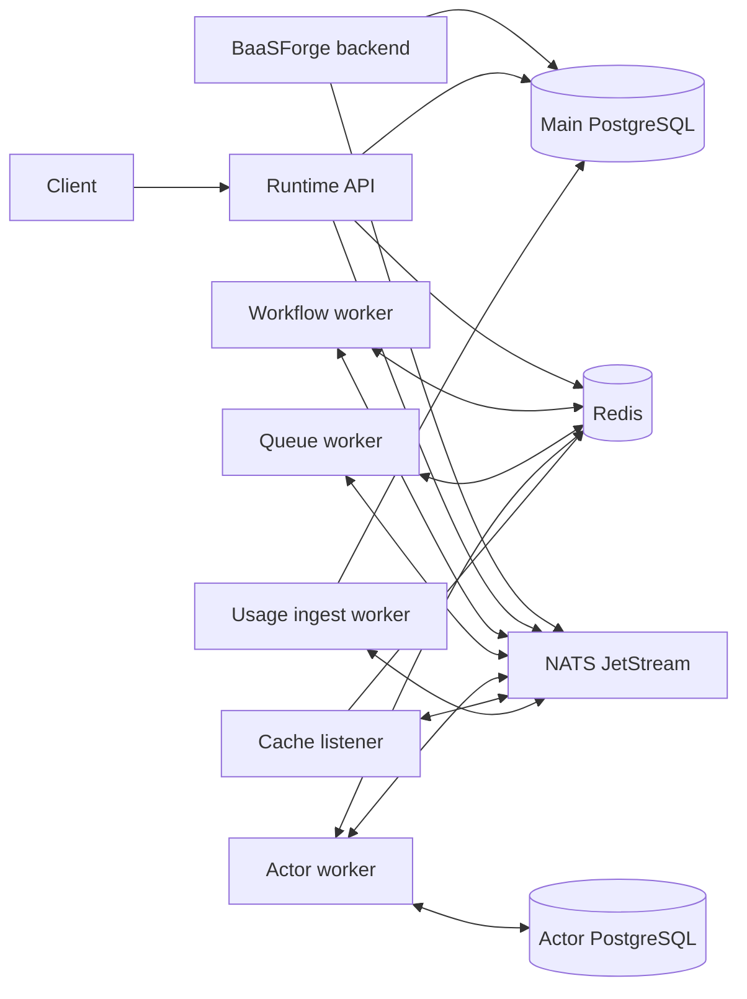

# Runtime architecture

## Repository role

This repository is the BaaSForge execution plane. It loads deployed units and runs them in QuickJS.

The [BaaSForge backend](https://github.com/BaaSForge/baasforge-backend-actix) is the control plane. It owns projects, source code, releases, runtime environment variables, and the main PostgreSQL schema.

`baal` is the former platform name. Existing `baal-*`, `BAAL_*`, `__baal_*`, and `baal.*` identifiers remain for compatibility. New product documentation uses `BaaSForge`.

## Processes

| Process | Responsibility |
| --- | --- |
| `baal-runtime-actix` | Serves HTTP and WebSocket routes. Loads and executes API units. Publishes workflow, queue-worker, and actor work. |
| `workflow_worker` | Consumes workflow wake messages and resumes durable workflows. |
| `queue_worker_worker` | Consumes queued jobs and handles retries, delays, batches, and dead letters. |
| `actor_worker` | Processes actor mailboxes sequentially. Manages state, snapshots, passivation, and alarms. |
| `runtime_cache_listener` | Consumes release and runtime-environment events. Invalidates Redis caches. |
| `usage_ingest_worker` | Consumes usage batches and writes them to the main PostgreSQL database. |

Production runs each process separately. `TEST_MODE` starts the workflow, queue-worker, actor, and optional usage consumers inside the API process. It does not start `runtime_cache_listener`.

## Data and message flow

### PostgreSQL

- `DATABASE_URL` points to the backend-owned database.
- The runtime reads projects, units, releases, and runtime environment data.
- Usage ingest writes metering rows.
- Schema changes for this database belong in the backend repository.

### Actor PostgreSQL

- `ACTOR_DATABASE_URL` points to the runtime-owned Actor database.
- It stores durable actor snapshots and alarms.
- Its migrations are in `migrations/actors/`.

### Redis

Redis stores release and environment caches, workflow state, queue-worker state, and hot Actor state. The logical subsystems can use separate URLs or the same Redis service.

Workflow and Actor data is durable application state. Enable persistence and do not use an eviction policy that can remove active state.

### NATS

NATS JetStream carries durable work:

- release and runtime-environment invalidation events
- workflow wake messages
- queue-worker jobs
- actor mailbox messages
- usage batches

Core NATS subjects carry live workflow, queue-worker, and Actor events for WebSocket subscribers.

## Release cache invalidation

Each project can have at most one production runtime. Redis separates release and unit caches by runtime scope:

- Production: `shared:units:{project_id}:prod:`
- Stage: `shared:units:{runtime_id}:`

The backend must publish release-deploy events through JetStream, not Core NATS. All `runtime_cache_listener` replicas share one durable pull consumer, so JetStream delivers each event to at most one replica.

Each event selects exactly one cache scope:

- A production event selects the project's shared `Prod` scope.
- A stage event must include `runtime_id` and selects only that stage scope. The listener rejects a stage event without `runtime_id`.

For the selected scope, `clear_project_runtime_cache_on_deploy` deletes the cached release and all cached units. Read-through loading refills them on the next request. It does not clear production when a stage changes, or clear sibling stages when one stage changes.

See `src/services/release_listener.rs` and `src/services/project_runtime_cache.rs` for the publisher contract, consumer behavior, and Redis key layout.

## Backend connection contract

Connect this runtime to [baasforge-backend-actix](https://github.com/BaaSForge/baasforge-backend-actix) through these shared interfaces:

1. Set `DATABASE_URL` to the same main PostgreSQL database.
2. Point both applications to the same NATS service.
3. Keep the release and runtime-environment stream and subject settings equal.
4. Set the same `RUNTIME_PRIVATE_API_KEY` on both applications.
5. Configure the backend to reach the runtime HTTP endpoint. Use `http://localhost:1500` for the scaled local setup.

The private runtime routes require the `x-private-api-key` header. Public API-unit trigger routes do not use this header.

This repository does not configure the backend. Follow the backend repository for its own setup.

Public REST and WebSocket payloads use `snake_case`. See [API and development conventions](conventions.md) before changing a contract or injected QuickJS SDK code.

## Unit execution

1. A trigger reaches the API process.
2. The runtime resolves the project, stage, release, and unit from PostgreSQL and Redis.
3. It creates a QuickJS context and installs supported modules and SDK host functions.
4. It evaluates the compiled JavaScript.
5. API units return directly. Durable and asynchronous unit types publish work through NATS and store state in Redis or Actor PostgreSQL.

The implemented unit types are:

- API
- durable workflow
- queue worker
- Actor

## Environment data

Runtime environment variables are stored encrypted in the main database. The runtime decrypts them during unit execution and caches the result in Redis. The cache listener removes stale entries after backend updates.

## Tests

Product tests are under `units/`. They run real QuickJS unit code and infrastructure through `TEST_MODE`. Rust helper tests run through `./test.sh`.

See [Testing](testing.md) for suite coverage and limits.
