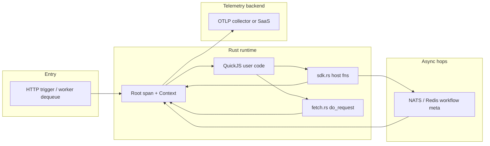

# Central tracing and logging — technical plan

## Goals and constraints (from product)

- **Multi-tenant topology**: projects → runtimes (stage/production) → units (API, queue worker, workflow, actor, …) with cross-unit calls forming one logical request path.
- **End-to-end correlation**: one trace/correlation identity from the entry unit through all downstream units; visible in a future monitoring UI.
- **No new “platform log format”**: storage, field names, and wire formats should follow an existing industry standard so third-party tools and future you are not maintaining bespoke semantics.
- **Zero unit-author instrumentation**: all automatic capture (inputs/outputs/metadata) happens in the **Rust** runtime, not in QuickJS user code. QuickJS remains execution-only; [`src/libs/unit_js/modules/sdk.rs`](src/libs/unit_js/modules/sdk.rs) host functions and [`src/libs/unit_js/modules/fetch.rs`](src/libs/unit_js/modules/fetch.rs) are the natural choke points (aligned with [`src/libs/unit_js/README.md`](src/libs/unit_js/README.md): injected `sdk.*` proxies to `__baal_*`, internal routes are not used from SDK).
- **Non-blocking export**: span/log export must not hold up unit work (batch/async processor, bounded queues, drop-on-pressure policy).
- **Flexible dashboard**: backend/dashboard should consume **vendor/collector query APIs** or standard trace JSON, not a locked-in proprietary wrapper—UI builds on returned trace trees.

## Standard stack (do not reinvent)

| Layer | Standard / tool | Role |
|--------|------------------|------|
| Identity & HTTP propagation | [W3C Trace Context](https://www.w3.org/TR/trace-context/) (`traceparent`, `tracestate`) | Same as browsers, gateways, and every major APM. |
| Telemetry model & wire | [OpenTelemetry](https://opentelemetry.io/) — traces, (optional) logs/metrics, **OTLP** export | Single vendor-neutral model; protobuf/JSON OTLP to collector or SaaS. |
| Semantic meaning | [OpenTelemetry semantic conventions](https://opentelemetry.io/docs/specs/semconv/) (HTTP, messaging, FaaS-style attributes) | Attribute names for method, status, URLs, etc.—not invented strings. |
| In-process API (Rust) | `opentelemetry` + `opentelemetry_sdk` + `opentelemetry-otlp` | Official SDK; batch span processor for async export. |
| Bridge from existing code | [`tracing`](https://docs.rs/tracing) + `tracing-opentelemetry` (optional) | You already use `tracing` in [`src/lib.rs`](src/lib.rs) (`init_tracing`); bridge spans/logs to OTel instead of replacing all call sites at once. |

**Why OpenTelemetry over ad-hoc JSON, “correlation_id + ELK mapping”, or Zipkin-only?** OTel is the de-facto convergence layer: every serious backend (Tempo, Jaeger, Datadog, Honeycomb, New Relic, Grafana Cloud, etc.) ingests **OTLP** or maps from it. Zipkin is a subset/trace format you can still **export to** from OTel if needed.

## Options for where telemetry lands (pick one deployment, same code path)

1. **OpenTelemetry Collector → OSS storage**  
   Collector receives OTLP → Tempo (traces) + Loki or Elasticsearch (logs, if you correlate by `trace_id`). **Query**: Grafana Tempo API / TraceQL, or Jaeger UI API. **Pros**: portable, no vendor lock-in. **Cons**: you operate collector + storage.

2. **Vendor SaaS (Datadog, Honeycomb, New Relic, Grafana Cloud, etc.)**  
   Runtime sends OTLP (often via collector sidecar). **Query**: vendor HTTP APIs or Grafana. **Pros**: minimal ops, built-in retention/alerting. **Cons**: cost, terms.

3. **Hybrid**  
   Collector fans out to cheap long-term store + vendor for alerting.

**Architectural decision**: implement the **runtime** against OTLP + W3C propagation only; choose Tempo vs vendor via config (endpoint + headers). Do not embed vendor-specific SDKs in application code if OTLP suffices.

## How context flows (big picture)

- **Root span**: created at true entrypoints (e.g. Actix request after middleware, queue consumer handling one message, workflow/Actor runner dispatch). Extract `traceparent` from incoming HTTP when present; otherwise start a new trace (standard behavior).
- **HTTP response correlation (entry only)**: for synchronous responses from public **`/api/v1/...`** triggers (API units and any unit type exposed that way), the runtime sets response headers so callers never depend on unit code:
  - Prefer echoing full **`traceparent`** (W3C) on the response when you want strict standard compliance.
  - Optionally add **`X-Trace-Id`** (or `X-Request-Trace-Id`) carrying the **32-hex-character OpenTelemetry `trace_id`**—same identifier the backend stores and the dashboard queries; this is a transport convenience header, not a new identity format (the value is the standard trace id).
  - Pick one canonical header name for your API docs; avoid inventing a second id scheme—header value must match the span’s `trace_id`.
- **In-process SDK calls** ([`sdk.rs`](src/libs/unit_js/modules/sdk.rs)): parent `Context` is whatever is active when the host function runs; each `host_*` creates a **child span** (name = SDK operation + target unit path). No JS changes: context is whatever Tokio/blocking task already carries (today you use `block_async` / async paths—attach context at spawn boundaries).
- **Cross-process / cross-runtime `fetch`** ([`fetch.rs`](src/libs/unit_js/modules/fetch.rs)): **inject** W3C `traceparent` (and optional `tracestate`) into outgoing headers in Rust before `ureq` sends; optionally parse response for server-driven context if you control the callee.
- **Async hops (NATS, Redis workflow metadata, internal subjects)**: **serialize** W3C `traceparent` (and optional `tracestate`) into message JSON where the runtime controls the publisher ([`workflow_engine`](src/services/workflow_engine.rs) wake payloads, SDK NATS payloads, etc.). The consumer uses OpenTelemetry **remote parent** so the consumer span continues the **same** `trace_id` when propagation is present. See [Durable workflows and correlation](#durable-workflows-and-correlation).

## Automatic logging without unit code

- **Spans** (primary): one child span per SDK host invocation (and optionally per HTTP `fetch`), with attributes: `project_id`, `runtime_id` / stage, `caller_unit_path`, `callee_unit_path`, `unit_instance_id`, handler name, **payload size** or **non-sensitive hash** (avoid logging secrets/PII by default; policy is a product decision).
- **Events or structured logs**: attach span events or use `tracing` fields that the OTel bridge maps to **OTel logs** with `trace_id` / `span_id` so log viewers correlate with traces (standard pattern).
- **Implementation style**: a thin internal wrapper (macro or generic function) around each `host_*` body: enter span → record sanitized I/O → `try/finally` end span; export path stays in OTel SDK.

## Fire-and-forget from Rust

- Use OpenTelemetry’s **batch span processor** (and batch log exporter if enabled): exports on a background worker with bounded queue; configure **max queue size** and **export timeout** so overload degrades by dropping telemetry, not user requests.
- Do not perform synchronous network I/O on the hot path beyond enqueueing.

## Local / dev telemetry stack (Docker)

- Add a **`docker-compose.yml`** (or sibling compose file) in the repo—not a custom “tracing server” image—using **official** images only, for example:
  - **OpenTelemetry Collector** (`otel/opentelemetry-collector-contrib` or distroless variant): receives OTLP from the runtime (`4317` gRPC / `4318` HTTP), processors, exporters.
  - **Trace backend**: **Grafana Tempo** or **Jaeger** all-in-one (both accept OTLP from the collector or directly).
  - Optional: **Grafana** UI + **Loki** if you also want log browsing correlated by `trace_id`.
- Document in [`docs/running.md`](docs/running.md) (or deploy README): which compose profile, ports, and env vars (`OTEL_EXPORTER_OTLP_ENDPOINT`, etc.) point the Actix binary at the collector.
- **No bespoke Dockerfile** required unless you later bundle config; bind-mount a **collector YAML** from the repo. Keeps maintenance on upstream images and version bumps only.

## Dashboard and “bring your own UI”

- Persist/query using the **backend’s native trace model** (Tempo/Jaeger/vendor JSON). Your dashboard service calls those APIs with `trace_id` (or TraceQL) scoped by **resource attributes** you set (`service.namespace` = project, `deployment.environment` = runtime, etc.—all standard attribute keys).
- Avoid introducing a parallel “BAAL trace JSON” unless it is a thin projection of OTLP/Jaeger for one screen; the source of truth remains OTel-compatible blobs/APIs.

## Relationship to existing `tracing::` calls

- Keep `init_tracing` for local/dev if desired; in production, add an **OTLP layer** (or replace subscriber with `tracing-subscriber` registry + OTel + fmt for dev).
- Long term: prefer one pipeline (OTel) so stdout and vendor stay consistent.

## Key risks to decide explicitly (not implementation detail, but policy)

- **PII / payload logging**: default to size + type + ids; opt-in redaction lists or “never log body” for production.
- **Context across durable workflow suspend/resume**: Baal’s default is **same trace** via `traceparent` on wake messages. If you need a **separate** consumer trace (e.g. cap tree size), set `BAAL_OTEL_ASYNC_CONSUMER_TRACE_MODE=split` — consumer becomes a new root with an OTel **link** to the producer span; the dashboard must pass `links` when explaining causality to an LLM.
- **Multi-binary deployment** ([`src/bin/actor_worker.rs`](src/bin/actor_worker.rs), [`queue_worker_worker.rs`](src/bin/queue_worker_worker.rs), etc.): each binary initializes the same OTel resource (`service.name` per binary) + shared attribute `baal.project_id` so traces stitch in the backend.

## Summary decision

**Standard**: W3C Trace Context + OpenTelemetry traces (and optionally logs) exported via **OTLP**.  
**Implementation surface**: Rust only—Actix middleware + runners + **`sdk.rs` / `fetch.rs`** wrappers + async message metadata; **`/api/v1/...`** responses expose **`traceparent`** and/or **`X-Trace-Id`** (hex `trace_id`) for dashboard/clients.  
**Operations**: OTLP endpoint (collector or SaaS); **docker-compose** with official Collector + Tempo/Jaeger (+ optional Grafana/Loki) for local dev; query with **their** APIs for a flexible UI.  
**Non-goals**: defining a custom trace/log schema; implementing exporters in QuickJS; blocking user handlers on telemetry I/O.

## Durable workflows and correlation

Industry practice (OpenTelemetry, Temporal-style systems):

| Approach | Use when | Baal default |
|----------|----------|----------------|
| **Same `trace_id` + parent/child** | You propagate W3C context across async delivery (HTTP → JetStream wake → `drive_workflow` → SDK). One narrative for humans and **LLM** tools. | **Yes** — wake/start payloads include `traceparent` when the publisher had an active context. |
| **Span links** (`links[]` in OTLP) | Producer span ended, fan-in batches, or you **choose** a new consumer trace but need causality to the producer. | **Optional** — set `BAAL_OTEL_ASYNC_CONSUMER_TRACE_MODE=split` (see below). |
| **Custom “related trace id” only** | Legacy stacks. | **Avoid** — prefer standard `trace_id` / `parent_span_id` / `links`. |

Workflow sleeps/resumes: the engine injects `traceparent` onto scheduled **wake** messages ([`wake_jetstream_payload_in_trace_carrier`](src/services/workflow_engine.rs)) so a timer resume stays on the **same** trace as the original `/api/v1/trigger/...` request when possible.

## Async unit triggers (NATS): consumer spans and propagation

HTTP `/api/v1/...` and in-process SDK work stay on **one trace** when context is attached. For JetStream deliveries (actor mailbox, queue worker run, workflow `start` / `wake`), the runtime builds a **`SpanKind::Consumer`** span (tracer `baal.async_consumer`):

- **Default (`BAAL_OTEL_ASYNC_CONSUMER_TRACE_MODE` unset or not `split`)**: if the message JSON contains a valid W3C `traceparent`, the consumer span uses OpenTelemetry **remote parent** — it is a **child** of that producer span and shares the **same `trace_id`**. This matches durable-orchestration expectations (Temporal-style “one trace for the logical run”).
- **`BAAL_OTEL_ASYNC_CONSUMER_TRACE_MODE=split`**: the consumer span is a **new trace root** and includes an OTel **span link** to the producer `SpanContext` when `traceparent` was present. Duplicate search tags (`baal.trigger.trace_id`, `baal.trigger.span_id`) still record the producer ids. Use when you want to **isolate** consumer duration in a separate trace tree (dashboards / LLM prompts must include `links` to explain cross-trace causality).

**Span attributes (search / LLM-friendly):**

| Attribute | Meaning |
|-----------|---------|
| `baal.trigger.source` | `actor_mailbox`, `queue_worker`, `workflow_start`, `workflow_wake`, `internal_alarm`, etc. |
| `baal.trigger.trace_id` | 32-hex trace id from the producer’s `traceparent` when present (stable across NATS redeliveries). |
| `baal.trigger.span_id` | 16-hex span id from that `traceparent` when valid. |
| `baal.otel.async_consumer.trace_mode` | `split` only when split mode is enabled. |
| `messaging.system` | `nats` when the message subject is known. |
| `messaging.operation` | `receive` for consumers. |
| `messaging.destination.name` | JetStream subject (e.g. `wf.{project}.{instance}.wake`). |
| `baal.unit.path` | Workflow / actor / queue worker unit path when known. |
| `baal.workflow.instance_id` | Workflow instance id for `workflow_start` / `workflow_wake`. |
| `baal.workflow.wake.reason` | Wake JSON `reason` when present (`sleep_elapsed`, `promise_resolved`, …). |
| `baal.actor.instance_id` | Actor instance id when known. |
| `baal.queue_worker.run_id` | Queue worker run id when known. |

**Internal alarms** (no NATS payload): new root consumer span with `baal.trigger.source = internal_alarm`; optional `baal.unit.path` / `baal.actor.instance_id` on the span.

**NATS redelivery:** payload should keep the original `traceparent`; `baal.trigger.trace_id` stays stable across attempts. With default mode, redelivered work remains the **same** trace.

**Example queries:** TraceQL-style `baal.trigger.trace_id == "<32-hex>"`; Jaeger tag `baal.trigger.trace_id=<hex>`.

## LLM / dashboard export contract

When the dashboard sends trace data to an **LLM** for debugging, prefer a **deterministic, low-noise** projection of OTLP/Jaeger data (not a second bespoke telemetry schema):

1. **Order spans** by start time; include `trace_id`, `span_id`, `parent_span_id`, span `name`, duration, and **status**.
2. **Sort attribute keys** alphabetically in JSON objects sent to the model to reduce run-to-run ambiguity.
3. **Token safety**: strip or truncate large attributes (e.g. HTTP body previews from [`http_trace`](src/middlewares/http_trace.rs)); keep **lengths**, **status codes**, and **stable ids** (`baal.workflow.instance_id`, `baal.unit.path`, `baal.trigger.source`).
4. **Prefer standard OTel names** (`http.*`, `messaging.*`, `server.*`) plus the **`baal.*`** keys above so models grounded on OpenTelemetry docs infer meaning.
5. **Optional digest line** (dashboard-generated): one short sentence built from ordered span names — e.g. `http.server.request → baal.consumer.workflow.wake → sdk.callActor` — as a **preamble** before span JSON improves LLM answers without changing the runtime.

References: [OpenTelemetry semantic conventions](https://opentelemetry.io/docs/specs/semconv/), [W3C Trace Context](https://www.w3.org/TR/trace-context/), Temporal observability (context via headers for workflow/activity continuity).
