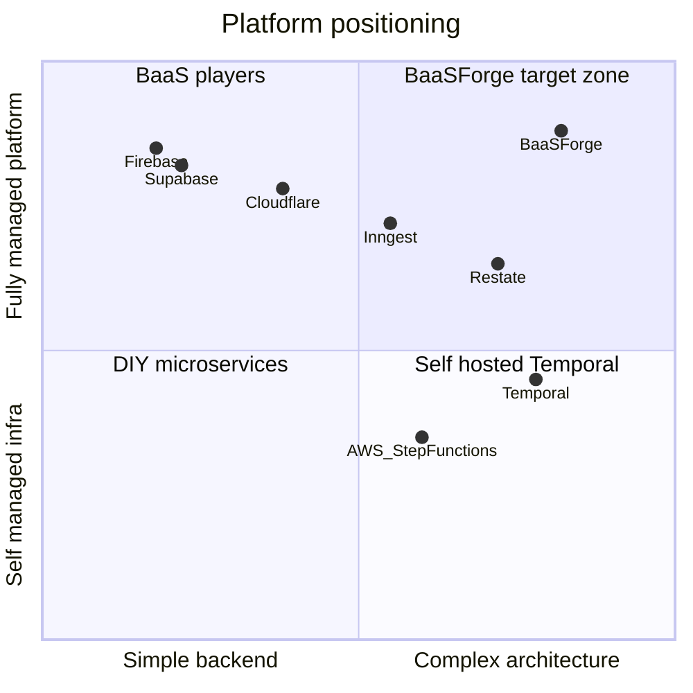
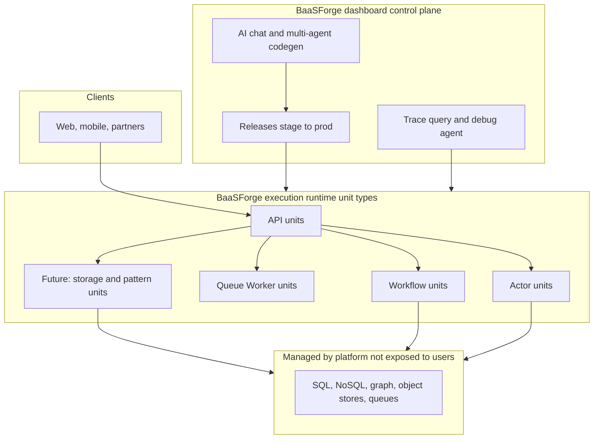

# BaaSForge Platform Positioning

## One-liner

**BaaSForge is Backend architecture platform** — a managed application runtime where distributed system patterns (workflows, queue workers, actors, APIs) are typed **units** in a bounded architecture, not infrastructure projects you assemble yourself.

**Supporting line:** Supabase exposes Postgres. Temporal exposes a workflow engine. BaaSForge exposes **backend behaviors** — through unit types that normalize storage and compute, so you don't assemble a stack.

---

## Full platform stack

BaaSForge is two systems working as one product:


| Layer               | Role                                                         |
| ------------------- | ------------------------------------------------------------ |
| **Control plane**   | Dashboard API, auth, chat/AI, releases, billing, trace query |
| **Execution plane** | Unit runtime, workflow/queue/actor workers, traces export    |


Users interact with the **dashboard**; code runs on **managed runtimes** (stage + prod per project).

## The category problem

BaaSForge gets compared to different products depending on which feature a buyer sees first. That creates confusion:


| If we say…                 | Buyer thinks…                     | Reality                                                              |
| -------------------------- | --------------------------------- | -------------------------------------------------------------------- |
| "Supabase-like"            | Raw Postgres + REST + RLS         | We abstract data through **unit types**, not database APIs (planned) |
| "Temporal-grade workflows" | Workflow engine for microservices | Workflows are one unit type among many                               |
| "You need Postgres too"    | BaaSForge is one layer in a stack      | **Wrong** — goal is one platform for the full backend app            |
| Both in one pitch          | Unclear product                   | We're in a third category: **behavior-first architecture platform**  |


**We are not a BaaS (expose-the-database) and not a workflow engine.** We are a **backend architecture platform** — compute and storage expressed as unit types and SDK behaviors, not as a tech stack the user operates.

---

## Where we sit

### Two axes

Coordinate map:




- **vs Supabase:** different **philosophy** — they expose Postgres deeply; we hide storage engines behind unit types and behaviors. Not "use both."
- **vs Temporal:** we're **up** (managed platform + multiple primitives), not a simpler workflow tool.

### Stack layers

**Important:** BaaSForge is designed to be the **only backend platform** you need. You do not pair it with Supabase or a user-managed Postgres for a complete app. Under the hood we may run SQL, NoSQL, or graph stores — but users never get a "Postgres API"; they get **unit types** and SDK primitives matched to backend patterns.




**BaaSForge owns control plane, execution, and (over time) all persistence patterns** — normalized into unit types, not vendor APIs.

**Temporal / DIY workers** are what teams bolt on when logic outgrows simple functions — BaaSForge replaces that glue as a single platform.

---

## Storage and data philosophy (critical)

This is the main difference from Supabase, Firebase, and "infrastructure catalogs" that hand you raw clients.

### What Supabase does

Exposes the **tool**: Postgres tables, SQL, RLS, PostgREST, GraphQL, Storage buckets. The developer thinks in **Postgres** and wires auth to rows.

### What BaaSForge does (and will do)

Exposes **backend behaviors** through **new unit types** and SDK primitives — each type may imply a storage model or compute model, but the user never operates Postgres/Neo4j/Redis APIs directly.


| Approach              | Supabase-style                    | BaaSForge-style                                                                              |
| --------------------- | --------------------------------- | --------------------------------------------------------------------------------------- |
| Relational data       | `SELECT` / RLS / REST from schema | Unit type + SDK behavior (e.g. actor state, projections, future record/aggregate units) |
| Graph / relationships | SQL joins or graph extension DIY  | Future unit types for graph-shaped domains — not Cypher queries in user code            |
| Files / blobs         | Storage API + bucket policies     | Future storage behavior units — not S3 paths in user code                               |
| Jobs / async          | pgmq + Edge Functions glue        | Queue worker units (shipped)                                                            |
| Long-running logic    | Cron + state tables               | Workflow units (shipped)                                                                |
| Per-entity state      | Rows + locking                    | Actor units (shipped)                                                                   |


**Design rule:** If a capability needs a new storage or compute model, we create a **unit type** (or SDK primitive on an existing type) over exposing a third-party tool API.

**Why:** The AI agents, linter, dependency graph, and runtime all reason about **units and behaviors** — not arbitrary SQL strings. Hiding engine complexity is what lets one platform cover every backend app shape without the user becoming a DBA or infra engineer.

### Planned engines, not planned APIs

We plan to support SQL, NoSQL, graph, object storage, and messaging **under the platform** — provisioned and scaled by us — the same way workflow state already lives in Redis/NATS without users managing those clusters. What we will **not** ship is "here is your Postgres connection string; write queries."

We have plans for the unit-type roadmap (streams, event sourcing, WebSocket units, etc.) — each adds a **behavior**, not a new vendor SDK surface.

### Today vs vision


|                            | Today                                                                               | Vision                                                                   |
| -------------------------- | ----------------------------------------------------------------------------------- | ------------------------------------------------------------------------ |
| Compute patterns           | api, workflow, queue worker, actor units                                            | + stream, WebSocket, schedule/event triggers, saga/state-machine helpers |
| Persistence in user code   | Actor state, workflow checkpoints — via SDK                              | Full storage patterns as unit types; no external DB product required     |
| End-user auth / files      | Roadmap                                                                             | Platform-native behavior units or SDK tiers — not "go use Supabase Auth" |
| External Supabase/Postgres | **Not required** for positioning; some teams may still attach one during transition | **Not the target architecture**                                          |


**Do not tell readers:** "Run BaaSForge for logic and Supabase for data."  
**Do tell readers:** "BaaSForge is the backend — behaviors and storage patterns as units, engines managed underneath."

## AI-native platform (major differentiator)

Most competitors give you primitives **or** an AI that writes generic code. BaaSForge connects **both**: the LLM is grounded in our unit types, SDK and runtime behavior — not a bolt-on copilot.

### What the AI does


| Capability                             | How it works                                                                                                                                                                                                                               |
| -------------------------------------- | ------------------------------------------------------------------------------------------------------------------------------------------------------------------------------------------------------------------------------------------ |
| **Multi-agent chat**                   | Planner → Architecture Analyzer → Solution Analyzer → Developer → (optional) Observability Analyzer. Each agent has its own context and tools; only consolidated results return to the Planner.                                            |
| **Runtime-aware codegen**              | Developer agent uses `create_unit` / `modify_unit` / `remove_unit` with gated discovery (must load contexts, units, env keys before mutating). Prompts and examples are per unit type (`api`, `workflow`, `queue_worker`, `actor`).        |
| **Pre-deploy validation gate**         | No unit row is written until **compiler** (typescript / tsgo) → **lint** (oxc/tsgolint) → **rule check** pass in the `unit_technical_reviewer` worker. LLM output is never trusted blindly.                                                |
| **Chat-scoped releases**               | Releases are born in chat sessions; stage before prod; session snapshots the production baseline at chat creation with stale-base warnings. Deploy by one click. You have git-like release history and the ability to rollback on history. |
| **Production/stage debugging via LLM** | **Observability Analyzer AI** calls `fetch_release_traces` — pulls Traces spans for a release, masks secrets, combines with live unit definitions. Explains what happened when a unit triggered, not just static code review.                 |


### vs others on AI


|                                 | Supabase AI / MCP        | Temporal            | Cursor / generic AI              |
| ------------------------------- | ------------------------ | ------------------- | -------------------------------- |
| Writes backend units            | No (SQL, Edge Functions) | No                  | Generic TS; no platform contract |
| Knows workflow/actor/worker SDK | No                       | N/A                 | Unless you paste docs            |
| Validates before save           | No                       | N/A                 | Local lint only                  |
| Debugs from production traces   | Logs, not agentic AI     | Workflow history UI | No runtime integration           |
| Deploys to managed runtime      | Edge deploy              | You operate workers | No                               |


**Pitch:** "The AI doesn't just write code — it writes **your** architecture, validates it against **your** rules, ships it to **your** stage or production, and explains failures from **your** realtime stage or production traces / logs."

---

## Core primitive: the unit

Every capability — **compute or storage** — is a **unit**.

**Unit types are the abstraction boundary.** New engines (SQL, document, graph, object) appear as **new types or SDK behaviors**, not as leaked vendor APIs.


| Unit type               | Role                               | Computation / storage model               |
| ----------------------- | ---------------------------------- | ----------------------------------------- |
| `api`                   | HTTP entry points                  | Request-scoped, synchronous               |
| `workflow`              | Durable orchestration              | Multi-step, crash-resilient, long-running |
| `worker` (queue worker) | Background jobs                    | Pull-based, retry/DLQ/batch               |
| `actor`                 | Stateful entities                  | Per-instance mailbox, persisted state     |
| *planned*               | Streams, WebSocket, projections, … | New behaviors — each type owns its model  |


## vs Supabase

### What Supabase is

A **Backend-as-a-Service** built around **exposing Postgres**: Auth, Storage, Realtime, auto-generated REST/GraphQL, Edge Functions, Cron, Queues (pgmq), Vector (pgvector), Studio, CLI. The product **is** the database surface.

### Relationship: different product category — not a stack pair

**Do not position BaaSForge as "Supabase + BaaSForge."** Supabase optimizes for **direct data access**. BaaSForge optimizes for **backend behaviors** abstracted into unit types. Over time, BaaSForge is intended to be **sufficient alone** for implementing any backend app — without the user operating Postgres, Supabase, or another data vendor.

**Contrast:**


| Question                       | Supabase                          | BaaSForge                                                  |
| ------------------------------ | --------------------------------- | ----------------------------------------------------- |
| What does the developer write? | SQL, RLS policies, REST consumers | Nothing, all "Units + SDK calls" are written by AI.   |
| How is data stored?            | User models tables explicitly     | Platform's AI picks engine; user models **behaviors** |
| Mental model                   | "My Postgres project"             | "My bounded contexts and unit graph"                  |
| AI writes                      | SQL migrations, Edge Functions    | Validated units per type with architecture agents     |


### Comparison


| Dimension                    | Supabase                                 | BaaSForge                                                                                                     |
| ---------------------------- | ---------------------------------------- | -------------------------------------------------------------------------------------------------------- |
| Core primitive               | Table / row                              | Unit (compute + future storage-pattern types)                                                            |
| Primary value                | Exposed database + client APIs           | Normalized backend architecture + behaviors                                                              |
| Data access style            | SQL, RLS, generated REST/GraphQL         | SDK + unit types — no raw engine queries                                                                 |
| Long-running processes       | DIY (Edge Functions + Cron + Queues)     | Native workflow units                                                                                    |
| Human-in-the-loop wait       | Status column + polling or external tool | Native human-in-the-loop supported by workflow units.                                                    |
| Stateful serverless entities | Postgres rows + app locking              | Actor units                                                                                              |
| Rich job processing          | pgmq queues                              | Queue worker units                                                                                       |
| Auth / files / vector        | First-class Postgres-centric features    | Roadmap as **behavior units / SDK** — not third-party Auth/Storage                                       |
| Architectural structure      | Flat Edge Functions                      | Bounded contexts + dependency graph + multi-agent AI understanding all your units and their relationship |
| Full backend app alone?      | Strong for CRUD/data-centric apps        | **Target:** any backend app without a separate data platform                                             |


### Where Supabase wins (today)

- Mature **exposed** Postgres DX: SQL editor, RLS, instant REST, Storage CDN
- Ship table-centric CRUD + auth + files **right now** without waiting on BaaSForge storage new unit types
- pgvector / RAG colocated with SQL
- Huge ecosystem, SOC2, global regions

### Where BaaSForge wins

- **Behavior-first** backends: orchestration, entities, jobs — not table wiring
- Multi-step fulfillment, billing, dunning without Temporal + Postgres DIY
- Per-entity compute (actors) without race-prone row locking
- AI that writes **units**, validates, deploys, and debugs from **production traces**
- **Vision:** one platform for every backend app shape — engines hidden, patterns explicit

### When to choose which


| Choose **Supabase** if…               | Choose **BaaSForge** if…                                 |
| ------------------------------------- | --------------------------------------------------- |
| You want direct SQL/RLS control today | You want architecture and behaviors, not engine ops |
| App is mostly CRUD + auth + files     | App is process-heavy, multi-pattern, or AI-built    |
| You think in tables and API rows      | You think in contexts, workflows, actors, workers   |


Not: "use both." That's a transition convenience, not the product story.

---

## vs Temporal

### What Temporal is

A **durable workflow engine**: crash-safe orchestration, activities, signals, timers. Best-in-class for long-running business processes. You bring workers, hosting, HTTP layer, job queues, and service structure.

### Relationship: superset on platform, peer on workflows

Don't claim "better workflows than Temporal." Claim **Temporal-class durability plus workers, actors, APIs, and architecture — fully managed.**

### Comparison


| Dimension         | Temporal                      | BaaSForge                                                                               |
| ----------------- | ----------------------------- | ---------------------------------------------------------------------------------- |
| Scope             | Workflow engine               | Full application runtime                                                           |
| Primitives        | Workflow + Activity           | api, workflow, worker, actor unit types                                            |
| Language          | Go, Java, TS, Python, etc.    | JavaScript/TypeScript units (QuickJS) - AI written, no need to write code yourself |
| HTTP entry        | You wire gateways             | API units with public trigger URLs                                                 |
| Background jobs   | Activities or separate system | Queue worker units                                                                 |
| Stateful entities | External store + conventions  | Actor units                                                                        |
| Project structure | Your repos/packages           | Domain-Driven Design + dependency graph supported as a primary built-in            |
| Operations        | You run workers/clusters      | Platform runs API + workflow + queue + actor workers                               |
| AI scaffolding    | None                          | Dashboard agent + unit conventions                                                 |


### Where Temporal wins

- Deepest workflow feature set (signals, queries, versioning, multi-namespace)
- Battle-tested at extreme enterprise scale
- Polyglot workers
- Huge community and hiring pool

### Where BaaSForge wins

- Teams that need workflows **and** HTTP **and** jobs **and** actors without operating Temporal + separate queues
- Teams wanting one deployment model and want to skip infra and CI / CD setup
- Opinionated architecture for large codebases (Domain-Driven Design, units dependencies graph)
- Managed platform — no cluster ops

---

## vs other peers

### Inngest / Hatchet

**Category:** Durable serverless / step functions for developers.


|                   | Inngest / Hatchet              | BaaSForge                                                       |
| ----------------- | ------------------------------ | ---------------------------------------------------------- |
| Focus             | Event-driven functions + steps | Multi-pattern units + bounded architecture                 |
| Stateful entities | Limited / external             | Actor units                                                |
| Differentiator    | Great DX for step functions    | Workflows + workers + actors + AI scaffolding in one model |


**When to win:** Buyer needs more than step functions — entity state, explicit architecture, thousands of units.

### Restate / Cloudflare (Durable Objects + Workflows)

**Category:** Durable execution + stateful serverless at the edge.


|                      | Restate / Cloudflare         | BaaSForge                                              |
| -------------------- | ---------------------------- | ------------------------------------------------- |
| Stateful compute     | Virtual objects / DO         | Actor units                                       |
| Workflows            | Yes (fragmented on CF)       | Workflow units                                    |
| Architecture opinion | Minimal                      | Strong (contexts, modules, units dependencies)    |
| Runtime              | Rust/WASM edge / V8 isolates | QuickJS in managed Rust runtime                   |
| Differentiator       | Edge latency, CF ecosystem   | Full backend architecture platform, not edge-only |


**When to win:** Buyer wants a **backend architecture platform**, not edge functions with add-ons.

### AWS Step Functions + Lambda

**Category:** Enterprise orchestration DIY.

**When to win:** Same problems (long processes, retries, state) without JSON state machines, six AWS services, and platform team overhead.

---

## Scenarios we own (by market demand)

Scenarios where Supabase has **no first-class primitive** and Temporal only covers **part** of the story. Ordered by how often teams hit these in production.

### 1. Multi-step order / payment fulfillment

Charge → reserve inventory → ship → compensate on failure. Steps must survive crashes and deploys.

**BaaSForge:** Workflow unit with `ctx.run()` and compensation.  
**Others:** Supabase = DIY; Temporal = workflows only (no native HTTP/job/actor layer).

### 2. Human-in-the-loop approvals

Expense, KYC, content moderation — suspend until a human acts, possibly days later.

**BaaSForge:** `ctx.promise().get()` with durable suspension.  
**Others:** Supabase = poll or external orchestrator; Temporal = yes, but rest of stack is DIY.

### 3. Subscription / dunning lifecycle

Trial → charge → failed payment → retry on day 3, 7, 14 → downgrade.

**BaaSForge:** `ctx.sleep()` + step history as platform state.  
**Others:** Supabase = cron + state tables; fragile orchestration logic in app code.

### 4. Rich background job pipelines

High volume, concurrency caps, exponential backoff, DLQ, batch mode, dedupe.

**BaaSForge:** Queue worker units.  
**Others:** Supabase Queues (pgmq) is simpler; Temporal needs separate queue story.

### 5. AI agent / LLM orchestration

Multi-tool runs over minutes; resume after crash without duplicate side effects.

**BaaSForge:** Each tool call = durable workflow step; deterministic replay helpers.  
**Others:** Supabase Edge Functions = single shot; Temporal = viable but no native agent/HTTP/unit model.

### 6. Stateful per-entity compute

Shopping cart, game room, device twin — sequential logic per entity ID.

**BaaSForge:** Actor units with mailbox semantics.  
**Others:** Supabase = Postgres + races; Temporal = not designed for entity model.

### 7. Nested durable orchestration

Parent workflow calls child workflows; parent suspends until children complete.

**BaaSForge:** `sdk.callWorkflow()` with typed contracts.  
**Others:** Supabase = message chaining DIY; Temporal = child workflows (strong) but no unified unit platform.

### 8. Long-running provisioning + external webhooks

Tenant setup, DNS verification, async cloud APIs over hours or days.

**BaaSForge:** Workflow + promises + sleep in one logical process.  
**Others:** Database webhooks fire on row change — they don't orchestrate multi-step lifecycles.

### 9. Sagas across third parties

Book flight + hotel + charge; compensate on partial failure with recorded steps.

**BaaSForge:** Workflow compensation + platform checkpointing.  
**Others:** DIY in any stack; not a platform primitive elsewhere except workflow engines (partial).

### 10. Large typed backend codebases

Hundreds or thousands of functions; AI edits one unit; need impact analysis.

**BaaSForge:** Units can be connected to eachother and AI understands it, each project has a dependency graph of it's units.  
**Others:** Flat serverless or microservice repos without platform-level dependency graph.

---

## Scenarios we're not for (today)

Gaps while storage/auth behavior units are still on the roadmap:


| Scenario                                       | Why not BaaSForge *yet*                | Direction                                             |
| ---------------------------------------------- | --------------------------------- | ----------------------------------------------------- |
| Table-first CRUD MVP with SQL you control      | Storage pattern units not shipped | Future record/aggregate units — not external Postgres |
| Realtime UI synced directly to SQL row changes | No exposed table CDC to clients   | WebSocket/realtime units + actors                     |
| Vector search as raw pgvector                  | No exposed SQL engine             | Future search/RAG behavior units                      |
| Team wants zero platform opinion               | BaaSForge is opinionated by design     | DIY Postgres + Temporal                               |
| Deepest Temporal enterprise features           | Temporal's maturity wins          | —                                                     |


**Not a permanent "send them to Supabase" list** — it's a **today** honesty check. The goal is not to coexist with Supabase forever.

---

## Our powers

### Execution runtime


| Capability                             | Power                                                                                |
| -------------------------------------- | ------------------------------------------------------------------------------------ |
| **Durable Workflow units**             | Temporal-grade: `ctx.run`, sleep, promises, compensation, replay, `sdk.callWorkflow` |
| **Queue Worker units**                 | Retry, DLQ, batch, concurrency, rate limits, dedup, lifecycle events                 |
| **Actor units**                        | Per-entity state, sequential handlers, alarms                                        |
| **API units**                          | HTTP triggers, public URLs, stage/prod runtimes                                      |
| **Bounded contexts**                   | Scales to thousands of units                                                         |
| **Units communicating with eachother** | Reduces the duplicated codes which is critical for large scaled projects             |
| **Debugging**                          | Traces across all units for using on dashboard + debugging by AI                     |


### Platform / dashboard


| Capability                      | Power                                                                                    |
| ------------------------------- | ---------------------------------------------------------------------------------------- |
| **Multi-agent AI chat**         | Planner, Architecture/Solution analyzers, Developer, Observability Analyzer              |
| **SDK-grounded codegen**        | AI have a deep understanding of our ecosystem ; not just generic function snippets       |
| **Technical reviewer pipeline** | Automatic typecheck + lint + project rules check before any unit is persisted            |
| **Chat-tied releases**          | The history of changes are kept with their chats                                         |
| **Managed runtimes**            | Auto-provision stage + prod per project; live release tracking                           |
| **Trace-aware debugging**       | The AI Observability Analyzer is connected to the traces and logs so it can debug easily |
| **Encrypted env vars**          | Per-runtime secrets; keys visible to AI, never values                                    |
| **Documentation share**         | Time-limited read-only project/release links                                             |


### Roadmap (position carefully — not current wedge)

New **unit types** for storage and connection patterns (streams, WebSocket, event sourcing projections), schedule/event triggers, end-user auth and file behaviors as platform primitives — **not** an infrastructure catalog that exposes `postgres.query()` or Neo4j drivers to user code.

---

## Ideal customer profile (ICP)

**Primary:** Teams with **process-heavy** backends who outgrew Edge Functions + cron + queue tables but won't hire a platform team or operate Temporal.

**Signals:**

- Multi-step money flows (billing, fulfillment, payouts)
- Waits for humans or external systems (hours to days)
- Per-entity state (cart, room, tenant provisioning)
- 50–2000 backend functions getting messy
- Evaluating Temporal + separate workers + custom event bus

**Anti-ICP:** Wants raw SQL control and table-first modeling with no interest in unit architecture (Supabase is a better fit **today**).

---

## Messaging guide

### Use everywhere

> BaaSForge is the backend architecture platform — backend behaviors as unit types, not a stack of vendor APIs.

### By audience


| Audience          | Lead with                                                                | Mention                                   |
| ----------------- | ------------------------------------------------------------------------ | ----------------------------------------- |
| Product / founder | "Describe your backend in chat; AI builds, validates, and deploys it"    | Trace debugging when things break in prod |
| Backend engineer  | Unit types, durability, workflows / actors / queue workers               | vs Temporal/Inngest as platform superset  |
| Architect         | Bounded contexts (DDD), unit types for compute **and** storage behaviors | vs Supabase: behaviors not databases      |
| Debugging         | "Ask the AI what happened" with Jaeger traces from stage/prod            | Not just compile-time lint                |


### Retire


| Stop                                | Replace with                                                                 |
| ----------------------------------- | ---------------------------------------------------------------------------- |
| "Supabase-like platform"            | "Behavior-first backend platform — not exposed Postgres"                     |
| "Complements Supabase"              | "Complete backend platform — unit types instead of a separate data vendor"   |
| "Bring your own Postgres"           | "Engines are managed underneath; you write units, not SQL"                   |
| "Replace your backend"              | "The backend platform — architecture, storage patterns, and AI in one place" |
| "BaaS"                              | "Backend architecture platform"                                              |
| "Better than Temporal at workflows" | "Temporal-class durability, plus workers, actors, and structure"             |


### Competitor mention rules

- **Marketing / homepage:** contrast **philosophy** with Supabase (exposed DB vs behavior units) — not "integration partner."
- **Technical sales:** Temporal, Inngest, Restate as **peers** on execution; Supabase as **category contrast** on data.
- **Never** imply BaaSForge requires an external database product to ship a complete backend.

---

## Platform story (default GTM)

```
User describes backend in dashboard chat
        ↓
AI plans architecture → writes validated units
        ↓
Stage → prod release on managed runtime
        ↓
Full backend app (compute + platform-managed persistence patterns)
```

**Pitch:** "One platform for backend apps — behaviors as unit types, engines underneath, AI that builds and debugs from real traces."

**Not:** "Supabase holds your data. BaaSForge runs your logic."

---

## Competitive summary table


| Platform                    | Category              | BaaSForge relationship      | We win when…                                                  |
| --------------------------- | --------------------- | ---------------------- | ------------------------------------------------------------- |
| **Supabase**                | Exposed-database BaaS | Category contrast      | They sell Postgres access; we sell backend behaviors as units |
| **Firebase**                | Exposed-database BaaS | Category contrast      | Same philosophical split                                      |
| **Temporal**                | Workflow engine       | Alternative / superset | Need more than workflows; want managed platform               |
| **Inngest / Hatchet**       | Durable serverless    | Peer                   | Need actors + architecture, not just steps                    |
| **Restate**                 | Durable execution     | Peer                   | Want opinionated unit model + JS units                        |
| **Cloudflare Workers + DO** | Edge compute          | Category contrast      | Backend architecture, not edge-only                           |
| **AWS Step Functions**      | Cloud orchestration   | Category contrast      | Backend architecture, not edge-only                           |
| **Cursor / Copilot**        | Generic AI IDE        | Different layer        | Platform contract + deploy + prod trace debug                 |


---

## Bottom line

BaaSForge is not "Supabase for workflows" and not "Temporal with a UI."

- **Supabase** answers: *How do I expose and query my database?*
- **Temporal** answers: *How do I run one durable workflow engine?*
- **BaaSForge** answers: *How do I build any backend app from behaviors — compute, storage patterns, AI, deploy, debug — without assembling a stack?*

**Category:** Backend architecture platform (behavior-first, not stack-first).  
**Wedge today:** AI-native codegen + durable unit types (api, workflow, worker, actor) + trace-aware debugging.  
**Vision:** The **only** backend tool needed — SQL/NoSQL/graph/object stores managed under unit types, not sold as separate products.  
**Peer comparison:** Temporal / Inngest / Restate (execution); Supabase (philosophical opposite on data exposure).