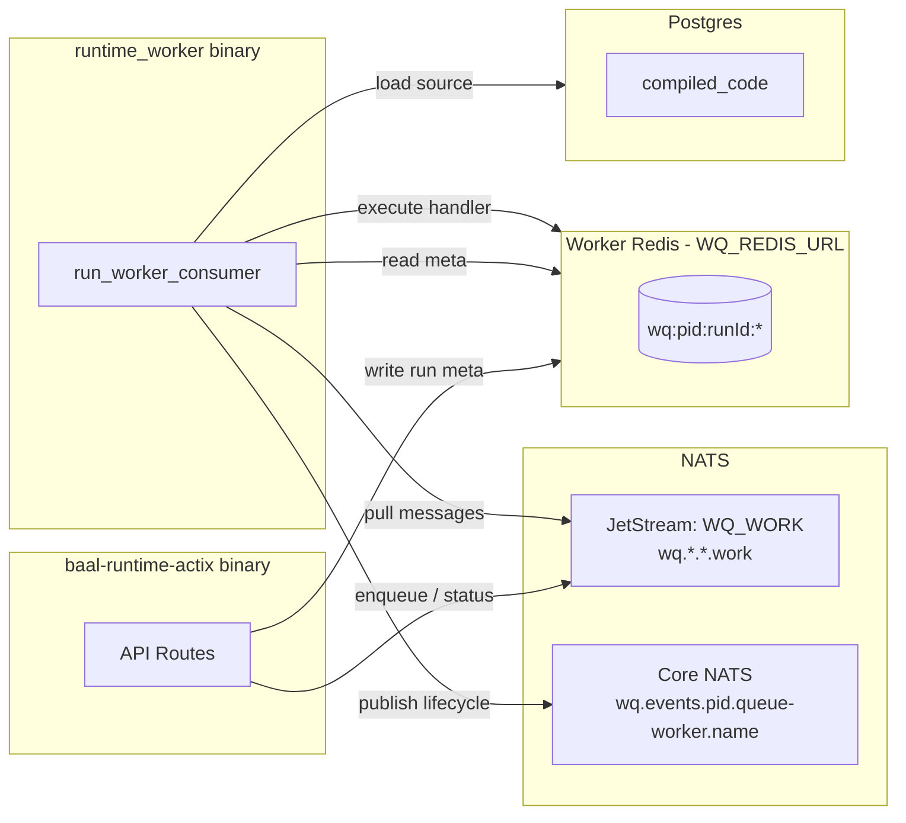
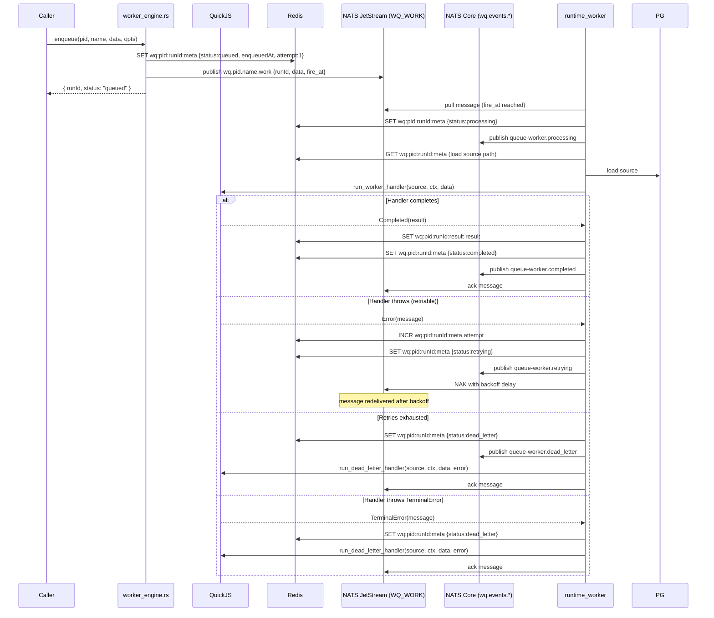
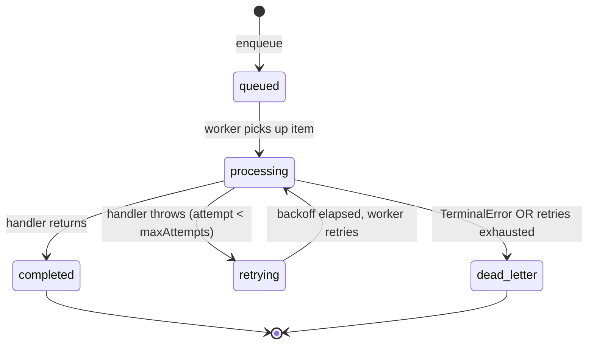

# Queue Worker Internals

## Overview

A queue worker is a stateless JS function that processes items from a durable queue. Unlike workflows, queue workers do not suspend or replay — each run executes from start to finish. The runtime dispatches one item per invocation, handles retries via the NATS JetStream redelivery mechanism, and routes exhausted items to a dead letter handler or dead letter queue.

---

## Process Architecture



> In `test_mode`, the HTTP server also spawns the worker consumer internally.

---

## Lifecycle of One Queue Worker Run



---

## SDK Interface

### `queueWorker<T>()` — simple form

```typescript
import { queueWorker, sdk } from "@sdk";

export default queueWorker<EmailPayload>(async (ctx, data) => {
  await sendEmail(data.to, data.subject);
  return { sent: true };
});
```

### `queueWorker<T>()` — full form (with dead letter handler)

```typescript
import { queueWorker, sdk } from "@sdk";

export default queueWorker<EmailPayload>({
  async process(ctx, data) {
    await sendEmail(data.to, data.subject);
    return { sent: true };
  },
  async onDeadLetter(ctx, data, error) {
    await sdk.callWorkflow("alerts.ops.workflow.notify", {
      worker: "send-emails",
      data,
      error: error.message,
      attempts: ctx.attempt,
    });
  },
});
```

### `sdk.enqueueWorker()` — enqueue from any unit

```typescript
const { runId } = await sdk.enqueueWorker(
  "notifications.comms.queue-worker.send-emails",
  { to: "user@example.com", subject: "Welcome" },
  { delay: { minutes: 5 }, deduplicationKey: `welcome-${userId}` },
);

// From inside a workflow — wrap in ctx.run for durability
await ctx.run("enqueue-email", () =>
  sdk.enqueueWorker("notifications.comms.queue-worker.send-emails", emailData),
);
```

---

## ctx Object

| Property            | Type     | Description                                                  |
| ------------------- | -------- | ------------------------------------------------------------ |
| `ctx.id`            | `string` | UUID for this run                                            |
| `ctx.attempt`       | `number` | Current attempt number (1 on first try, increments on retry) |
| `ctx.enqueuedAt`    | `number` | Unix timestamp (ms) when the item was enqueued               |
| `ctx.TerminalError` | `class`  | Throw to skip retries and go directly to dead letter         |

---

## Metadata

Metadata is static config set per worker in the dashboard. It is NOT part of the enqueue call.

| Field         | Example                                                                                                          | Behavior                                            |
| ------------- | ---------------------------------------------------------------------------------------------------------------- | --------------------------------------------------- |
| `retry`       | `{ "maxAttempts": 5, "initialInterval": { "seconds": 5 }, "maxInterval": { "minutes": 5 }, "backoffFactor": 2 }` | Retry policy for failed runs                        |
| `concurrency` | `10`                                                                                                             | Max simultaneous runs for this worker               |
| `rateLimit`   | `{ "max": 100, "window": "60s" }`                                                                                | Max runs started per time window                    |
| `batch`       | `{ "size": 50, "timeout": "5s" }`                                                                                | Collect items and deliver as array                  |
| `timeout`     | `30000`                                                                                                          | Max execution time (ms) before killing the run      |
| `deadLetter`  | `{ "enabled": true }`                                                                                            | Whether to route exhausted items to `onDeadLetter`  |

---

## HTTP Endpoints

| Method | Path                                                                                 | Behavior                                                                               |
| ------ | ------------------------------------------------------------------------------------ | -------------------------------------------------------------------------------------- |
| `POST` | `/api/v1/trigger/workerQueue/{project_id}/{ctx}/{mod}/{worker_name}`                 | Enqueue data, returns `{ runId, status: "queued" }`                                    |
| `GET`  | `/api/v1/trigger/workerQueue/{project_id}/{ctx}/{mod}/{worker_name}/{run_id}/status` | Returns `{ status: "queued" | "processing" | "completed" | "failed" | "dead_letter" }` |
| `GET`  | `/api/v1/trigger/workerQueue/{project_id}/{ctx}/{mod}/{worker_name}/{run_id}/result` | Returns `{ result }` if completed                                                      |

---

## Enqueue Options

| Option             | Type       | Behavior                                        |
| ------------------ | ---------- | ----------------------------------------------- |
| `delay`            | `Duration` | Don't process until delay has elapsed            |
| `deduplicationKey` | `string`   | Reject if same key is already queued/processing  |

---

## Status Transitions



All status transitions are atomic via Redis Lua CAS (same `transition_status` script used by workflows).

---

## Retry and Dead Letter Flow

```
queued → processing → completed
queued → processing → retrying → processing → ... → completed
queued → processing → retrying → ... → dead_letter  (retries exhausted)
queued → processing → dead_letter                   (TerminalError)
```

**Retry backoff** uses the same exponential formula as workflow step retries:
- `delay = min(initialInterval * backoffFactor^(attempt-1), maxInterval)`
- Default: `initialInterval=1s`, `backoffFactor=2`, `maxInterval=5min`

**Dead letter handler** (`onDeadLetter`) runs synchronously after the run enters `dead_letter`. If the handler throws, the run stays in `dead_letter` — no loop.

**TerminalError** skips all remaining retries and invokes `onDeadLetter` directly on the same attempt.

---

## Cross-Unit Interaction Patterns

```typescript
// Queue worker calling a workflow
export default queueWorker<OrderData>(async (ctx, data) => {
  const result = await sdk.callWorkflow("orders.fulfillment.workflow.process", data);
  await sdk.enqueueWorker("notifications.comms.queue-worker.send-receipt", {
    email: data.customerEmail,
    receipt: result,
  });
  return { processed: true };
});
```

Queue workers can call any SDK primitive: `sdk.callWorkflow`, `sdk.enqueueWorker`, `sdk.emit`. Since queue workers are not durable, side-effectful calls should be idempotent or wrapped in retry-safe logic.

---

## NATS Usage

| Subject | Transport | Direction | Purpose |
|---|---|---|---|
| `wq.*.*.work` | **JetStream** `WQ_WORK` stream | Engine → Worker | Durable work items (initial dispatch + retries) |
| `wq.{pid}.{name}.work` | Same stream | Engine → Worker | Per-worker publish |
| `wq.events.{pid}.queue-worker.{name}` | Core NATS | Worker → Subscribers | Lifecycle broadcast: processing, completed, retrying, dead_letter |

### JetStream Stream: `WQ_WORK`

```
Name:     WQ_WORK  (env: WQ_NATS_JETSTREAM_STREAM)
Subjects: wq.*.*.work
Consumer: wq_work_consumer  (env: WQ_NATS_JETSTREAM_CONSUMER)
          durable, pull, ack_wait=300s, filter_subjects=[wq.*.*.work]
```

The consumer NAKs with the retry backoff delay for retriable failures. For TerminalError or exhausted retries, the consumer acks and the engine writes `dead_letter` status.

---

## Redis Usage

Key pattern: `wq:{project_id}:{run_id}:{suffix}`

| Key | Written by | Read by | Purpose |
|---|---|---|---|
| `wq:{pid}:{runId}:meta` | `enqueue`, `worker_engine` | `get_status`, `worker_consumer` | Run metadata: `status`, `attempt`, `enqueuedAt`, `name` (unit path) |
| `wq:{pid}:{runId}:result` | `worker_engine` on complete | `get_result` | Final return value |
| `wq:{pid}:{runId}:dedup:{key}` | `enqueue` (SET NX EX ttl) | `enqueue` | Deduplication lock; expires when item completes or TTL elapses |
| `wq:{pid}:{runId}:exec_lock` | `worker_consumer` (SET NX EX 300) | `worker_consumer` | Prevents concurrent dispatch of same run |

---

## Atomicity Guarantees

| Concern | Mechanism |
|---|---|
| Duplicate dispatch of same run | Redis `SET NX EX 300` exec lock per `(project_id, run_id)` |
| Concurrent status writes | Lua CAS in `transition_status` |
| Duplicate enqueue with same key | `SET NX` on dedup key — second enqueue sees existing runId |
| Message durability across crashes | JetStream `WQ_WORK` — NAK'd messages survive restart |
| Retry delay precision | Consumer NAKs with remaining delay; NATS server holds message |
