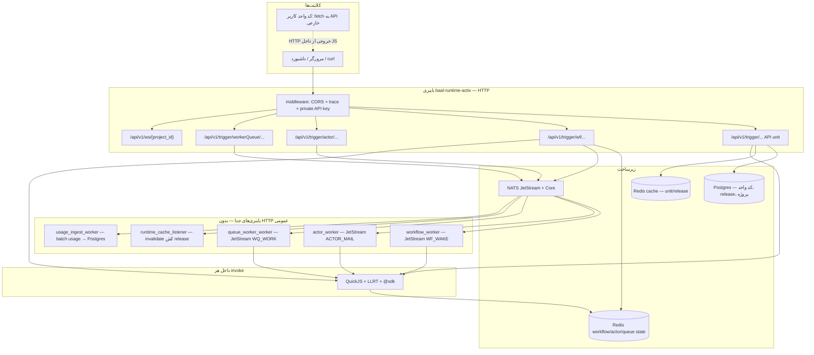
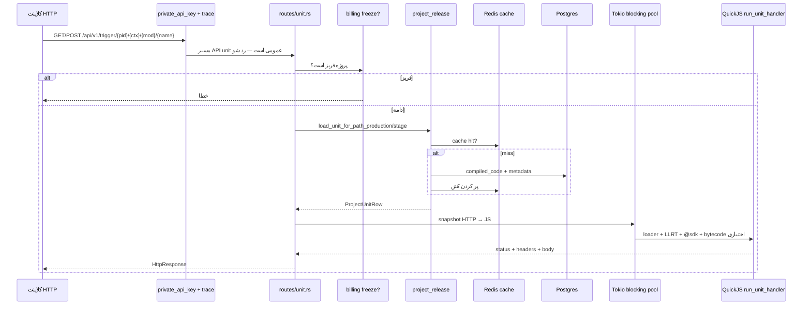
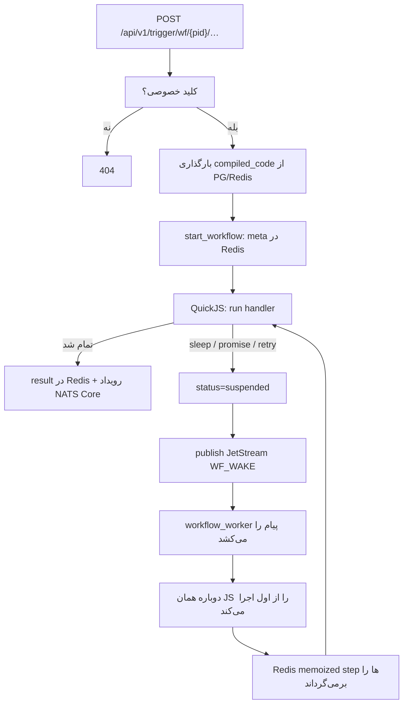
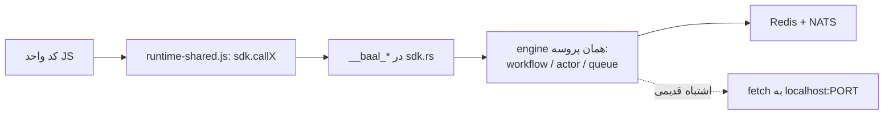
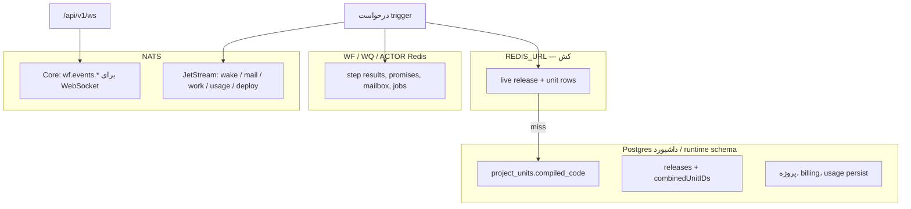
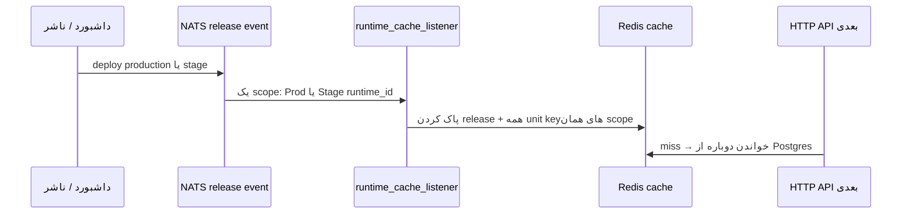

# فرآیند کارکرد Runtime (با فلوچارت)

این سند مسیر واقعی `baal-runtime-actix` را جمع می‌کند: چه چیزی **HTTP** است، چه چیزی **نیست**، و هر باینری چه کار می‌کند.

جزئیات هر unit type در اسناد جداست: [workflow-internals](workflow-internals.md)، [actors-internals](actors-internals.md)، [queue-worker-internals](queue-worker-internals.md)، [running](running.md).

---

## جواب کوتاه: آیا HTTP می‌زنیم؟

**بله، به بیرون سرو می‌دهیم.** باینری اصلی (`baal-runtime-actix`) یک سرور **Actix-web** است. کلاینت خارجی (مرورگر، بک‌اند داشبورد، `curl`) به `/api/v1/...` می‌زند.

**نه، بین unitها HTTP نمی‌زنیم.** وقتی یک unit، unit دیگری را صدا می‌زند (`sdk.callWorkflow`, `sdk.callActor…`, `sdk.enqueueWorker…`) کد JS به `fetch("http://127.0.0.1:…/api/v1/trigger/…")` نمی‌رود. به host functionهای Rust (`__baal_*`) می‌رود و از آنجا Redis / NATS / Postgres.

| جهت | چیست | HTTP؟ |
|---|---|---|
| کلاینت → runtime | trigger عمومی API unit | **بله** — مسیرهای `/api/v1/trigger/{project}/…` عمومی‌اند |
| کلاینت → runtime | workflow / actor / queue / WebSocket | **بله** — ولی با هدر `x-private-api-key` |
| unit → unit داخل پلتفرم | `sdk.*` | **خیر** — Rust host + Redis/NATS |
| کد کاربر داخل unit | `fetch(url)` به اینترنت / API خارجی | **بله** — از LLRT، جدا از SDK داخلی |
| runtime Rust → جای دیگر | `reqwest` در Cargo هست ولی در `src/` استفاده نشده | عملاً **خیر** |
| telemetry | OTLP به `127.0.0.1:4317` | پروتکل trace، نه trigger بیزنس |

قانون تزریق JS: [unit_js README](../src/libs/unit_js/README.md) — «No `fetch()` to internal routes».

---

## تصویر کلی سیستم

شش فرآیند از یک crate. در پروداکشن جدا اجرا می‌شوند. در `TEST_MODE` بعضی workerها داخل همان پروسهٔ API بالا می‌آیند.



---

## باینری‌ها

| باینری | نقش | ورودی اصلی |
|---|---|---|
| `baal-runtime-actix` | سرور HTTP + شروع workflow/actor/queue | درخواست HTTP |
| `workflow_worker` | resume ورکفلوهای معلق | پیام JetStream `WF_WAKE` |
| `actor_worker` | اجرای mailbox اکتر | پیام JetStream `ACTOR_MAIL` |
| `queue_worker_worker` | اجرای job صف | پیام JetStream `WQ_WORK` |
| `runtime_cache_listener` | پاک کردن کش بعد از deploy | رویداد release روی NATS |
| `usage_ingest_worker` | نوشتن usage به DB | JetStream usage batch |

---

## مسیر HTTP ورودی

همه روی `0.0.0.0:{PORT}` (معمولاً `1501`).

```
/api/v1/trigger/{project_id}/{ctx}/{mod}/{unit}          API unit — production
/api/v1/trigger/{project_id}/stage/{runtime_id}/…        API unit — stage
/api/v1/trigger/wf/…                                     workflow start / status / result / cancel / handler
/api/v1/trigger/actor/…                                  actor
/api/v1/trigger/workerQueue/…                            queue worker
/api/v1/ws/{project_id}                                  رویدادهای لایف‌سایکل (NATS Core)
```

**عمومی بدون کلید:** فقط triggerهای API unit (چهار یا شش سگمنت، بدون `wf` / `actor` / `workerQueue`).

**با `x-private-api-key`:** بقیه، از جمله workflow و WebSocket. اگر کلید غلط باشد پاسخ `404` است (عمداً، نه `401`).

هر پروژه حداکثر یک production runtime دارد. کش Redis:

- production: `{project_id}:prod:…`
- stage: `{runtime_id}:…`

---

## فلوچارت: یک درخواست API unit

این همان «HTTP می‌زنیم» از سمت کلاینت است. JS کاربر `handleRequest(req, res)` را اجرا می‌کند.



جزئیات اجرا در `src/libs/unit_js/api_runner.rs`:

1. `AsyncRuntime` جدید (بدون pool رانتایم).
2. اگر `BAAL_JS_BYTECODE=1` باشد، ماژول‌ها از کش بایت‌کد داخل‌حافظه لود می‌شوند.
3. LLRT ماژول‌هایی مثل `fetch` و `crypto` را attach می‌کند.
4. `handleRequest` روی snapshot همان درخواست HTTP صدا زده می‌شود.
5. timeout از metadata واحد (پیش‌فرض ۳۰ ثانیه، سقف ۱ ساعت).

اگر همان واحد `sdk.callWorkflow(...)` بزند، از اینجا **HTTP دوم ساخته نمی‌شود**؛ `__baal_*` در Rust به engine ورکفلو می‌رود.

---

## فلوچارت: شروع workflow از HTTP، ادامه با NATS



QuickJS داخل step صبر نمی‌کند. suspend یعنی VM خارج می‌شود؛ worker بعداً از نو eval می‌کند. جزئیات: [workflow-internals](workflow-internals.md).

Actor و queue worker الگوی مشابه دارند: HTTP (یا SDK) پیام را در JetStream می‌گذارد؛ worker جدا JS را اجرا می‌کند.

---

## فلوچارت: صدا زدن داخلی SDK (بدون HTTP)



فلش نقطه‌چین عمداً ممنوع است. `sdk_public_host` هنوز در context هست ولی برای ساخت URL داخلی در SDK تزریقی استفاده نمی‌شود.

---

## داده کجا زندگی می‌کند



وضعیت اجرای ورکفلو در Postgres نیست؛ در Redis است. اگر Redis ورکفلو wipe شود، instance معلق دیگر resume نمی‌شود.

---

## Deploy و کش



scopeهای دیگر دست نخورده می‌مانند.

---

## خلاصه یک جمله

این پروژه **یک runtime توزیع‌شده است که از بیرون HTTP است و از داخل message-driven** (NATS + Redis + QuickJS). HTTP برای ورود به پلتفرم است، نه باس داخلی بین functionها.
