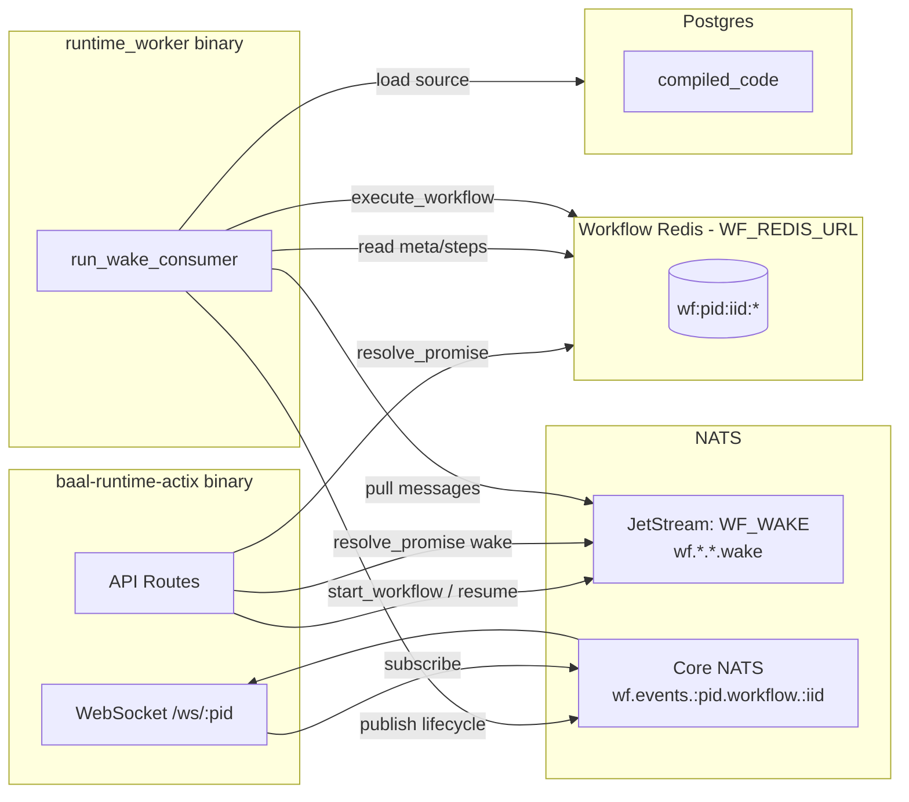
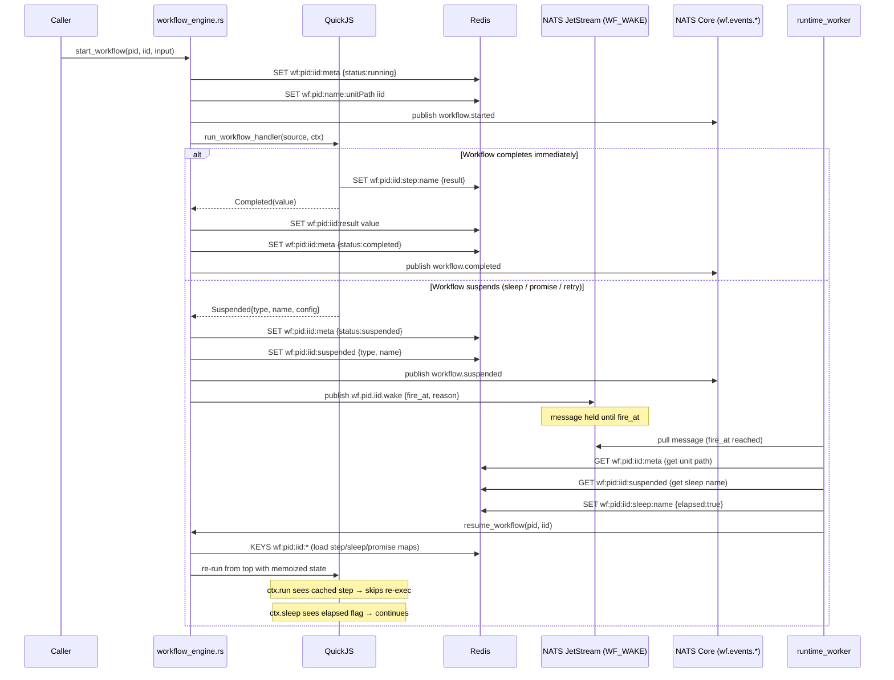
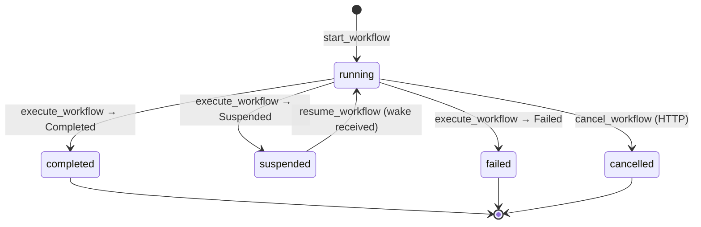

# Workflow Internals

## Overview

A workflow is a durable, resumable JS function. The JS VM (QuickJS) runs synchronously — it never waits inside JS. Instead, when a step/sleep/promise needs to pause, the VM exits and a NATS wake signal is published. The workflow_worker consumer receives the signal and re-runs the JS from scratch; Redis holds the memoized state so replay is deterministic.

---

## Process Architecture



> In `test_mode`, the HTTP server also spawns the wake consumer internally (no separate binary needed).

---

## Lifecycle of One Workflow Execution



---

## sdk.call Flow (RPC between workflows)

`sdk.call` suspends the caller workflow via a durable promise — **no thread is held** while waiting for the callee. This mirrors how Temporal handles child workflows.

```mermaid
sequenceDiagram
    participant WF_A as Caller Workflow (QuickJS)
    participant SDK as sdk.rs __baal_start_call
    participant Redis
    participant NATS_JS as NATS JetStream (WF_WAKE)
    participant NATS_CORE as NATS Core
    participant Worker as runtime_worker
    participant Engine as workflow_engine.rs
    participant WF_B as Callee Workflow (QuickJS)

    WF_A->>SDK: __baal_start_call(unitPath, dataJson, "sdk_call_0")
    SDK->>Redis: SET wf:pid:callee_iid:meta  {callerTriggered, callerInstanceId, callerPromiseName}
    SDK->>NATS_JS: publish wf.pid.callee_iid.start
    SDK-->>WF_A: returns immediately
    Note over WF_A: throws __SuspendExecution("promise","sdk_call_0",{timeout:300000})
    Note over WF_A: QuickJS exits — thread freed

    Worker->>NATS_JS: picks up .start (WF_WAKE stream)
    Worker->>Engine: launch_callee_workflow(callee_iid)
    Engine->>WF_B: execute callee

    alt Callee completes
        WF_B-->>Engine: Completed(result)
        Engine->>Redis: SET wf:pid:callee_iid:result
        Engine->>Redis: SET NX wf:pid:caller_iid:promise:sdk_call_0  {status:resolved, value:result}
        Engine->>NATS_JS: publish wf.pid.caller_iid.wake  {reason:promise_resolved}
        Worker->>Engine: resume_workflow(caller_iid)
        Engine->>Redis: KEYS wf:pid:caller_iid:*  — loads promise:sdk_call_0 as resolved
        Engine->>WF_A: re-run from top; sdk.call sees cached promise → returns result
    else Callee fails
        WF_B-->>Engine: Failed(error)
        Engine->>Redis: SET NX wf:pid:caller_iid:promise:sdk_call_0  {status:rejected, error}
        Engine->>NATS_JS: publish wf.pid.caller_iid.wake  {reason:promise_rejected}
        Worker->>Engine: resume_workflow(caller_iid)
        Engine->>WF_A: re-run; sdk.call sees rejected promise → throws error
    end
```

### How the call index works

Each `sdk.call` in a workflow gets a stable promise name (`sdk_call_0`, `sdk_call_1`, …) based on a counter that resets to 0 for every QuickJS execution. This is safe because execution always replays the same call sequence in the same order. On replay, calls whose promise is already in `wfCtx.__promises` short-circuit instantly — `__baal_start_call` is never invoked again.

### Redis keys added by sdk.call

| Key | Set by | Purpose |
|---|---|---|
| `wf:{pid}:{callee_iid}:meta` | `__baal_start_call` | Callee seed: `callerInstanceId`, `callerPromiseName`, `status:pending` |
| `wf:{pid}:{caller_iid}:promise:sdk_call_N` | `workflow_engine` on callee completion/failure | Durable result — read during caller replay |

---

## NATS Usage

| Subject | Transport | Direction | Purpose |
|---|---|---|---|
| `wf.*.*.wake` | **JetStream** `WF_WAKE` stream | Engine → Worker | Durable timer / wake signals (sleep, promise timeout, step retry) |
| `wf.{pid}.{iid}.wake` | Same stream | Engine → Worker | Per-instance wake publish |
| `wf.{pid}.{iid}.start` | **JetStream** `WF_WAKE` stream | `sdk.call` → Worker | Start a callee workflow instance; captured durably so the worker survives restarts |
| `wf.events.{pid}.workflow.{iid}` | Core NATS | Engine → Subscribers | Lifecycle broadcast: `workflow.started / completed / suspended / failed`. WebSocket clients subscribe here. `sdk.call` no longer listens to this — it uses the durable promise mechanism instead. |
| `wf.events.{pid}.>` | Core NATS | Engine → WS clients | Full project event fan-out (wildcard). Best-effort — missing events on crash is acceptable for real-time UI. |

### JetStream Stream: `WF_WAKE`

```
Name:     WF_WAKE  (env: WF_NATS_JETSTREAM_STREAM)
Subjects: wf.*.*.wake, wf.*.*.start
Consumer: wf_wake_consumer  (env: WF_NATS_JETSTREAM_CONSUMER)
          durable, pull, ack_wait=300s, filter_subjects=[wf.*.*.wake, wf.*.*.start]
```

Wake message payload:
```json
{ "reason": "sleep_elapsed|promise_timed_out|step_retry|step_retry_exhausted",
  "fire_at": 1713000000000,
  "sleep": "stepName" }
```

The consumer NAKs with remaining delay if `fire_at` is still in the future, so NATS acts as a durable timer.

### ack_wait Semantics

`ack_wait=300s` is the NATS redelivery ceiling -- not a max workflow duration.

**The ack is sent after `execute_workflow` returns** (`runner.rs`). `ack_wait` bounds one **execution segment** (all code between two suspension points), not the total workflow lifetime.

**For sleep/timer workflows this is safe:**
- When a workflow calls `ctx.sleep(hours)`, `execute_workflow` suspends and returns immediately
- A new wake message with `fire_at` is published to JetStream
- The consumer NAKs with the remaining delay -- so the message is not redelivered until `fire_at`
- No ack is held open during the sleep

**In-progress heartbeat:** Before calling `handle_start` or `handle_wake`, the consumer spawns a background task that sends `AckKind::Progress` every 15 seconds. This resets the `ack_wait` timer for the duration of execution. The task is aborted before the final `ack()`. This means execution segments can exceed 300s without redelivery.

**Execution lock:** `handle_start` and `handle_wake` acquire a Redis `SET NX EX 300` lock at key `wf:{pid}:{iid}:exec_lock` before calling into the engine. A second concurrent wake for the same instance returns immediately if the lock is held. The lock is always released after execution (success or error); the 300s TTL is a crash-recovery safety net.

---

## Redis Usage

All workflow keys live in **`WF_REDIS_URL`** (separate from the cache Redis).

Key pattern: `wf:{project_id}:{instance_id}:{suffix}`

| Key | Written by | Read by | Purpose |
|---|---|---|---|
| `wf:{pid}:name:{unitPath}` | `start_workflow` | `start_workflow` | Dedup: maps unit path → active instance ID. Only reused if status is `running` or `suspended`. |
| `wf:{pid}:{iid}:meta` | `start_workflow`, `execute_workflow` | `handle_wake`, `resume_workflow`, `get_workflow_status` | Workflow metadata: `name` (unit path), `status`, `input`, `createdAt`, `callerTriggered` |
| `wf:{pid}:{iid}:result` | `execute_workflow` on complete/fail | `get_workflow_result`, `get_workflow_status` | Final return value or `{"error":"..."}` |
| `wf:{pid}:{iid}:suspended` | `execute_workflow` on suspend | `handle_wake`, `get_workflow_status` | Suspension descriptor: `{type, name, config}`. Used by wake handler to know which sleep/promise to mark. |
| `wf:{pid}:{iid}:step:{name}` | `host_persist_step` / `host_persist_step_error` | `load_execution_context` (replay) | Memoized step result. Replay checks this map — if present, skips re-executing the step function. Core of durability. |
| `wf:{pid}:{iid}:sleep:{name}` | `handle_wake` (on timer fire) | `load_execution_context` (replay) | `{elapsed:true}` flag. On replay, `ctx.sleep` checks this to decide whether to continue or suspend again. |
| `wf:{pid}:{iid}:promise:{name}` | `resolve_promise` / `reject_promise` / `handle_wake` (timeout) | `load_execution_context` (replay) | `{status:"resolved"|"rejected"|"timed_out", value?}`. On replay, `ctx.promise` checks this. |
| `wf:{pid}:{iid}:step_retry:{name}` | `execute_workflow` (retry branch) | `execute_workflow` (retry branch) | Retry attempt counter `{attempt: N}`. Enforces `maxAttempts`. Deleted when retries exhaust. |
| `wf:{pid}:{iid}:state:{key}` | `host_persist_state` (`sdk.setState`) | `host_read_state` (`sdk.getState`) | Arbitrary user-managed persistent state. Read/written on demand, not loaded during replay. |

### Replay Bulk Load

On every resume, `load_execution_context` runs:
```
KEYS wf:{pid}:{iid}:*
```
and partitions results into three maps (`steps`, `sleeps`, `promises`) passed to QuickJS for deterministic replay. The `meta`, `result`, `suspended`, `step_retry`, and `state` keys are fetched individually as needed.

---

## Redis Cleanup

Workflow Redis keys are **never automatically deleted**. After a workflow reaches a terminal state (`completed`, `failed`, `cancelled`), all its keys remain. The only exception is `step_retry:{name}`, which is explicitly deleted when retries are exhausted.

### What stays after completion

| Keys | Still needed? |
|---|---|
| `wf:{pid}:name:{unitPath}` | Yes — dedup guard is checked before every new start |
| `wf:{pid}:{iid}:meta` | Yes — status and audit record, queryable via HTTP |
| `wf:{pid}:{iid}:result` | Yes — final result queryable via HTTP |
| `wf:{pid}:{iid}:step:*` | No — replay memoization is only needed while running |
| `wf:{pid}:{iid}:sleep:*` | No — elapsed flags are only needed while running |
| `wf:{pid}:{iid}:promise:*` | No — only needed while running |
| `wf:{pid}:{iid}:state:*` | Intentional — user-managed state kept for explicit reads |

### Cleanup options (until a proper API exists)

**1. Manual periodic scan** — safe for any deployment:
```
SCAN 0 MATCH wf:*:*:meta COUNT 100
```
For each key returned, parse the JSON value — if `status` is `completed`, `failed`, or `cancelled` and `createdAt` is older than your retention window, delete all keys under that `wf:{pid}:{iid}:*` prefix.

**2. Separate Redis instances** — recommended for production:
- `WF_REDIS_URL` → dedicated Redis, no eviction policy (`maxmemory-policy noeviction`), persistence on
- `REDIS_URL` (cache) → separate Redis, LRU eviction ok, persistence optional

**3. `allkeys-lru` eviction** — only safe if all your workflows are short-lived and always complete before the next eviction cycle. Evicting keys of a `suspended` workflow breaks resume permanently. Not recommended.

The correct long-term solution is a `DELETE /workflows/{id}` API that removes all `wf:{pid}:{iid}:*` keys for a terminated instance.

---

## Status Transitions



All transitions are atomic via a Redis Lua CAS script (`transition_status`). The script reads the current status, verifies it is in the allowed `from` set, writes the new status, and returns the old meta -- all in a single round-trip. If the status has already moved (e.g., a concurrent cancel beat a completion), the script returns `{rejected: current_status}` and the caller skips the transition silently.

| Transition | Allowed from | To | Caller |
|---|---|---|---|
| `cancel_workflow` | running, suspended | cancelled | HTTP route |
| `execute_workflow` Completed | running | completed | worker |
| `execute_workflow` Failed | running | failed | worker |
| `execute_workflow` Suspended | running | suspended | worker |

---

## Atomicity Guarantees

| Concern | Mechanism |
|---|---|
| Redelivery within a segment | `ack_wait=300s` + `AckKind::Progress` heartbeat every 15s |
| Concurrent execution of same instance | Redis `SET NX EX 300` exec lock per `(project_id, instance_id)` |
| Concurrent status writes | Lua CAS in `transition_status` -- second writer sees rejected transition |
| Duplicate workflow start (same name_key) | `SET NX` atomically claims name_key; second starter sees existing active instance |
| Double promise resolution | `SET NX` on promise key -- second resolution is a no-op, no duplicate wake |
| Wake signal durability | Promise resolution publishes to JetStream (`WF_WAKE` stream), not core NATS |
