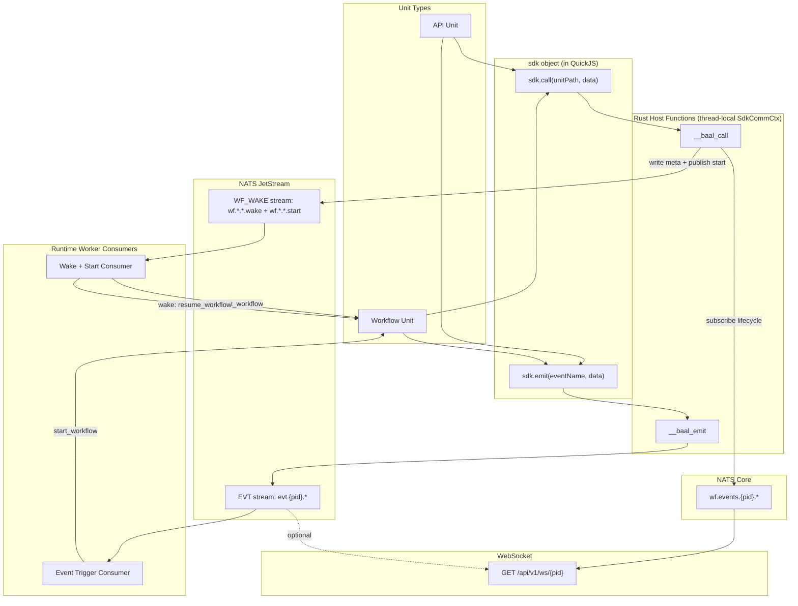

1. at // Publish via JetStream for durability; fall back to core NATS
            if let Some(js_ctx) = &js {
                js_ctx
                    .publish(start_subject, bytes::Bytes::from(start_payload))
                    .await
                    .map_err(|e| format!("sdk.call: JetStream publish start failed: {e}"))?;
            } else {
                nats_client
                    .publish(start_subject, bytes::Bytes::from(start_payload))
                    .await
                    .map_err(|e| format!("sdk.call: NATS publish start failed: {e}"))?;
            }
dont fallback to core NATS and assume jet stream is always necessary to have in this project 


2. are you sure we don't have to create a separated worker (binary) for the jetstream oull consumer for evt.*.>? at @runner.rs (101-117) , I mean double check it and tell me if it's better or not, if it doesnt have too much overhead and is scalable, just leave it and it's ok, I just want to make sure we can scale it


3. is this ack wait enough?                 ack_wait: std::time::Duration::from_secs(30), I mean does it wait for the unit trigger to be ran completly? or its just the trigger max timeout?
at @runner.rs (163-167) 


4. check and make sure the NATS and redis clients are passed correctly, I mean we have a nats and a redis for the runtime generic usages and another for workflows only, also Im not sure if you wrote the minimum code at @runner.rs (1-745)  or not, I see compiled_code multiple times, and also I see workflow_engine::start_workflow multiple times, are you sure there is no single place in code to minimize the code you wrote? and also Im not sure if you wrote the codes at runner.rs src/services/runtime_worker/runner.rs exclusively for the workflows only or not, note we have events which start workflows, and also events which can trigger other unit types, find best place to write the code consuming and triggering based on the target unit type (I know new units are not implemented yet, but add a placeholder comment) 


5. @mod.rs (251-253) how is that working? how did you designed the subscribers? I mean the subscribers can be designed this way:

- any unit which is going to be listening to an event, can have list of wake up events in its metadata, then when the consumer receives a new event, it loads all units and find those which have these events set inside their metatada then triggers them, why you didn't use this solution instead of inserting list of subscribers per event? when did you insert those subscribers? I just saw @workflow_units.rs (8-20)  and noticed you parsed the js code to extract the triggering events, thats not proper solution as we have metadata for each units, is that test only?? @units/communication-tests/@sdk.d.ts:1-239 

6. the codes @@sdk.d.ts (1-239) are duplicated between two folders inside @units/ , share it into a proper place

7. What if we create a new unit type named `Event` which is just a typescript type then use that to be able to track the relationship and dependency between units instead of relying on strings like `sdk.emit("some-event")`, the second form can't be detected automatically during refactors, but we have developed a dependency layer to figure out the relationships to make the codes be lintable automatically to prevent having dangling events

8. I think the `sdk.call` cant be generic as different units might have different handlers and options to be called, so propose a new sdk design instead of call and be explicit about the target unit types


---
name: SDK Communication Event Triggers
overview: "Implement sdk.emit (fire-and-forget event broadcast), fix sdk.call (workflow-to-workflow RPC via start consumer), add event triggers on workflow units, and enable sdk.call/sdk.emit in API units -- all with QuickJS lifecycle safety (no long-running JS, all waiting in NATS/Rust). TDD-first with 30+ test scenarios. API units are HTTP-only: no event triggers, no sdk.call targeting them."
todos:
  - id: phase-a
    content: "SdkCommCtx: shared communication context struct, thread-local, register_sdk_comm for both runners"
    status: pending
  - id: phase-b
    content: "sdk.emit: __baal_emit host function, EVT JetStream stream, sdk.emit in runtime-shared.js"
    status: pending
  - id: phase-c
    content: "Fix sdk.call: add wf.*.*.start to JetStream stream, start consumer in runtime_worker, publish start via JetStream"
    status: pending
  - id: phase-d-triggers
    content: "Event triggers on workflows: trigger registry in Redis, run_event_consumer in runtime_worker, dispatch to start_workflow"
    status: pending
  - id: phase-e-ws
    content: "WS domain events: subscribe to evt.{pid}.> in ws.rs with channel filter"
    status: pending
  - id: tests-emit
    content: "TDD Group 1: 7 sdk.emit test scenarios + endpoint files"
    status: pending
  - id: tests-call
    content: "TDD Group 2: 6 sdk.call cross-unit test scenarios + endpoint files"
    status: pending
  - id: tests-trigger-wf
    content: "TDD Group 3: 8 event trigger workflow test scenarios + endpoint files"
    status: pending
  - id: tests-integration
    content: "TDD Group 4: 5 integration chain test scenarios"
    status: pending
  - id: tests-ws
    content: "TDD Group 5: 3 WS domain event tests"
    status: pending
  - id: tests-edge
    content: "TDD Group 6: 4 edge case tests"
    status: pending
isProject: false
---


# SDK Communication and Event Triggers

## Strategic Design Decisions

### Decision 1: API units are HTTP-only. No event triggers, no `sdk.call` targeting them.

**API means HTTP.** The unit type is called "API" because it serves HTTP endpoints. Its handler signature is `handleRequest(req, res)` with headers, cookies, query params, status codes. Mixing event-triggered logic into this type would:
- Require a dual handler signature (`handleRequest` + `handleEvent`), confusing the unit's identity
- Break the clean mental model: "API = HTTP endpoint"
- Contradict the naming: an "API unit triggered by an internal event" is not an API

**No platform calls event-triggered functions "API" either:**
- **AWS Lambda**: One function type, trigger is external config. But the function is called "Lambda function" -- not "API function."
- **Inngest**: All functions are event-driven. None are called "API functions."
- **Firebase**: `onRequest` (HTTP) and `onDocumentCreated` (event) use different factory methods, but both are "Cloud Functions" -- not "API functions."
- **Cloudflare**: Workers handle `fetch()` (HTTP), `queue()`, `scheduled()` in the same Worker type -- but it's called "Worker," not "API."

API units stay pure HTTP. This is correct.

### Decision 2: Do we need a new unit type for simple event-triggered logic?

**No. Existing unit types cover all event-triggered use cases.**

Applying the litmus test from the architecture document to a hypothetical "Event Handler" unit:
- **New computation model?** No -- run a function, finish. Same as a workflow with no steps.
- **New lifecycle?** No -- invocation-scoped, same as a workflow that completes immediately.
- **New connection model?** No -- fire-and-forget, same as any invocation-scoped unit.
- **Unique vs ALL other types?** No -- a workflow without `ctx.run`/`ctx.sleep`/`ctx.promise` behaves identically.

**It fails all three tests. No new unit type is justified.**

**What every major platform does instead:**
- **AWS Lambda**: ONE function type, many trigger sources. No separate "event function" type.
- **Inngest**: ONE function type (always event-driven). Simple reactions and complex workflows use the same type.
- **Firebase/Cloud Run Functions**: ONE function type with different trigger modes (`onRequest` vs `onEvent`). Not separate types.
- **Temporal**: Workflows + Activities. Activities are reusable callable units, but they can ONLY be called from workflows, never triggered independently by events. Event-triggered logic always goes through a workflow.
- **Cloudflare**: Workers handle HTTP, queues, cron -- all in the same Worker type.

**No platform has BOTH a "workflow/durable function" type AND a separate "simple event function" type alongside an "HTTP function" type.** They either have one generic type (Lambda, Inngest) or route everything through the orchestration layer (Temporal).

### How existing units handle all event-triggered use cases

**Simple event reaction (no durable steps needed):**
Use a workflow with no steps. A workflow that just runs logic and returns is ~4ms overhead (2 Redis SETs for meta+result, 1 KEYS scan finding 0 entries, 2 NATS lifecycle publishes). This is negligible.

```typescript
import { workflow, sdk } from "@sdk";

// metadata: { "triggers": [{ "event": "order.created" }] }
export default workflow(async (ctx, event) => {
  if (event.data.total > 10000) {
    await sdk.call("compliance.check", event.data);
  }
  await sdk.call("notifications.send", {
    userId: event.data.userId,
    message: `Order #${event.data.orderId} confirmed!`
  });
  return { processed: true };
});
```

**Reliable event processing with retry/DLQ (future):**
Use a Queue Worker. Events become jobs with at-least-once delivery, configurable retry, dead letter queue, rate limiting. This is the natural fit for high-throughput event processing.

**Complex event-triggered orchestration:**
Use a workflow with durable steps. Full `ctx.run`/`ctx.sleep`/`ctx.promise` machinery.

**Entity-scoped event reaction (future):**
Use an Actor. Events are messages to a specific entity instance.

**Continuous event aggregation (future):**
Use a Stream Processor. Events are windowed and aggregated.

**Summary: every event-triggered pattern maps cleanly to an existing unit type.**

### Decision 3: What about shared utility functions callable from anywhere?

The user notes: "there are always shared functions which may not fit into workflow or actor or worker or stream."

**How other platforms handle this:**
- **Temporal**: Activities are reusable functions, but they can ONLY be called from workflows. There is no standalone "Activity" deployment.
- **Cloudflare**: Service Bindings let Worker A call Worker B's methods directly. Worker B is a normal Worker -- same type, just called via RPC instead of HTTP.
- **Inngest**: `step.invoke()` calls another Inngest function. Same function type.
- **AWS Lambda**: `InvokeFunction` API calls any Lambda directly. Same function type.

**The pattern: reusable logic lives in the SAME function/unit types, just called via RPC (`sdk.call`) instead of HTTP.**

In our platform:
- **Simple reusable logic**: Extract into a shared JS module, import from multiple units. This is standard JavaScript -- no platform concept needed.
- **Isolated reusable service**: Deploy as a workflow. `sdk.call` targets it. A workflow with no durable steps is just a callable function with ~4ms overhead.
- **Entity-scoped reusable service (future)**: Deploy as an Actor. `sdk.call("path.actor.name", { handler: "methodName", data })` calls its handler.

No new unit type needed for shared functions.

### Decision 4: QuickJS Lifecycle Safety

**Rule: No long-running operations inside QuickJS that are not inherent to the user's logic.**

| Operation | Where blocking happens | QuickJS alive? | Acceptable? |
|---|---|---|---|
| `sdk.emit` | Rust `block_async` -> NATS publish (~1ms) | Yes, briefly | Yes -- sub-millisecond |
| `sdk.call` (workflow target) | Rust `block_async` -> NATS subscription wait (up to 30s) | Yes, idle | **Acceptable but documented** -- the caller asked for RPC, they need the result |
| Event trigger listener | Rust NATS consumer (no QuickJS) | No | Yes -- QuickJS spun up on demand |
| Workflow sleep/promise | Workflow suspends, QuickJS terminates. NATS timer fires, new QuickJS spins up | No | Yes -- existing pattern |

The only case where QuickJS stays alive for a non-trivial duration is `sdk.call`, which is an intentional synchronous RPC. The user chose to wait for the result. This is identical to how Inngest's `step.invoke()` works. The mitigation is clear documentation and a 30s timeout.

**What we avoid:** Any pattern where QuickJS subscribes to a NATS subject and waits for messages in a loop. Event listening always happens in Rust.

---

## Communication SDK Design

### Two Primitives

```typescript
const sdk = {
  call(unitPath: string, data?: any): Promise<any>,
  emit(eventName: string, data?: any): Promise<{ eventId: string }>,
};
```

Available in ALL unit types. Same shape, same behavior, regardless of whether the caller is an API unit, workflow, or (future) actor/worker/gRPC/WebSocket.

### `sdk.call` -- RPC with Result

| Target unit type | Behavior | Blocking? |
|---|---|---|
| **Workflow** | Creates new instance, waits for completion/failure via NATS event subscription | Yes (up to 30s) |
| **API** | NOT SUPPORTED -- throws: "sdk.call does not support API targets. API units are HTTP-only." | N/A |
| **Actor** (future) | Sends message to actor handler, waits for response | Yes |
| **Worker** (future) | Enqueues job, waits for completion | Yes |

### `sdk.emit` -- Fire-and-Forget Event Broadcast

- Publishes to JetStream subject `evt.{project_id}.{event_name}` (dots in event name preserved)
- Returns immediately with `{ eventId: "evt_..." }`
- Caller never blocks on subscribers
- In workflows: should be inside `ctx.run()` for durability (prevents re-emission on replay)
- In API units: fires immediately, no durability concern

### Event Triggers -- Workflows Only (for now)

Event triggers are available on **workflow units** only. When `sdk.emit("order.created", data)` fires, the event trigger consumer starts a new workflow instance for each workflow whose metadata matches the event name.

Future unit types (Queue Worker, Actor) will also support event triggers once implemented. API units never receive event triggers -- they are HTTP-only.

| Unit type | Triggerable by events? | How |
|---|---|---|
| **API** | No -- HTTP-only | N/A |
| **Workflow** | Yes | `start_workflow(...)` with event envelope as input |
| **Actor** (future) | Yes | Message to `onEvent` handler |
| **Worker** (future) | Yes | Enqueue event as a job |
| **Stream** (future) | N/A | Declares source in metadata, not via triggers |

### Per-Unit-Type Communication Matrix

```
                      Can use        Can use      Callable via    Triggerable
  Unit Type          sdk.call?      sdk.emit?     sdk.call?       by events?
  ─────────────────  ────────────   ──────────    ────────────    ────────────
  API (implemented)     Yes(1)         Yes            No(2)          No(3)
  Workflow (impl.)      Yes            Yes            Yes            Yes
  Actor (future)        Yes            Yes            Yes            Yes
  Worker (future)       Yes            Yes            Yes            Yes
  Stream (future)       Yes            Yes            No(4)          N/A(5)
  gRPC (future)         Yes            Yes            No(6)          No(3)
  WebSocket (future)    Yes            Yes            No(7)          No(3)

  (1) Targets workflows only for now. Future: actors, workers
  (2) API handlers expect (req, res). HTTP-only.
  (3) Protocol-specific units are bound to their protocol
  (4) Streams are perpetual processors, not callable units
  (5) Streams declare their source in metadata, not via triggers
  (6) gRPC units serve gRPC endpoints only
  (7) WebSocket units manage persistent connections only
```

### Event Envelope

Every `sdk.emit` produces this payload on NATS:

```json
{
  "eventId": "evt_...",
  "event": "order.created",
  "data": { "orderId": "123", "total": 99.99 },
  "source": {
    "unitPath": "shop.orders.workflow.checkout",
    "instanceId": "abc-123"
  },
  "projectId": "...",
  "timestamp": "2026-04-14T..."
}
```

### NATS Subject Hierarchy (complete picture after this implementation)

```
evt.{project_id}.{event.name.dots.preserved}   -- domain events (JetStream EVT stream)
wf.events.{project_id}.{unit_type}.{id}        -- lifecycle events (core NATS, real-time)
wf.{project_id}.{instance_id}.wake             -- workflow wake signals (JetStream WF_WAKE)
wf.{project_id}.{instance_id}.start            -- workflow start (JetStream WF_WAKE, new)
```

---

## Architecture



---

## Implementation Phases

### Phase A: `SdkCommCtx` -- Shared Communication Context

**Problem:** [api_runner.rs](src/libs/unit_js/api_runner.rs) has no access to Redis/NATS. [workflow_runner.rs](src/libs/unit_js/workflow_runner.rs) uses `WorkflowHostCtx` which mixes communication with persistence.

**Solution:** New `SdkCommCtx` struct in [sdk.rs](src/libs/unit_js/modules/sdk.rs) -- a second thread-local holding only what `sdk.call` and `sdk.emit` need.

```rust
pub struct SdkCommCtx {
    pub redis: Arc<Mutex<redis::aio::MultiplexedConnection>>,
    pub nats: Option<async_nats::Client>,
    pub js: Option<jetstream::Context>,
    pub project_id: String,
    pub source_unit_path: String,
    pub source_instance_id: Option<String>,
}
```

**Files to modify:**
- [src/libs/unit_js/modules/sdk.rs](src/libs/unit_js/modules/sdk.rs) -- add `SdkCommCtx`, `set_comm_ctx`/`clear_comm_ctx`, `register_sdk_comm` (registers `__baal_call` + `__baal_emit`). Move `__baal_call` to read from `SdkCommCtx` instead of `WorkflowHostCtx`.
- [src/libs/unit_js/modules/mod.rs](src/libs/unit_js/modules/mod.rs) -- export `register_sdk_comm`
- [src/libs/unit_js/api_runner.rs](src/libs/unit_js/api_runner.rs) -- extend `run_unit_handler` to accept optional SDK connection params; set `SdkCommCtx` before eval; call `register_sdk_comm`
- [src/libs/unit_js/workflow_runner.rs](src/libs/unit_js/workflow_runner.rs) -- also set `SdkCommCtx` alongside `WorkflowHostCtx`
- [src/routes/unit.rs](src/routes/unit.rs) -- pass `wf_redis`/`nats_client`/`wf_jetstream`/`project_id` from `AppContext` to `run_unit_handler`

### Phase B: `sdk.emit` Implementation

**Rust side (`__baal_emit`):**
1. Read `SdkCommCtx` from thread-local
2. Generate `eventId` (UUID with `evt_` prefix)
3. Build event envelope JSON
4. Publish to JetStream subject `evt.{project_id}.{event_name}`
5. Return `{ eventId }` to JS

**JS side** -- add to [runtime-shared.js](src/libs/unit_js/scripts/runtime-shared.js):

```javascript
sdk.emit = function (eventName, data) {
  if (typeof __baal_emit !== 'function') {
    throw new Error('sdk.emit is not available');
  }
  var dataJson = data !== undefined ? JSON.stringify(data) : "null";
  var resultJson = __baal_emit(eventName, dataJson);
  if (resultJson === null || resultJson === undefined) return null;
  return JSON.parse(resultJson);
};
```

Note: `sdk.emit` is synchronous from JS perspective (host function publishes and returns immediately). The `Promise.resolve().then(...)` wrapper used by `sdk.call` is not needed because JetStream publish is near-instant.

**JetStream stream setup** -- new `ensure_evt_stream` in [workflow_engine.rs](src/services/workflow_engine.rs):

```rust
pub async fn ensure_evt_stream(client: &async_nats::Client, stream_name: &str) -> Result<...> {
    let js = jetstream::new(client.clone());
    js.get_or_create_stream(stream::Config {
        name: stream_name.to_string(),
        subjects: vec!["evt.*.>".to_string()],
        ..Default::default()
    }).await
}
```

### Phase C: Fix `sdk.call` Workflow-to-Workflow

**Problem:** `host_call` publishes to `wf.{pid}.{iid}.start` but no consumer processes `.start` subjects. The WF_WAKE JetStream stream only captures `wf.*.*.wake`.

**Fix:**
1. Expand `WF_WAKE` stream subjects to include `wf.*.*.start`:
   ```rust
   subjects: vec!["wf.*.*.wake".to_string(), "wf.*.*.start".to_string()],
   ```
2. In `run_wake_consumer` in [runner.rs](src/services/runtime_worker/runner.rs), add a branch for `.start` messages (subject ends with `.start`):
   - Parse `unitPath`, `instanceId`, `input` from payload
   - Load unit source via `load_unit_for_path_production`
   - Call `workflow_engine::start_workflow`
3. Update the `host_call` in [sdk.rs](src/libs/unit_js/modules/sdk.rs) to publish `.start` via JetStream (not core NATS) so the message is durable and picked up by the consumer even if it's momentarily busy.

### Phase D: Event Trigger System (Workflows Only)

**Trigger registry** -- store trigger configs in Redis for fast lookup:
- Key: `evt_triggers:{project_id}` (Redis Hash)
- Field: event pattern (e.g., `order.created`, `order.*`)
- Value: JSON array of `{ unitPath, unitType }` objects

Populated at deploy time (test_seed for test mode). When future unit types (Queue Worker, Actor) are implemented, they will also register triggers here. API units never appear in this registry.

**Event trigger consumer** in [runner.rs](src/services/runtime_worker/runner.rs):

New `run_event_consumer` function (parallel to `run_wake_consumer`):
1. Create/get JetStream stream `EVT` with subjects `evt.*.>`
2. Pull consumer with durable name `evt_trigger_consumer`
3. On each message:
   - Parse NATS subject: `evt.{project_id}.{event_name_parts}`
   - Look up `evt_triggers:{project_id}` in Redis
   - For each matching workflow unit:
     - Load compiled source via `load_unit_for_path_production(..., ProjectUnitType::Workflow, ...)`
     - Call `workflow_engine::start_workflow(...)` with the full event envelope JSON as input
   - ACK the message after all dispatches succeed

**Workflow input when event-triggered:**
The workflow receives the full event envelope as its input, identical to what `sdk.emit` published:
```json
{
  "eventId": "evt_...",
  "event": "order.created",
  "data": { "orderId": "123", "total": 99.99 },
  "source": { "unitPath": "...", "instanceId": "..." },
  "projectId": "...",
  "timestamp": "..."
}
```
The workflow code accesses it via the standard input parameter: `async (ctx, event) => { event.data.orderId ... }`.

**Test seed integration** in [test_seed/mod.rs](src/services/test_seed/mod.rs):
- Add `trigger_config: Option<serde_json::Value>` to `UnitSpec`
- After seeding units, populate `evt_triggers:{project_id}` Redis hash from workflow specs that have trigger configs
- Extend `workflow_units.rs` to parse trigger config from test endpoint files

### Phase E: WS Domain Event Integration (lightweight)

Extend [ws.rs](src/routes/ws.rs) to optionally subscribe to `evt.{pid}.>` alongside `wf.events.{pid}.>`:

```json
{"action": "subscribe", "channel": "domain"}
```

This subscribes to `evt.{pid}.>` (domain events from `sdk.emit`), complementing the existing lifecycle events.

---

## Test Scenarios (TDD)

All tests use the existing infrastructure: endpoint files in `units/workflow-tests/endpoints/`, test definitions in `units/workflow-tests/index.ts`.

### Group 1: `sdk.emit` -- Basic Event Emission (7 tests)

| # | Test Name | Scenario | Assertion |
|---|---|---|---|
| 1 | `emit-from-workflow-step` | Workflow calls `sdk.emit("test.basic-emit", { key: "value" })` inside `ctx.run` | Workflow completes; emit returns `{ eventId }` with valid format |
| 2 | `emit-from-api-unit` | API unit calls `sdk.emit("test.api-emit", data)` | Returns 200; response contains `{ eventId }` |
| 3 | `emit-returns-event-id` | Check return shape from emit | `result.eventId` matches `evt_` + UUID format |
| 4 | `emit-payload-types` | Emit with nested objects, arrays, null, numbers, booleans | All types preserved in event envelope |
| 5 | `emit-empty-data` | `sdk.emit("test.empty")` with no data argument | Succeeds; `data` is `null` in envelope |
| 6 | `emit-invalid-event-name` | `sdk.emit("", data)` | Throws descriptive error |
| 7 | `emit-multiple-rapid` | Emit 5 events in tight loop inside one workflow | All 5 succeed; 5 distinct eventId values |

**Endpoint files:**
- `endpoints/emit-from-step.ts` -- workflow that emits inside `ctx.run` and returns emit result
- `endpoints/emit-payload-types.ts` -- workflow that emits various data types
- `endpoints/emit-multiple.ts` -- workflow that emits 5 times in sequence
- API test unit in `api_units.rs` that calls `sdk.emit` and returns the result

### Group 2: `sdk.call` Cross-Unit (6 tests)

| # | Test Name | Scenario | Assertion |
|---|---|---|---|
| 8 | `call-workflow-from-workflow` | Workflow A calls `sdk.call("test.wf.workflow.echo-input", { x: 1 })` | Returns echo-input result `{ x: 1 }` |
| 9 | `call-workflow-from-api` | API unit calls `sdk.call("test.wf.workflow.echo-input", { y: 2 })` | API returns `{ y: 2 }` |
| 10 | `call-api-from-workflow-errors` | Workflow calls `sdk.call("test.wf.api.some-api", data)` | Throws clear error: "sdk.call does not support API unit targets" |
| 11 | `call-nonexistent-unit` | `sdk.call("test.wf.workflow.does-not-exist", {})` | Throws error containing "not found" or timeout |
| 12 | `call-invalid-path` | `sdk.call("bad-path", {})` | Throws error about invalid unit path format |
| 13 | `call-timeout` | `sdk.call` to a workflow that sleeps 60s | Throws timeout error within 30s |

**Endpoint files:**
- `endpoints/call-workflow.ts` -- workflow that calls `echo-input` via `sdk.call`
- `endpoints/call-from-api.ts` -- API unit test that calls a workflow via `sdk.call`

### Group 3: Event Triggers -- Workflow (8 tests)

| # | Test Name | Scenario | Assertion |
|---|---|---|---|
| 14 | `trigger-workflow-on-emit` | Workflow A emits `"test.trigger.basic"` -> workflow B with that trigger starts | Triggered workflow B eventually completes; result contains emitted data |
| 15 | `trigger-receives-event-envelope` | Triggered workflow inspects its input for eventId, event, timestamp, source | All fields are non-null, eventId matches `evt_` format |
| 16 | `trigger-receives-event-data` | Emit `{ orderId: "123", amount: 50 }` -> triggered workflow returns event data | `result.data.orderId === "123"` and `result.data.amount === 50` |
| 17 | `trigger-multiple-subscribers` | Emit one event -> two workflows subscribed to same event name | Both workflow instances eventually complete |
| 18 | `trigger-workflow-with-steps` | Event triggers a workflow that has multiple `ctx.run` steps | All steps complete correctly using event data as input |
| 19 | `trigger-wildcard-pattern` | Workflow subscribes to `"test.order.*"`, emit `"test.order.created"` | Workflow is triggered and completes |
| 20 | `trigger-does-not-retrigger-on-replay` | Event-triggered workflow suspends (sleep) then resumes | Only one instance created; resume does not start a second |
| 21 | `trigger-project-isolation` | Emit from project A; verify no cross-project leakage | Scoped by project_id in NATS subject; no workflow started in other project |

**Endpoint files:**
- `endpoints/on-trigger-basic.ts` -- workflow triggered by `test.trigger.basic`, returns full event envelope
- `endpoints/on-trigger-steps.ts` -- workflow triggered by event, has multiple ctx.run steps using event data
- `endpoints/on-trigger-wildcard.ts` -- workflow triggered by `test.order.*`
- `endpoints/on-trigger-multi-a.ts` and `on-trigger-multi-b.ts` -- two workflows subscribing to same event
- `endpoints/emit-and-trigger.ts` -- workflow that emits an event (used to trigger the above)

### Group 4: `sdk.call` + `sdk.emit` Integration (5 tests)

| # | Test Name | Scenario | Assertion |
|---|---|---|---|
| 22 | `triggered-workflow-calls-another` | Event triggers WF A; A calls WF B via `sdk.call` | B completes; A returns B's result |
| 23 | `triggered-workflow-emits` | Event triggers WF; triggered WF emits another event | Second event published (verify via WS) |
| 24 | `chain-emit-trigger-emit` | A emits -> triggers B -> B emits -> triggers C | C completes (full three-hop chain verified) |
| 25 | `concurrent-emit-same-event` | Two workflows emit the same event name simultaneously | Triggered workflow gets two separate instances (dedup is per-path, not per-event) |
| 26 | `emit-inside-ctx-run-idempotent` | Workflow emits inside `ctx.run`, workflow crashes and replays | Event is NOT re-emitted on replay (step result is memoized) |

**Endpoint files:**
- `endpoints/on-trigger-chain.ts` -- workflow triggered by event that emits a follow-up event
- `endpoints/chain-end.ts` -- terminal workflow in the chain that just returns the event data

### Group 5: WebSocket Domain Events (3 tests)

| # | Test Name | Scenario | Assertion |
|---|---|---|---|
| 27 | `ws-receives-domain-events` | Connect WS with domain channel, emit event from workflow | WS receives frame with event envelope |
| 28 | `ws-domain-event-payload-shape` | Verify received WS frame matches event envelope schema | Has `eventId`, `event`, `data`, `source`, `timestamp` |
| 29 | `ws-filter-by-event-name` | Subscribe to specific event pattern | Only matching events received |

These go into `ws-tests.mjs`.

### Group 6: Edge Cases (4 tests)

| # | Test Name | Scenario | Assertion |
|---|---|---|---|
| 30 | `emit-without-nats-graceful` | Emit when NATS not configured | Clear error "event bus not available" |
| 31 | `emit-large-payload` | Emit ~100KB data payload | Succeeds (under NATS max message size) |
| 32 | `trigger-dedup-same-workflow` | Same event triggers same workflow path twice rapidly | Dedup via workflow name key (only one active running instance) |
| 33 | `call-from-api-without-connections` | API unit calls sdk.call/sdk.emit when Redis/NATS not configured | Clear error messages, no crash |

---

## File Change Summary

### New files

- `units/workflow-tests/endpoints/emit-from-step.ts` -- workflow that emits inside ctx.run
- `units/workflow-tests/endpoints/emit-payload-types.ts` -- workflow that emits various data types
- `units/workflow-tests/endpoints/emit-multiple.ts` -- workflow that emits 5 times in sequence
- `units/workflow-tests/endpoints/call-workflow.ts` -- workflow that calls another via sdk.call
- `units/workflow-tests/endpoints/emit-and-trigger.ts` -- workflow that emits an event to trigger others
- `units/workflow-tests/endpoints/on-trigger-basic.ts` -- workflow triggered by `test.trigger.basic`
- `units/workflow-tests/endpoints/on-trigger-steps.ts` -- triggered workflow with multiple ctx.run steps
- `units/workflow-tests/endpoints/on-trigger-wildcard.ts` -- workflow triggered by `test.order.*`
- `units/workflow-tests/endpoints/on-trigger-multi-a.ts` -- first of two workflows on same event
- `units/workflow-tests/endpoints/on-trigger-multi-b.ts` -- second of two workflows on same event
- `units/workflow-tests/endpoints/on-trigger-chain.ts` -- triggered workflow that emits follow-up
- `units/workflow-tests/endpoints/chain-end.ts` -- terminal workflow in emit chain

### Modified files

- [src/libs/unit_js/modules/sdk.rs](src/libs/unit_js/modules/sdk.rs) -- `SdkCommCtx`, `__baal_emit`, refactor `__baal_call` to use `SdkCommCtx`, reject API targets with clear error, `register_sdk_comm`
- [src/libs/unit_js/modules/mod.rs](src/libs/unit_js/modules/mod.rs) -- export `register_sdk_comm`
- [src/libs/unit_js/scripts/runtime-shared.js](src/libs/unit_js/scripts/runtime-shared.js) -- add `sdk.emit`
- [src/libs/unit_js/api_runner.rs](src/libs/unit_js/api_runner.rs) -- accept optional SDK params, set `SdkCommCtx`, call `register_sdk_comm` (for sdk.call/sdk.emit FROM api units, not event triggers TO api units)
- [src/libs/unit_js/workflow_runner.rs](src/libs/unit_js/workflow_runner.rs) -- set `SdkCommCtx` alongside `WorkflowHostCtx`
- [src/routes/unit.rs](src/routes/unit.rs) -- pass Redis/NATS/JetStream/project_id to `run_unit_handler`
- [src/services/runtime_worker/runner.rs](src/services/runtime_worker/runner.rs) -- add `wf.*.*.start` to stream subjects, handle start messages, add `run_event_consumer` (dispatches to workflows only)
- [src/services/workflow_engine.rs](src/services/workflow_engine.rs) -- add `ensure_evt_stream`
- [src/services/test_seed/mod.rs](src/services/test_seed/mod.rs) -- add `trigger_config` to `UnitSpec`, populate `evt_triggers:{project_id}` Redis hash
- [src/services/test_seed/workflow_units.rs](src/services/test_seed/workflow_units.rs) -- support trigger config extraction from workflow endpoint files
- [src/routes/ws.rs](src/routes/ws.rs) -- subscribe to `evt.{pid}.>` for domain events
- [units/workflow-tests/index.ts](units/workflow-tests/index.ts) -- all new test definitions (Groups 1-6)
- [units/workflow-tests/ws-tests.mjs](units/workflow-tests/ws-tests.mjs) -- domain event WS tests (Group 5)

### NOT modified (intentionally)

- [src/libs/unit_js/scripts/api-runtime.js](src/libs/unit_js/scripts/api-runtime.js) -- NO changes. API units remain HTTP-only. No event handler mode.

---

## Implementation Order (dependency-aware)

1. **Phase A** (SdkCommCtx) -- foundation for everything
2. **Phase B** (sdk.emit) -- can be tested immediately with Group 1 tests
3. **Phase C** (fix sdk.call start consumer) -- can be tested with Group 2 tests
4. **Phase D** (event triggers on workflows) -- depends on Phase B (EVT stream) and Phase C (triggered workflows can sdk.call others); tested with Groups 3-4
5. **Phase E** (WS domain events) -- lightweight, tested with Group 5
6. **Group 6** edge case tests can run throughout
