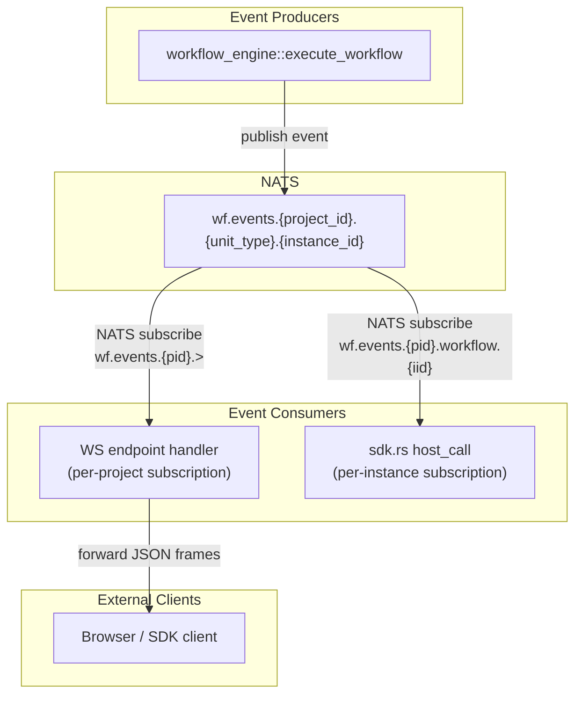

# WebSocket Event Broadcasting

## Current Problems

- [`src/routes/workflow.rs`](src/routes/workflow.rs) `do_get_result` (line 230) polls Redis in a loop for up to 30s, holding a connection/thread open.
- [`src/libs/unit_js/modules/sdk.rs`](src/libs/unit_js/modules/sdk.rs) `host_call` (line 275) does the same poll-then-sleep loop inside a `block_on` context, which is even worse since it blocks the QuickJS thread.

## Architecture Overview



## 1. New NATS event subject pattern

Introduce a new subject hierarchy separate from the existing internal `wf.*.*.wake` subjects:

```
wf.events.{project_id}.{unit_type}.{instance_id}
```

This supports NATS wildcard filtering:
- `wf.events.{project_id}.>` -- all events for a project (default WS subscription)
- `wf.events.{project_id}.workflow.>` -- only workflow events
- `wf.events.{project_id}.workflow.{instance_id}` -- single instance

These are **core NATS** publishes (not JetStream) -- events are ephemeral/real-time. No stream or consumer needed; only live subscribers receive them.

## 2. Publish lifecycle events from `workflow_engine`

In [`src/services/workflow_engine.rs`](src/services/workflow_engine.rs) `execute_workflow` (line 334), after each terminal state transition, publish an event:

- **`completed`**: after setting the result key (line 373-392)
- **`failed`**: after setting the failed meta (line 576-598)
- **`suspended`**: after setting the suspended key (line 496-521)
- **`started`**: at the end of `start_workflow` (line 94)

Event payload shape:

```json
{
  "event": "workflow.completed",
  "projectId": "...",
  "instanceId": "...",
  "unitPath": "ctx.mod.workflow.name",
  "result": "...",
  "timestamp": "2026-04-14T..."
}
```

Add a helper `publish_wf_event(nats, project_id, instance_id, event_type, payload)` to centralize this.

## 3. New WebSocket route: `src/routes/ws.rs`

Create [`src/routes/ws.rs`](src/routes/ws.rs) using the existing `actix-ws = "0.3.1"` dependency.

**Endpoint**: `GET /api/v1/ws/{project_id}`

**Protocol**:
1. Client connects; server upgrades to WS.
2. Server subscribes to `wf.events.{project_id}.>` on core NATS.
3. Server forwards every NATS message as a WS text frame.
4. Client can send filter messages to narrow the subscription:

```json
{"action": "subscribe", "unitType": "workflow", "instanceId": "abc-123"}
```

This resubscribes to `wf.events.{project_id}.workflow.abc-123`.

```json
{"action": "subscribe", "unitType": "workflow"}
```

This resubscribes to `wf.events.{project_id}.workflow.>`.

```json
{"action": "subscribe"}
```

This resubscribes to the default `wf.events.{project_id}.>`.

5. Server handles WS `Ping`/`Pong` keepalive and cleans up the NATS subscription on disconnect.

**Implementation approach**: Use `actix_ws::handle()` which returns a `(response, Session, MessageStream)`. Spawn a tokio task that:
- Selects on (a) incoming WS messages and (b) incoming NATS messages
- Forwards NATS events to WS session
- Handles client filter/subscribe commands and unsubscribe/resubscribe on NATS

**Registration** in [`src/routes/mod.rs`](src/routes/mod.rs):

```rust
.route("/api/v1/ws/{project_id}", web::get().to(ws::ws_project_events))
```

## 4. Remove polling from `workflow.rs` `do_get_result`

Change [`src/routes/workflow.rs`](src/routes/workflow.rs) `do_get_result` (lines 230-270) to a single check:

- If `wf:{project_id}:{instance_id}:result` exists in Redis, return `200` with `{"status": "completed", "result": ...}`.
- If not, return `202 Accepted` with `{"status": "pending", "message": "workflow has not completed yet"}` -- signaling the client to use the WS endpoint for real-time updates.

This is a one-line Redis GET, no loop.

## 5. Remove polling from `sdk.rs` `host_call`

Replace the poll loop in [`src/libs/unit_js/modules/sdk.rs`](src/libs/unit_js/modules/sdk.rs) `host_call` (lines 328-354) with a NATS subscription:

1. After publishing `wf.{project_id}.{callee_instance_id}.start`, subscribe to `wf.events.{project_id}.workflow.{callee_instance_id}`.
2. Wait on `subscriber.next()` with a timeout (30s).
3. When the event arrives with `event == "workflow.completed"` or `event == "workflow.failed"`, return the result.
4. On timeout, return an error as before.

This eliminates the sleep loop entirely. The NATS subscription is lightweight and event-driven.

**Key constraint**: `host_call` runs inside `block_async` (which calls `Handle::block_on`). The NATS subscription is fully async, so it works naturally within `block_on`.

## Files to create/modify

| File | Action |
|------|--------|
| `src/routes/ws.rs` | **Create** -- WebSocket endpoint handler |
| `src/routes/mod.rs` | **Modify** -- add `pub mod ws;`, register WS route |
| `src/services/workflow_engine.rs` | **Modify** -- add `publish_wf_event` helper, publish events at state transitions |
| `src/routes/workflow.rs` | **Modify** -- remove polling loop from `do_get_result` |
| `src/libs/unit_js/modules/sdk.rs` | **Modify** -- replace poll loop with NATS subscribe-and-wait |
